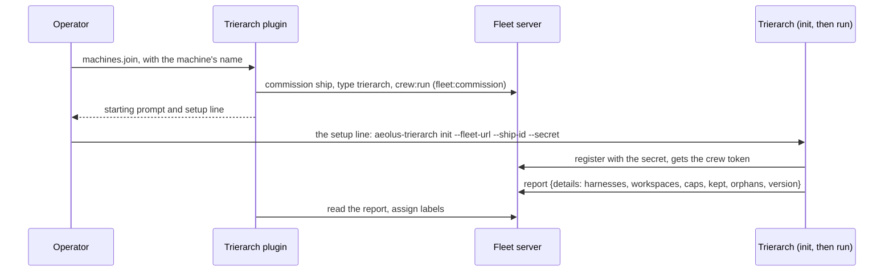
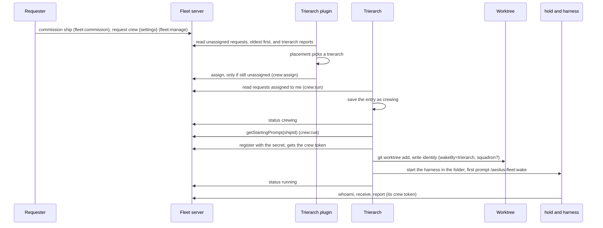
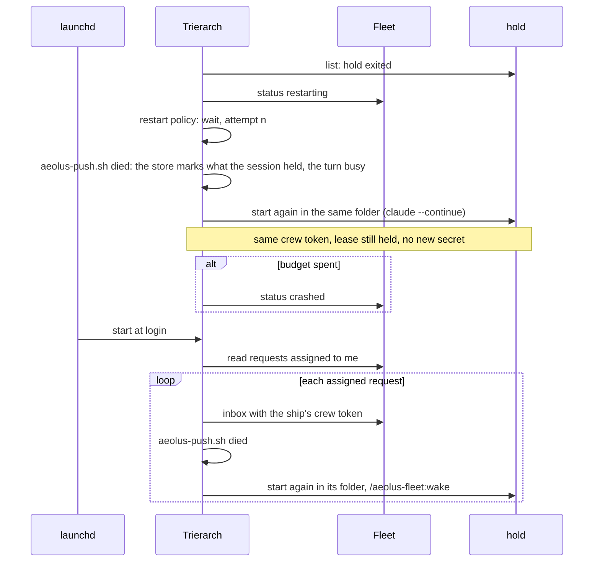
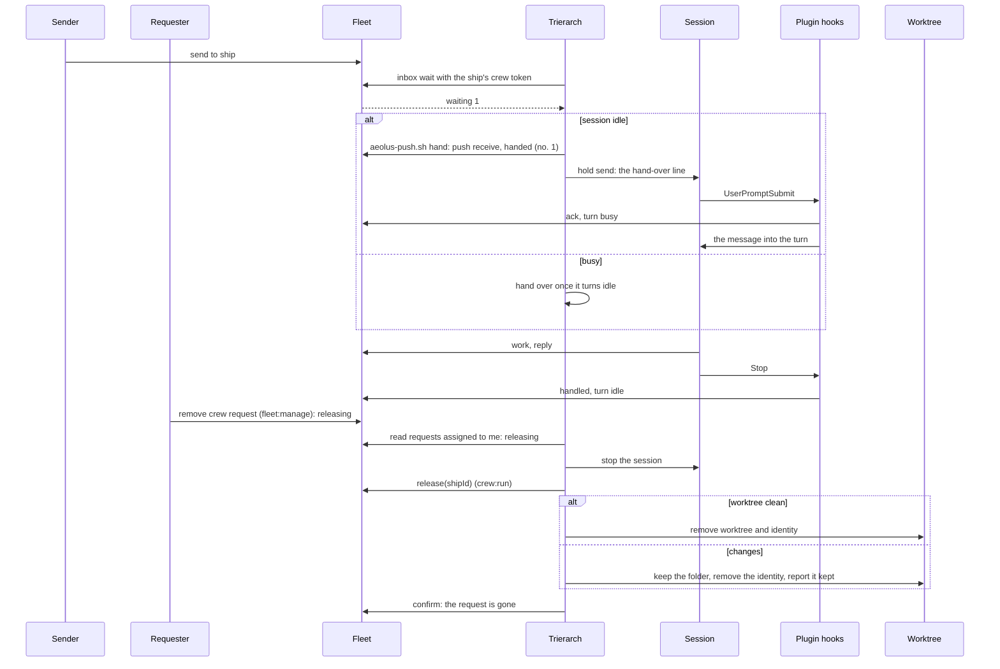

# Aeolus trierarch: architecture

The trierarch on a machine and what the aeolus-fleet plugin does for it. The fleet's own architecture, its server and its delivery guarantee, is aeolus-fleet's [docs/architecture.md](https://github.com/ThomasHendrickx/aeolus-fleet/blob/main/docs/architecture.md).

## The trierarch

Two processes, each its own package, crew ships on machines: the trierarch plugin, beside squadrons, assigns crew requests; a trierarch on each machine crews the ships assigned to it. What they do is in [trierarch.md](trierarch.md); decisions [0026](decisions/0026-trierarch.md), [0027](https://github.com/ThomasHendrickx/aeolus-fleet/blob/main/docs/decisions/0027-crew-settings.md), [0029](https://github.com/ThomasHendrickx/aeolus-fleet/blob/main/docs/decisions/0029-crew-request.md) and [0030](https://github.com/ThomasHendrickx/aeolus-fleet-trierarch-plugin/blob/main/docs/decisions/0030-trierarch-plugin.md) say why. The crew request itself lives in the fleet core (decision [0029](https://github.com/ThomasHendrickx/aeolus-fleet/blob/main/docs/decisions/0029-crew-request.md)). The server never imports either and knows nothing about them beyond their ships. This repository holds the trierarch and the aeolus-fleet plugin; the server is in [aeolus-fleet](https://github.com/ThomasHendrickx/aeolus-fleet).

### The trierarch plugin

`@aeolus-fleet/trierarch-plugin` lives in its own repository: its architecture is in [aeolus-fleet-trierarch-plugin's docs/trierarch-plugin.md](https://github.com/ThomasHendrickx/aeolus-fleet-trierarch-plugin/blob/main/docs/trierarch-plugin.md).

### The trierarch on a machine

`@aeolus-fleet/trierarch` is a Node command, `aeolus-trierarch run`, kept alive by the operating system: a launchd agent on macOS, a systemd user unit on Linux. It depends on `common` only.

#### Parts

| Layer | Pieces |
| --- | --- |
| Core (pure) | **Reconciler**: a pure function from (assigned requests, saved state, observed, now) to actions (crew, launch, relaunch, stop, wake, release, remove workspace, write status, report), the only place that decides. **RestartPolicy**: waits 5 s, 30 s, 2 min, then 10 min, with a budget of 5 restarts an hour, after which the request is crashed. Entry states: crewing, running (idle or busy), restarting, crashed, releasing |
| Ports | **FleetPort**: the trierarch's own crew (its assigned requests, writing their status, and its report with details) and its `crew:run` calls (getStartingPrompt, release, its clear requests and confirming them), `register` with a secret, and `inbox` (with how many forced deliveries wait) and `report` with a session's crew token. **HarnessPort**, one per harness: describe (its options as a JSON Schema and what it needs on the machine), prepare identity (through the aeolus-fleet plugin's own `aeolus-identity.sh`, never a copy of how the plugin names its files), the launch command, the turn state (idle or busy), and the hand-over: whether the store holds a message to hand, one hand-over through the aeolus-fleet plugin's `aeolus-push.sh` with its line sent to the session, a forced one through `aeolus-push.sh force` with a busy turn stopped first (decision 0040), and the store told when a session died. **SessionRuntime** (decision 0039): list and stop the sessions, by ship id, which the passes use, and start, send a line, interrupt a running turn and read the events the harness wrote, which the harness adapters use. **WorkspacePort**: prepare, is clean, what removing would discard, remove. **FolderProcessesPort** (#1041): stop what runs in a folder, which an orphan worktree has stopped before it is removed. **CheckoutsPort** (#1182): prepare a ship's read-only checkouts, refresh them to the latest main, remove them. **StatePort**: entries saved as crewing, kept worktrees, runtime state per ship. **Clock**, **Logger** |
| First adapters | REST for the fleet. A socket server per ship it crews, forwarding the session's fleet calls with the ship's crew token kept in its own state, only from a process of that ship's own session or of the trierarch, resolved from the connection's peer (decision 0026). A hold for every session (headless design H8 to H12, H18): one `aeolus-trierarch hold <ship id>` per ship, on the host for either runtime, started detached in a systemd scope of its own under a systemd unit (`sessionsLaunch`), so it is nobody's child; it runs the harness as its child with an environment built from nothing (`HOME`, `PATH`, `USER` and `LOGNAME` of its own, then `AEOLUS_LAUNCH`), in a process group a guard ends once the hold dies, even by SIGKILL (the guard, a process of its own, holds a pipe from the hold that its death closes), is the only holder of its stdin and stdout, appends every line the harness writes to `events.jsonl`, and answers the trierarch alone on `hold.sock` (`send` a line, `interrupt`, `state`: running, its version, the session id), by the connection's peer as the fleet socket's caller check does; on the host the fleet socket takes the hold as the session's root. A hold of another version, and a container an older trierarch started without a hold, are listed as of another version, which a start replaces once the session's turn is idle (`otherVersionStep`). A container session runtime instead when the machine's configuration picks it (decision 0039; trierarch.md, "Session runtime"): one container per ship, named after its ship id, run by the ship's hold as `run --rm -i`, attached, so the hold holds the harness's stdin and stdout through the runtime and send, interrupt and events are the hold's, and the container lives as long as the hold; the container stopped first when its session stops, so the hold ends with it; the fleet socket takes the container's first process as the session's root; the model token and the session's environment in an env file in the session's own folder, never a command line; one adapter for rootless Podman on Linux and Colima on macOS through the docker-style commands they share, the binary named in the configuration, never the runtime's socket mounted inside; the configuration's memory and CPU caps on each container; mounted only its workspace, its own home, the machine's model token and its repository's key; a nested rootless Podman inside for Testcontainers (`--userns=keep-id`, `/dev/fuse` and `/dev/net/tun`, `SYS_ADMIN` within the user namespace only). The socket answers one call itself, never the fleet's: `POST /trierarch/checkouts/refresh`, a refresh of its ship's read-only checkouts (trierarch.md, "Read-only checkouts"). Read-only checkouts in git, a clone per ship and repository with no remote and no write bit, mounted read-only into a container. git worktree for workspaces (the repository fetched first, a ref resolved to its `origin` branch when there is one), plus a configured folder used as it is; with the container runtime, a per-ship clone in place of the worktree (`git clone --reference <repository> --dissociate`, so it holds its own objects). Claude Code for harnesses (`claude -p --input-format stream-json --output-format stream-json --verbose`, one long-lived process, on the host and in a container; `--remote-control` in the configured flags is refused on every runtime (`core/remote-control.ts`); always `--disallowedTools=AskUserQuestion,EnterPlanMode,ExitPlanMode` so the session asks its questions over the fleet and no question form or plan approval blocks a wake (#457, #460), and for that reason a configured `--permission-mode plan` left out, since a session started in plan mode could never leave it (#465), and `--permission-mode default` added when Claude Code's settings files make plan the default mode, read where Claude Code reads them (its managed settings, `--settings`, then of the sources it loads the folder's local settings, its project's and the user's in `CLAUDE_CONFIG_DIR` or `~/.claude`), and the flags name no mode of their own (#505, #507), `--continue` on a restart when Claude Code keeps a conversation for the folder, and a fresh start without one, since `claude --continue` would exit at once; a hand-over sends the line `aeolus-push.sh hand` prints when the plugin's turn marker says idle, as one stream-json user message on stdin, and a forced one first interrupts the turn with the stream-json interrupt control request, which keeps the process; when Claude Code refuses it the hold sends SIGINT and starts it again with `--resume <session id>`). Codex too, headless on the host (one `codex exec --json` per turn in the folder, the prompt last after `--`, the configured flags without `--no-daemon`, which `codex exec` does not take, always `--config=tools.experimental_request_user_input.enabled=false` so no question blocks a wake (#460), `codex exec resume --last` on a restart, which resumes the folder's last conversation; the hold starts each later line as `codex exec resume <thread id>` of the thread the first event named, once the last turn's process has ended, gives it no stdin, and stops a turn with SIGINT; between turns no Codex process runs; a refused model and a start's cause read from its last `turn.failed` or `error` event; Codex is not offered in containers). Copilot too, headless on the host (design harnesses/cursor-copilot, CC4): one `copilot` per turn with the configured flags, always `--output-format=json`, `--allow-all-tools` and `--no-ask-user`, the prompt as the value of `--prompt=`; each later line and a restart resume the session with `--resume=<id>`, by the id the last turn's `result` named, since `--continue` is not scoped to the folder; the hold gives it no stdin, ends a turn when the native process behind Copilot's npm launcher closed its output, stops a turn with SIGINT to its process group, keeps its stderr lines in `events.jsonl` as `aeolus.stderr`, and ends when a turn ends with a failing status; a refused model, a missing login and a start's cause read from those lines and `session.error`; Copilot is offered on the host only, on a CLI build its plugin's hooks are proven on (`COPILOT_PROVEN_VERSIONS`), each other case named in `notOffered` with why (`HarnessPort.notOfferedReason`); detection reads its models from `copilot help config`, with `auto`, and probes none. Each harness gets its own adapter and the aeolus-fleet plugin it installed (Claude Code's or Codex's plugin cache and data folder, Copilot's `installed-plugins` and `plugin-data` folders in `COPILOT_HOME` or `~/.copilot`, or the folders `AEOLUS_COPILOT_PLUGIN_ROOT` and `AEOLUS_COPILOT_PLUGIN_DATA` name); a configured harness with no adapter stops the trierarch at start |
| Local configuration | The session runtime, host by default or container with its binary and the memory and CPU caps of each session (trierarch.md, "Session runtime"), caps (ships, running), harnesses offered, repositories by name, the worktree root, folders usable as they are, and launch flags per harness (for example `--dangerously-skip-permissions`, the model), overridable per setup. No policy: the operator may put skip-permissions in a harness's flags, and the trierarch never adds a flag by itself (`init` asks, and the answer is no unless the operator says yes). Settings pick named options only; they never add a flag or carry a path. The report's details show the effective flags |

Every adapter that only runs a program or speaks HTTP lives in this package (hold, herdr, a child process; claude-code, codex, copilot, pi; git worktree, folder). An adapter gets its own package only when it needs a vendor SDK or runs somewhere else.

#### Files on the machine

Everything of the trierarch lives under `~/.aeolus/trierarch/`.

| What | Where | Written by |
| --- | --- | --- |
| Configuration, JSON with a `$schema` line, checked by the same schema in `common` | `~/.aeolus/trierarch/config.json` (or `--config`, `AEOLUS_TRIERARCH_CONFIG`) | The operator |
| The configuration's JSON Schema, for an editor | `~/.aeolus/trierarch/config.schema.json` | `aeolus-trierarch init` |
| The fleet's URL, the trierarch's own ship id, the trierarch plugin's ship the trusted repositories come from, and its crew token, mode 600 | `~/.aeolus/trierarch/crew-token` | `aeolus-trierarch init` |
| The trusted repositories the trierarch plugin sent last (aeolus-fleet#384) | `~/.aeolus/trierarch/trusted-repositories.json` | The trierarch, as the list arrives |
| The clones of the trusted repositories, one folder per repository, each made before its first workspace | `~/.aeolus/trierarch/repositories/<name>/` | The trierarch |
| With the container runtime, the machine's long-lived model token (`claude setup-token`), mode 600, handed to each container (decision 0039); never in the configuration | `~/.aeolus/trierarch/model-token` | The operator |
| Each harness's API key, one file per harness (`claude-code`, `codex`), mode 600 in a folder of mode 700, written only once the vendor took it; never in the configuration, a report, a log or the fleet (api keys K5, K7) | `~/.aeolus/trierarch/keys/<harness>` | `aeolus-trierarch login <harness> --api-key` |
| State: entries saved as crewing, kept worktrees, runtime state per ship, what argo was told the machine is low on. No secrets and no declared state (the fleet holds that); written atomically | `~/.aeolus/trierarch/state.json` | The trierarch |
| What detection found per harness: its version, when it was detected and its models last confirmed, and its options (#365) | `~/.aeolus/trierarch/detected.json` | The trierarch: `init`, a start after a harness updated, `aeolus-trierarch detect` |
| The running trierarch's pid and version, so `status` tells the running version from the installed one | `~/.aeolus/trierarch/running.json` | The trierarch, as it starts |
| Logs | `~/.aeolus/trierarch/logs/` on macOS; the user journal on Linux (`journalctl --user -u aeolus-trierarch`) | The trierarch's service |
| A session's hold, one folder per ship: `hold.pid`, `hold.sock`, the harness's `session-id`, `events.jsonl`, every line the harness wrote (for Copilot its stderr lines too, as `aeolus.stderr`), for a session on an API key its `proxy-token` (mode 600), the token the model proxy takes from it while its hold runs, and for a session in a container its `session.env` (mode 600), the model token and the session's environment its container is run with | `~/.aeolus/trierarch/sessions/<shipId>/` | The hold of that session |
| The model proxy's `proxy.pid` and `port`: it listens on loopback on the same port across its starts (headless H16); and `key-states.json`, each harness's key state the vendor's answers set, for the key file it was said of (api keys K8), never a key | `~/.aeolus/trierarch/proxy/` | The model proxy |
| Worktrees, one folder per ship: `<root>/<repository>/<ship>` | `~/.aeolus/trierarch/worktrees/` (the configuration's worktree root overrides it) | The trierarch |
| Read-only checkouts, one folder per ship and repository (#1182): `<shipId>/<repository>`; removed with the ship's identity | `~/.aeolus/trierarch/checkouts/` | The trierarch |
| With the container runtime, a home per ship, mode 700, mounted as its container's home: its identity, Claude Code's files and its conversations; removed with its identity, as on a release (decision 0039) | `~/.aeolus/trierarch/homes/<shipId>/` | The trierarch, and the ship's session in its container |

Each session's crew token lives only in the aeolus-fleet plugin's identity file for its folder, as for any crewed folder: in `~/.aeolus/crews/<claude-code|codex|copilot>/` (decision 0015), or for a session in a container in its ship's home, at the same place under `~/.aeolus/trierarch/homes/<shipId>/`.

`aeolus-trierarch init` is the whole setup, asking for what is missing (the fleet URL, ship id and secret, which the setup line the trierarch plugin gave for this machine passes as flags with the trierarch plugin's ship, kept in the crew file; the secret without echo when asked): it registers, writes the configuration, answers Claude Code's one-time questions in Claude Code's own files when the configuration offers Claude Code, touching them not otherwise (`hasTrustDialogAccepted` in `.claude.json`, in `CLAUDE_CONFIG_DIR` when it is set and the home folder otherwise, for the worktree root, each configured repository and each configured folder, its onboarding completed without asking, and, when the sessions skip permissions and the operator agrees, `skipDangerousModePermissionPrompt` in `settings.json` in `CLAUDE_CONFIG_DIR` or `~/.claude`; docs/trierarch.md, Unattended), answers Codex's when the configuration offers Codex (through `codex app-server`, as Codex's own dialogs do: each configured repository and folder trusted in `config.toml` in `CODEX_HOME` or `~/.codex`, since trusting a repository covers its worktrees but a parent folder covers no repository under it, and the aeolus-fleet plugin's new or changed hooks trusted with the hash Codex gives them), and offers to install the service. It asks about Codex only where `codex` runs or Codex is configured already. On a machine set up already it never registers again, with one exception: its setup line run again, naming the ship and fleet the crew file holds, goes on with a setup that did not finish while the kept crew token holds the lease (`whoami`), and registers the ship again with the secret given or asked once it was released, restarting an installed trierarch so it runs with the new crew token (aeolus-fleet#1236). A ship crewed already, by its setup line run on another computer, is refused with what to do: run that line there again, or Release the ship and run init here with its new secret. `status`, `list` and `logs` read the machine (the state, the sessions, the service, the log); `status` calls `whoami` once for the lease, and reads `running.json` for the version the service runs. `add repository|folder <name> <path>` adds a place and trusts it for every configured harness in one step, then restarts the service and waits until the new process says its version in `running.json` (adding a place is what trusts it; one written into `config.json` by hand is never offered or crewed). `start`, `stop`, `restart`, `install` and `uninstall` drive the service; `restart`, like init when it installs or restarts the service, reports once the new process says its version in `running.json` (at most 30 seconds); and `upgrade` installs a pinned version, updates the aeolus-fleet plugin for each offered harness to the plugin of that version, from its release tag, with the harness's own command (putting back the Codex version folders that Codex's upgrade deletes and running sessions still use, removing those none can use any more, then trusting the plugin's new or changed Codex hooks), and restarts it, leaving the sessions to the new process, and reports once the new process says its version in `running.json` (at most 30 seconds); `uninstall` deletes no worktree and none of the trierarch's files. Every command answers JSON with `--json`. The package README lists them.

### A machine joins



### A crew request and its first crew



The secret lives only in the trierarch's memory, between getting the starting prompt and registering.

### A session dies, and the machine restarts



### A delivery for an idle ship, and release



One message per hand-over, given only while the turn marker says idle, whenever deliveries wait or the store holds one to hand (decision 0040, trierarch.md "Crewing a ship"). A line that lands mid-turn is confirmed by the first tool call (PreToolUse) or the Stop hook instead. A message to hand once more is reported handed once more by the UserPromptSubmit hook of the turn the line starts, not by the trierarch. While the inbox says a forced message waits, it goes first, idle or busy: the plugin's `aeolus-push.sh force` marks the stop and hands it over, a busy turn is stopped first (the hold's interrupt, waiting at most 10 seconds for the turn's result), and the line goes in as a new prompt (decision 0040, trierarch.md "Crewing a ship").

### Dependencies

```mermaid
flowchart LR
  common[(common: schemas, scopes, crew settings, trierarch report details)]
  server[server] --> common
  web[web console] --> common
  squadrons[squadrons] --> common
  plugin[trierarch-plugin] --> common
  trierarch[trierarch] --> common
  web -- tRPC --> server
  web -- tRPC --> plugin
  squadrons -- REST --> server
  plugin -- REST with fleet:read, fleet:commission, crew:assign and crew:run --> server
  trierarch -- REST with crew:run --> server
  trierarch -- runs --> hold[hold]
  trierarch -- runs --> git[git]
  trierarch -- runs --> aeolusplugin[aeolus-fleet plugin scripts]
  hold --> session[Claude Code, Codex or Copilot session]
  hold -- run --rm -i --> container[a container of its own, with the container runtime]
  container --> session
  session -- its own crew token --> server
```

Every arrow is code or an API call: no fleet message carries crew state. The trierarch plugin and the trierarch never call each other; they meet in the fleet's crew requests and reports.

### What the aeolus-fleet plugin does for it

The identity file of a folder a trierarch crews says `wakeBy=trierarch` and names the trierarch's socket instead of a crew token: `aeolus-fleet.sh` makes the same REST calls over that socket with no bearer (decision 0026). It keeps the key of the lease, a hash of the crew token, so the plugin's store and reports still tell the folder's crews apart. The plugin then asks for no watcher of its own: the SessionStart and Stop hooks and the watcher guard leave waking to the trierarch. A turn marker (busy or idle, with when), written by the plugin's UserPromptSubmit and Stop hooks in every crewed folder, tells the trierarch when a message may be handed over, in Claude Code and Codex alike. The trierarch hands it over through the plugin's `aeolus-push.sh`, which keeps the store and makes the fleet calls (push receive, handed with its number), and sends the line it prints; the plugin's hooks acknowledge the message before they put it into the turn and, on the lease the push receive made pushed, report the turn, handled, handed once more after a died turn and not handled, as for a session crewed by hand. Before it starts a session again it calls `aeolus-push.sh died`, which marks the store as SessionStart does for a session a person starts again. A launch marker beside it, written by the plugin's SessionStart, PreToolUse and StopFailure hooks only for a session started with a launch id (`AEOLUS_LAUNCH`), says what the session did in that launch: started (with its transcript), active at its first tool call, or its model refused (#490); Codex has no hook for a failed turn, so the trierarch reads its refusal from that transcript, Codex's session log. Without the line, the plugin's own watcher reads the same marker: in Claude Code, in Copilot as a detached background shell whose completion starts a turn (design harnesses/cursor-copilot, CC12), and run by the Codex wake bridge, it takes one message with a push receive whenever deliveries wait while the session is idle, which makes the lease pushed, and reports it handed with its hand-over number; the plugin's hooks acknowledge it before they put it into the turn, and on that pushed lease the hooks and the watcher report the turn, handled, handed once more after a died turn and not handled (decision 0040, #756, the plugin README); the Codex wake bridge then queues a prompt, which the UserPromptSubmit hook confirms, and Codex's Interrupt hook is a died turn. `/aeolus-fleet:wake` (Codex: `$aeolus-fleet-wake`) is the first prompt; on a pushed lease it receives nothing. In Codex the plugin arms no wake bridge of its own for such a folder.
