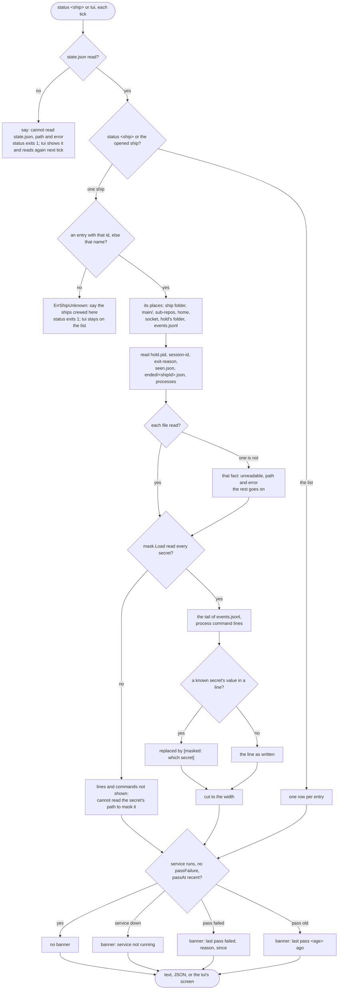
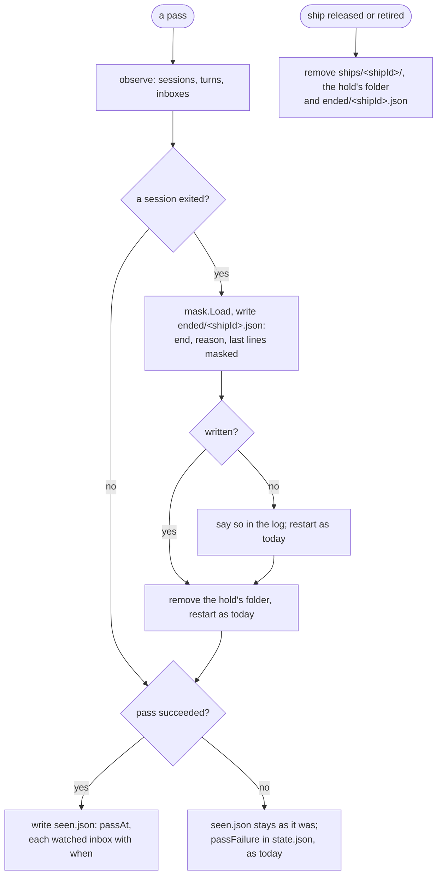

# Design: tools to check in on and debug the sessions a trierarch keeps (#271)

Status: stage 2, the detailed design. The purpose is approved by Thomas on 20 Nov (card 563c69d7, option 1), with the scope below, and he answered the ten questions of stage 1 on 20 Nov, one card each; they are the decisions below. What follows them is this design's proposal on those decisions, for Thomas to approve, with the screens drawn as text and new questions at the end. Nothing is built.

Thomas, verbatim (#271): "It would be handy if the trierarch process had tools that helped with debugging and checking in on sessions." And on 20 Nov: "fits the unit rework we did. Making one of our critical parts of aeolus more dev friendly". The unit rework is the ship folder: one `ships/<shipId>/` per ship, holding its ship folder with `main/` and `sub-repos/<repository>/` (aeolus-fleet#1759, [ship-folder.md](ship-folder.md)).

## Purpose (approved)

Approved by Thomas on 20 Nov (card 563c69d7, option 1), with his note, verbatim: "Including the TUI scope we discussed in chat".

**For whom.** The person who runs a machine's trierarch, on that machine as the trierarch's user, and a ship that person sets to investigate for them.

**The job.** When a ship goes quiet, or its session keeps dying, they name the ship and see in one place what its session is doing now and why: whether it is in a turn and for how long, what it last did, what runs under it, what waits for it, and why its last session ended. They need not know where each harness keeps its files, nor which process belongs to which ship. The ship is the unit, as the ship folder made it: a ship's session is found by the ship, whatever its harness and whether it runs on the host or in a container.

**The scope.** Besides the existing commands (`list`, `status`, `logs`), the trierarch gets a full-screen live mode in its Go binary (for example `aeolus-trierarch tui`), for the same person and the same data:

- it shows the ship list, one ship opened, and why that ship's last session ended;
- it shows a banner when the trierarch's service is down, since then nothing it shows is current;
- it only shows, and names the existing way to act (a forced message, **Restart**, **Edit…** in the console);
- it works over SSH, without the fleet;
- no secret is ever on screen;
- nothing a session wrote leaves the computer.

The trierarch is one Go binary with no Node (the TypeScript package is being removed), so the live mode is Go.

**What it is not.**

- Not monitoring or alerting: noticing that a ship went quiet stays with the fleet's facts and the watch plugin ship (decision 0071).
- Not a view in the console or of the fleet: core stays content-blind, and a session's activity reaches the fleet as its kind and tool only, never content.
- Not a new way to steer a session: a forced message, **Restart** and **Edit…** already do that.
- Not for a ship crewed by hand: there the person already holds the session.
- Not a reader of messages: what a message says stays the ship's.

## Lessons to check against

### Seen on the machine

1. **What prompted it** (#271, 6 Nov): a Codex design ship was in one long step for over 30 minutes and did not take Thomas's messages. Finding out what it did took a `ps` pipeline grepping for the ship id and knowing where Codex writes its session log. The same night the trierarch's service itself was down, found only through `journalctl`.
2. **A long step keeps a ship deaf** (#270): Thomas decided a ship runs a long command in the background with a message to itself at its end, and ends its turn. A ship that ignores that rule is the case the tool must make visible.
3. **The evidence of a dead session goes too soon** (#471, #497, #482): restarts left no exit reason and the session's files were removed, so the cause "cannot be read afterwards"; #471 expects "the evidence of a crashed session is kept until it is read". Today each exit's status or signal reaches the log and the blocked report, then the hold's files are removed (#482).

### What the trierarch already shows and keeps

4. **`list`, `status` and `logs`** ([trierarch day to day](../guide/trierarch-day-to-day.md); #177, #183, #218): `list` shows each ship's state, harness, workspace, since when and its restarts; `status` counts the ships, the caps, whether the service runs and whether its last pass succeeded; `logs` follows what the trierarch does. These are where a person looks today.
5. **Where a ship's files live**: `ships/<shipId>/` holds its ship folder, its home and its fleet socket, with no secret; the hold's files are in `sessions/<shipId>/` beside it (`hold.pid`, `hold.sock`, `session-id`, `harness-sessions`, `events.jsonl`, and the mode 600 token files); the trierarch's log is in `~/.aeolus/trierarch/logs/` on macOS and the user journal on Linux ([architecture.md](../architecture.md)). Host Claude Code keeps its conversations in the ship's home (#538); Codex keeps the user's home (#538), so its session log is outside the ship's folders.
6. **The hold records every line the harness writes** to `events.jsonl`, for every harness (docs/trierarch.md, the hold): one record per ship of what its session did, whatever the harness.
7. **The facts exist already**: the turn marker, idle or busy with when (decision 0040; blueprint Turn); each running session's activity each pass, its latest event's kind and tool and when `events.jsonl` last changed (#165, docs/trierarch.md "What a trierarch writes of its sessions' activity"); the inbox with how many deliveries wait and how many are forced (blueprint, `inbox`).

### Decisions and principles

8. **Content-blind** (blueprint, principles): payloads are opaque. **Activity** is "the latest event's time and kind (text, tool, result, error), never content" (blueprint; decisions 0029, 0071). What a session wrote stays on the machine unless Thomas decides otherwise.
9. **No hidden behaviour**: "Hidden behaviour is a source of debugging nightmare." (blueprint, principles; 0034).
10. **A plain process, not an AI** (decision 0026): the trierarch starts, restarts, wakes and stops sessions, and never judges content.
11. **The crew token never reaches a ship's folder or a session** (decision 0026; architecture.md): the model token, the proxy token and the secret variables sit in mode 600 files beside `ships/`. Nothing the tool shows may print them.
12. **The hold's socket answers the trierarch alone** (docs/trierarch.md, the hold): a caller under any session's hold is refused, by its peer credentials. A ship on the same machine cannot reach a hold.
13. **Sessions run as the trierarch's user** ([keeping sessions running](../guide/keeping-sessions-running.md)): a session on the host can already read whatever that user can, another ship's files included; a session in a container sees only its own ship's parts (decision 0039).
14. **Declared state lives in the fleet** (decision 0026): Restart and Edit write the crew request again as a new settings version; a forced message stops a busy turn (decision 0040; "Force means act now"). Acting from the machine instead would be a path the fleet does not see.
15. **Monitoring is the watch plugin's** (decision 0071): core keeps the facts, the watch compares them with expectations and alerts.
16. **The trierarch reaches the plugin only through the plugin's own scripts** (CLAUDE.md): what the plugin keeps (its store, its turn marker) is read through them, never as a copy of how the plugin names its files.

### House rules

17. **The blueprint's language** (CLAUDE.md): ship, session, crew, lease, turn, activity, delivery, inbox, hold. No new term. "Check-in" is a squadrons term (a member's message to its flagship), so this design keeps Thomas's words "check in on" as a verb only.
18. **New rules, checks and process steps come only from Thomas** (CLAUDE.md): this design proposes; it adds none.

### The Go binary

19. **The commands read the trierarch's files, not the service** (`go/internal/cli`): `list` reads the state file; `status` asks the service manager whether the service runs, reads the last pass's failure, and asks the fleet only whether the trierarch's lease holds, saying "unreachable" when it cannot. Neither calls the running service, so a reader of the same files works while the service is down, and without the fleet.
20. **The state file holds a secret**: each entry keeps its crew token in the state (decision 0026), beside the ship's name, state, exits and folders. Whatever reads the state for a screen reads past that field.
21. **The inbox is seen each pass but kept nowhere on the machine**: deliveries waiting and forced are read from the fleet each pass and acted on, not written to a file a command can read. The turn is the plugin's marker, read through the plugin's scripts (lesson 16).
22. **The binary has few outside modules, and `upgrade` checks each release's checksum and attestation** (`go/go.mod`; [trierarch-binary.md](trierarch-binary.md)): it argues its own command line, colours with `internal/style`, and already has `golang.org/x/term`. Every library added is code in the binary every machine runs.

## Decisions

Thomas answered each question of stage 1 on 20 Nov, one card each, in the order they were asked. Each is current state for this design.

- **D1. What it shows of what a session did** (Q1, option 2): the facts (state, turn and since when, the latest activity's kind and tool and how long ago, the processes under the session with how long each runs, where its files are), and the last lines the session wrote, from the hold's `events.jsonl`. They are shown on the computer only: nothing of them leaves it.
- **D2. Secrets** (Q2, option 2): what the tool shows never reads the trierarch's secret fields (the crew token in the state, the token files beside `ships/`), and in what a session wrote each known secret is masked by its value before a line is shown. Nothing is masked by its shape.
- **D3. What a dead session left** (Q3, option 2): its end's reason and last lines are kept until the ship's next session ends or the ship's folder goes. A new session's start keeps the last end beside it.
- **D4. A ship's places** (Q4, option 1): the tool takes a ship by its name or id and finds each of its places where they are. No file moves.
- **D5. The inbox's facts** (Q5, option 2): the trierarch writes what each pass saw of each inbox, with when it saw it, to a file beside the state; the tool shows it with its age and calls no fleet.
- **D6. The banner** (Q6, option 2): it shows when the service manager says the service does not run, and also when the service runs but its last pass failed or is older than a few pass intervals.
- **D7. How the live mode opens** (Q7, option 1): a command of its own, `aeolus-trierarch tui`.
- **D8. One ship without a terminal** (Q8, option 2): a plain command for one ship, `aeolus-trierarch status <ship>`, with `--json`, says the same facts as the live mode's opened ship, from the same code.
- **D9. The library** (Q9, option 1): Bubble Tea (charmbracelet), with Lip Gloss for layout.
- **D10. Staying current** (Q10, option 1): the live mode reads the files again on a fixed interval of about one pass.

## The parts in the Go binary

Seven parts. The first four are shared code with no screen; the last three are what a person runs. Each new file the trierarch writes sits beside `ships/`, under `~/.aeolus/trierarch/`, mode 600, as every file of the trierarch's own does (lesson 11).

### 1. The reader: `internal/shipview`

One reader behind `status <ship>` and `tui` (D8), so the two never tell different things.

- `List(at paths.Paths, now time.Time) (Machine, error)`: every crewed ship, one row each, and the trierarch's own standing (part 6).
- `Ship(at paths.Paths, ship string, now time.Time) (View, error)`: one ship, found by its name or its id (D4): an exact ship id first, else the entry whose `shipName` is that name. No match is `ErrShipUnknown`, naming the ships crewed here.
- What a `View` holds, each with where it was read:

  | Fact | Read from |
  |---|---|
  | name, id, harness, state, since, restarts (exits in the restart window), workspace | `state.json`, through a decoder of its own that has no crew token field |
  | its places: the ship's folder, `main/`, each `sub-repos/<repository>/`, its home, its socket, its hold's folder, its `events.jsonl` | the entry's `shipFolder` and `folder`, `paths.ShipHome`, `paths.ShipSockets`, `hold.FilesOf` |
  | the session: running or exited, the hold's pid, the harness's session id | `sessions/<shipId>/`: `hold.pid`, `session-id`, `exit-reason` |
  | the turn, idle or busy, since when, and when the pass saw it | `seen.json` (part 4; question 11) |
  | the latest activity's kind and tool, and when `events.jsonl` last changed | `activity.Of` with the harness's own reader, as the pass reads it |
  | the processes under the session, each with its command and how long it runs | `folderprocess` for a session on the host, `container`'s folder processes for one in a container, each command line masked (part 2) |
  | the inbox: waiting, forced, and when the pass saw it | `seen.json` (part 4) |
  | the last lines the session wrote | the tail of `events.jsonl`, each line masked (part 2) |
  | its last session's end | `ended/<shipId>.json` (part 3) |
  | the trierarch's standing | the service manager, `state.json`'s `passFailure`, `seen.json`'s `passAt` (part 6) |

- A file it cannot read does not fail the whole view: the fact it holds says unreadable, with the path and the error, and the rest is shown (the unhappy path "files unreadable"). Only `state.json` unreadable fails the read, since without it no ship is known.
- It reads files only, never a hold's socket (which answers the trierarch alone, lesson 12), never the running service, never the fleet (lesson 19). It writes nothing.
- It is plain Go with its file reads behind a small interface, so each fact is tested on files a test writes, test first.

### 2. The masking: `internal/mask`

The one part that reads a secret's value (D2), so it can replace it; it holds the values in memory only, hands none out, and the reader gets back only masked text.

- `Load(at paths.Paths) (Masker, error)` reads every secret the trierarch holds on this machine: each entry's crew token in `state.json` (every ship's, not only the one shown), the trierarch's own `crew-token`, `model-token`, each file under `keys/`, `sealing-key`, the opened values in `mcp-configuration.json`, and in each `sessions/<shipId>/` the model proxy token, the token in `mcp-config.json` and the values in `secret-env.json`.
- `Masker.Line(text string) string` replaces each value where it stands as written and where it stands JSON-escaped (a line of `events.jsonl` is JSON), with `[masked: <which secret>]`, such as `[masked: crew token]` or `[masked: claude-code API key]`. It names the kind of secret, never any part of its value.
- Masking comes before a line is cut to the screen's width, so a cut never leaves part of a secret.
- A secret file it cannot read is a reason to show no line at all: the lines say `lines not shown: cannot read <path> to mask it (<error>)`. Showing a line it could not mask would break D2.
- What it cannot promise, said in the docs: a secret the session found elsewhere, which the trierarch never held, is not masked (D2 masks known secrets only).

### 3. A dead session's end: `internal/ended`

What a dead session left is kept until the ship's next session ends or its folder goes (D3).

- When a pass sees a session exited (the runtime's `Observed.ExitReason`, which `observe` already reads), before its hold's folder is removed, the run pass writes `ended/<shipId>.json`: when it ended, its exit reason, its harness and session id, when it started, its latest activity, and the last lines of its `events.jsonl`, masked with the secrets known then (part 2). Masked when kept, since its session's token files go with the hold's folder and could not be masked by value afterwards.
- The next session's start leaves the file as it is; that session's end writes it again, so one end is kept per ship, the last.
- It goes when the ship's folder goes (release or retire), in the same step that removes `ships/<shipId>/` and the hold's folder.
- A write that fails is said in the log and fails nothing else: the session is restarted as today.

### 4. What each pass saw: `seen.json`

The inbox's facts without the fleet (D5), and the time of the last pass the banner needs (D6).

- At the end of each pass that succeeded, the run pass writes `seen.json` whole, as `state.json` is written: `passAt`, and per ship it watched the inbox it read (waiting, forced) with when it read it; with question 11 picked, also the turn it read, idle or busy, with the marker's own since.
- An inbox is watched only while the ship's session runs (#473), so a ship with no running session has no inbox line: the tool says `not watched while no session runs`, never a count of zero.
- A pass that fails writes no `seen.json`: the last one stays, with its older `passAt`, and the banner says so (part 6).

### 5. The trierarch's standing

The banner (D6) and the `Trierarch` line of `status <ship>` come from one function of what part 1 read:

- `service not running`: the service manager says it does not run, as `status` reads it today.
- `last pass failed`: `state.json` holds a `passFailure`, with its reason and since when.
- `last pass <age> ago`: `passAt` is older than a few pass intervals (question 12).
- Otherwise current, and no banner.

When more than one holds, the banner says each, the service first.

### 6. `aeolus-trierarch status <ship>`

The one-ship command (D8): `status` with no word stays as it is; `status <ship>` reads the view of part 1 and prints it as text, or as JSON with `--json`. It exits 0 when the ship is found, 1 with the ships crewed here when it is not. It needs no terminal, so a ship set to investigate reads it.

### 7. `aeolus-trierarch tui`

The live mode (D7, D9, D10), in `internal/tui`, on Bubble Tea with Lip Gloss.

- Three screens: the ship list, one ship opened, and that ship's last end. The banner sits above each.
- Its model holds the last `Machine` or `View` read; a tick every 5 seconds (`passEvery`, about one pass, D10) reads again through part 1. Each screen is a function of the model, so each is tested as text, test first, without a terminal.
- Keys: up and down (or `k` and `j`) move, enter opens, `e` shows the last end, esc goes back, `q` quits. None acts on a ship: the footer names the way to act, in the console (a forced message, **Restart**, **Edit…**).
- With no terminal it starts nothing and says to use `status <ship> --json`, exit 2; it never prints one screen instead (D8's pick, lesson 9).
- New modules: `github.com/charmbracelet/bubbletea` and `github.com/charmbracelet/lipgloss`, with what they pull in. `upgrade`'s checksum and attestation checks are unchanged; they check the binary these are built into.

## The flow



What the run pass adds, each pass:



## Slices, in build order

Each is one PR, test first, with its docs (docs/trierarch.md, docs/architecture.md's files on the machine, the day to day guide) in the same PR.

1. **The reader and `status <ship>`, facts only.** Part 1 without lines, inbox or end; part 6.
   Done when: `status <ship>` and `status <ship> --json` say a ship's name, id, harness, state, since, restarts, places, session status, hold pid, latest activity and processes (commands not yet shown), found by its name or id; an unknown ship exits 1 naming the ships crewed here; an unreadable file says which and the rest is shown; the state's crew token is in no output (a test greps for it).
2. **The masking and the last lines.** Part 2; the lines and process commands in `status <ship>`.
   Done when: a test session line holding each kind of known secret, as written and JSON-escaped, is shown with `[masked: <which>]`; a secret file the masker cannot read shows no line and says why; masking comes before the cut.
3. **What each pass saw.** Part 4; the inbox (and, with question 11, the turn) in `status <ship>` with its age.
   Done when: a pass that succeeded writes `seen.json` whole, a failed pass leaves it; `status <ship>` shows waiting and forced with how long ago they were seen, and `not watched while no session runs` for a ship with no session.
4. **A dead session's end.** Part 3; the end in `status <ship>`.
   Done when: a session that exits leaves `ended/<shipId>.json` with its reason and masked last lines before its hold's folder goes; a new session's start keeps it; the next end replaces it; a release removes it; a failed write is logged and the restart happens.
5. **The standing.** Part 5; the `Trierarch` line in `status <ship>`.
   Done when: each of service down, last pass failed and last pass old gives its own words, from files a test writes, and none gives none.
6. **The live mode.** Part 7: the three screens, the banner, the 5 second tick, the keys; Bubble Tea and Lip Gloss added.
   Done when: each screen in "The screens" below is matched by a test of its model's view; with no terminal it exits 2 with its words; `--help` says `tui` and `status <ship>`.

## The screens

Every screen is drawn with made up ships. Colours follow `internal/style`'s tones (state colours, strong labels) and are not drawn. Times are local, as the machine says them; ages are rounded to the second below a minute and to the minute above.

### `--help`, before and after

The only existing output that changes. `status` with no word, `list` and `logs` say what they say today (question 15 asks whether `status` should say the last pass's age).

Before:

```
  status         how the trierarch stands on this machine
  list           the ships it crews
```

After:

```
  status         how the trierarch stands on this machine
  status <ship>  one ship, by its name or id: its session, turn, activity, processes,
                 inbox, last lines and last end, on this machine only
  list           the ships it crews
  tui            the same, live, full screen: the ship list, one ship opened, its last end
```

### The ship list (`tui`)

```
 aeolus-trierarch                                               5 ships, 3 sessions running
 ──────────────────────────────────────────────────────────────────────────────────────────────
   SHIP              STATE       HARNESS      TURN         ACTIVITY             INBOX       RESTARTS
 > design-tri-271c   running     claude-code  busy 31m     tool Bash, 12s ago   2, 1 forced        0
   build-api-12      running     codex        idle 2m      result, 2m ago       0                  0
   release-bot       crewing     claude-code  busy 20s     text, 3s ago         0                  0
   review-88         restarting  claude-code  -            -                    not watched        2
   docs-writer       crashed     codex        -            -                    not watched        3
 ──────────────────────────────────────────────────────────────────────────────────────────────
 up/down move   enter open   e last end   q quit                read 14:02:31, pass 4s ago
 To act on a ship: a forced message, Restart or Edit… in the console
```

### One ship opened (`tui`, enter on a ship)

```
 aeolus-trierarch > design-tri-271c                                         read 14:02:31
 ──────────────────────────────────────────────────────────────────────────────────────────────
 Ship        design-tri-271c (shp_01m7xef43k9rg7ff4djsgwp2fy), claude-code, on the host
 State       running since 13:30:12, 0 restarts
 Turn        busy since 13:31:27 (31m), seen 4s ago
 Activity    tool Bash, 12s ago
 Inbox       2 waiting, 1 forced, seen 4s ago
 Processes   pid 48211  31m  npm test --workspaces
             pid 48230  31m  node node_modules/.bin/vitest run
 Last end    13:30:09, exit status 1 (e to read it)
 Places      ship folder  ~/.aeolus/trierarch/ships/shp_01m7xef43k9rg7ff4djsgwp2fy
             main         ~/.aeolus/trierarch/ships/shp_01m7xef43k9rg7ff4djsgwp2fy/main
             home         ~/.aeolus/trierarch/ships/shp_01m7xef43k9rg7ff4djsgwp2fy/home
             hold         ~/.aeolus/trierarch/sessions/shp_01m7xef43k9rg7ff4djsgwp2fy
             events       ~/.aeolus/trierarch/sessions/shp_01m7xef43k9rg7ff4djsgwp2fy/events.jsonl
 ──────────────────────────────────────────────────────────────────────────────────────────────
 Last lines of events.jsonl                                               up/down scroll
 13:31:25  text    {"type":"assistant","message":{"content":[{"type":"text","text":"Running the w…
 13:31:27  tool    Bash  {"type":"assistant","message":{"content":[{"type":"tool_use","name":"Bash"…
 13:31:27  tool    Bash  {..."command":"AEOLUS_TOKEN=[masked: crew token] npm test --workspaces"…
 ──────────────────────────────────────────────────────────────────────────────────────────────
 esc back   e last end   q quit
 To act on design-tri-271c: a forced message, Restart or Edit… in the console
```

The third line shows the masking: a crew token the session put in a command is replaced before the line is cut.

### A dead session's end (`tui`, e on a ship)

```
 aeolus-trierarch > docs-writer > last end                                  read 14:02:31
 ──────────────────────────────────────────────────────────────────────────────────────────────
 Ended       13:58:40, exit status 101, after running 4m 12s
 Session     codex, session 019a3f2c-7d1e-7c40-9b8e-3e1a52c0d9f4
 Activity    error, at 13:58:40
 Kept until  the next session of docs-writer ends, or its folder goes
 ──────────────────────────────────────────────────────────────────────────────────────────────
 Its last lines                                                           up/down scroll
 13:58:31  tool    shell  {"type":"item.started","item":{"type":"command_execution","command":"…
 13:58:39  result         {"type":"item.completed","item":{"type":"command_execution","exit_co…
 13:58:40  error          {"type":"turn.failed","error":{"message":"stream disconnected before…
 ──────────────────────────────────────────────────────────────────────────────────────────────
 esc back   q quit
```

A ship whose session never ended since it was crewed:

```
 Last end    none kept: no session of this ship ended since it was crewed here
```

### The banner

Above every screen, only while one of the three holds (part 5):

```
 ! The trierarch's service is not running (aeolus-trierarch start): nothing below is current.
```

```
 ! The last pass failed, failing since 13:41:10: fleet unreachable: nothing below is current.
```

```
 ! The last pass was 2m ago: nothing below is current.
```

Two at once, the service first:

```
 ! The trierarch's service is not running (aeolus-trierarch start): nothing below is current.
 ! The last pass was 3h ago.
```

### `status <ship>`

```
$ aeolus-trierarch status design-tri-271c
Ship: design-tri-271c (shp_01m7xef43k9rg7ff4djsgwp2fy), claude-code, on the host
State: running since 2026-11-20T13:30:12+01:00, 0 restarts
Turn: busy since 2026-11-20T13:31:27+01:00, seen 4s ago
Activity: tool Bash, 12s ago
Inbox: 2 waiting, 1 forced, seen 4s ago
Processes: 48211 for 31m: npm test --workspaces; 48230 for 31m: node node_modules/.bin/vitest run
Last end: 2026-11-20T13:30:09+01:00, exit status 1
Places: ship folder ~/.aeolus/trierarch/ships/shp_01m7xef43k9rg7ff4djsgwp2fy, hold ~/.aeolus/trierarch/sessions/shp_01m7xef43k9rg7ff4djsgwp2fy
Trierarch: current, last pass 4s ago
Last lines:
  13:31:25 text {"type":"assistant","message":{"content":[{"type":"text","text":"Running the workspace tests in the background ...
  13:31:27 tool Bash {"type":"assistant","message":{"content":[{"type":"tool_use","name":"Bash","input":{"command":"AEOLUS_TOKEN=[masked: crew token] npm test --workspaces"}}]}}
```

Text has no width to cut to, so each line is shown whole, masked.

### `status <ship> --json`

```json
{
  "shipId": "shp_01m7xef43k9rg7ff4djsgwp2fy",
  "shipName": "design-tri-271c",
  "harness": "claude-code",
  "isContainer": false,
  "state": "running",
  "since": "2026-11-20T13:30:12+01:00",
  "restarts": 0,
  "places": {
    "shipFolder": "/home/me/.aeolus/trierarch/ships/shp_01m7xef43k9rg7ff4djsgwp2fy",
    "main": "/home/me/.aeolus/trierarch/ships/shp_01m7xef43k9rg7ff4djsgwp2fy/main",
    "subRepositories": {},
    "home": "/home/me/.aeolus/trierarch/ships/shp_01m7xef43k9rg7ff4djsgwp2fy/home",
    "socket": "/home/me/.aeolus/trierarch/ships/shp_01m7xef43k9rg7ff4djsgwp2fy/sockets/fleet.sock",
    "hold": "/home/me/.aeolus/trierarch/sessions/shp_01m7xef43k9rg7ff4djsgwp2fy",
    "events": "/home/me/.aeolus/trierarch/sessions/shp_01m7xef43k9rg7ff4djsgwp2fy/events.jsonl"
  },
  "session": {
    "status": "running",
    "holdPid": 48102,
    "sessionId": "5b6c1e0a-2f7d-4b0e-a7a3-61f0c9d2e811",
    "turn": { "state": "busy", "since": "2026-11-20T13:31:27+01:00", "seenAt": "2026-11-20T14:02:27+01:00" },
    "activity": { "kind": "tool", "tool": "Bash", "at": "2026-11-20T14:02:19+01:00" },
    "processes": [
      { "pid": 48211, "startedAt": "2026-11-20T13:31:28+01:00", "command": "npm test --workspaces" },
      { "pid": 48230, "startedAt": "2026-11-20T13:31:29+01:00", "command": "node node_modules/.bin/vitest run" }
    ]
  },
  "inbox": { "isWatched": true, "waiting": 2, "forced": 1, "seenAt": "2026-11-20T14:02:27+01:00" },
  "lines": [
    { "kind": "text", "line": "{\"type\":\"assistant\",...}" },
    { "kind": "tool", "tool": "Bash", "line": "{\"type\":\"assistant\",...\"command\":\"AEOLUS_TOKEN=[masked: crew token] npm test --workspaces\"...}" }
  ],
  "lastEnd": {
    "endedAt": "2026-11-20T13:30:09+01:00",
    "startedAt": "2026-11-20T13:12:40+01:00",
    "exitReason": "exit status 1",
    "sessionId": "5b6c1e0a-2f7d-4b0e-a7a3-61f0c9d2e811",
    "lines": [ { "kind": "error", "line": "{\"type\":\"result\",\"is_error\":true,...}" } ]
  },
  "trierarch": { "service": "running", "lastPassAt": "2026-11-20T14:02:27+01:00", "passFailure": null, "isCurrent": true, "says": [] },
  "unreadable": []
}
```

Times are absolute in JSON, so a reader works out the age itself. `lastEnd` is `null` when none is kept; `inbox` is `{ "isWatched": false }` when no session runs; `unreadable` lists `{ "path", "error" }` for each file the reader could not read.

### The unhappy paths

A ship that is not crewed here:

```
$ aeolus-trierarch status design-tri-999
No ship design-tri-999 is crewed here. Crewed here: build-api-12, design-tri-271c, docs-writer, release-bot, review-88.
```

In the live mode there is no name to type: the list holds only the ships crewed here, and a ship whose entry went while it was open goes back to the list with `design-tri-271c is no longer crewed here`.

A file it cannot read:

```
Processes: unreadable: /proc/48102/cwd: permission denied
Last end: unreadable: ~/.aeolus/trierarch/ended/shp_01m7xef43k9rg7ff4djsgwp2fy.json: unexpected end of JSON input
```

A secret it cannot read to mask:

```
Last lines: not shown: cannot read ~/.aeolus/trierarch/sessions/shp_01m7xef43k9rg7ff4djsgwp2fy/secret-env.json to mask it (permission denied)
```

The state unreadable:

```
$ aeolus-trierarch status design-tri-271c
cannot read the state at ~/.aeolus/trierarch/state.json: permission denied
```

No terminal:

```
$ aeolus-trierarch tui < /dev/null
tui needs a terminal: read one ship with aeolus-trierarch status <ship> --json
```

## Questions

New questions this design raises, for Thomas, each one decision, in the order they should be decided.

**Q11. Where does the turn shown come from?**
1. The pass writes the turn it read through the plugin's scripts, with the marker's since, into `seen.json` beside each inbox, and the tool shows it with its age.
2. The tool asks the plugin's scripts for each ship's turn itself, at each read.
3. The tool shows no turn, only the latest activity.

Pick 1: the pass already reads each running ship's turn through the plugin (lesson 16), so writing it beside the inbox is the same file and the same age; option 2 runs a script per ship every 5 seconds from a tool that only shows, and option 3 drops a fact D1 names.

**Q12. How old is "older than a few pass intervals" for the banner?**
1. 3 passes, 15 seconds.
2. 1 minute.
3. 5 minutes.

Pick 2: a pass is 5 seconds apart but a pass over many ships waits on the fleet for each inbox, so 15 seconds would show the banner on a slow pass that is still current; 5 minutes leaves a stuck service unseen for too long.

**Q13. How is a line of `events.jsonl` shown?**
1. As written, masked, after its time and the kind and tool the harness's existing reader gives it; cut to the width in the live mode, whole in `status <ship>`.
2. Each harness's reader also pulls out the line's text (the message, the command), and that is shown instead of the JSON.

Pick 1: it shows what the hold wrote, the same for every harness, with no new reader per harness to keep in step with each harness's format; the kind and tool in front already say what a line is. Option 2 reads more of each harness's content and hides the rest of the line.

**Q14. How many last lines are shown and kept?**
1. 200, as many as the pass already reads for activity (`activity.eventLines`).
2. 50.
3. Every line of the session.

Pick 1: the same number the trierarch already reads each pass, enough to see a long step's start, and a kept end stays a small file; option 3 keeps a whole session's content with no bound.

**Q15. Does `status` with no ship say the last pass's age?**
1. No: `status` stays as it is; the age is in `status <ship>` and the banner.
2. Yes: its `Last pass` line also says how long ago the last pass was, from `seen.json`.

Pick 2: the same stale facts D6 shows in the banner are on `status` today as `Last pass: succeeded` while the service passes nothing; it is one more phrase on an existing line. This changes `status`'s output:

```
Before: Last pass: succeeded
After:  Last pass: succeeded, 4s ago
```

**Q16. Where is a dead session's end kept?**
1. Beside `ships/`, in `~/.aeolus/trierarch/ended/<shipId>.json`, mode 600.
2. In the ship's folder, `ships/<shipId>/last-end.json`.

Pick 1: what a session wrote can hold a secret the trierarch did not know to mask, and the ship's folder is what a container session mounts and what holds no secret (lesson 11); beside `ships/` it is the trierarch's own file, read by its user only.
