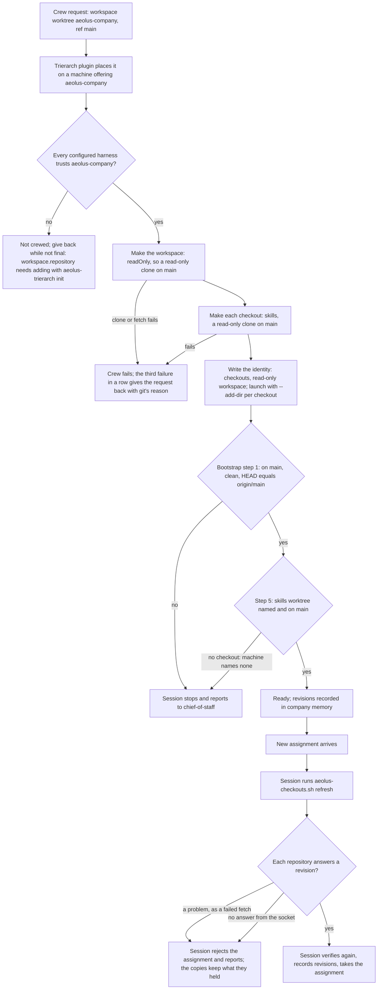

# Design: the company worktree and the skills worktree (aeolus-fleet#1449)

Status: structure, for Thomas to approve. No detailed decisions before the purpose and the picks below are agreed.

## Purpose

A company session (a ship of ThomasHendrickx/aeolus-company) gets, from the trierarch that crews it, two read-only copies on `main`: the company worktree as its working directory and the skills worktree beside it, named in its start context, both refreshed to the latest `main` when the session asks before a new assignment. Then a company ship passes bootstrap steps 1 and 5 and its refresh rule, instead of failing as ecosystem-relationships did on 31 Oct.

## Lessons to check against

- **The company bootstrap** (aeolus-company `runtime/bootstrap.md`): step 1, the company worktree is "on `main`", has no local modifications and its `HEAD` equals `origin/main`; step 5, a skills worktree is supplied, "on `main`" with no local modifications, else fail; step 7, both `HEAD` revisions are recorded. Runtime rule Updates: refresh before every new assignment.
- **agent-environment.md**, Session Hosting: "for each session, the Trierarch supplies two read-only worktrees on `main`"; the skills location is stated in the start context; a refresh that "cannot be done or verified" makes the session reject the assignment. Local workspace: agents may keep temporary working files.
- **The crew request settings today** (decision 0027, docs/trierarch.md "The crew request"): one `workspace`, `{ kind: worktree, repository, ref? }` or `{ kind: folder, name }`; no paths, no flags. Placement (the trierarch plugin) matches only the repository or folder against the machine's report.
- **The trierarch today**:
  - the workspace of a repository is a git worktree, detached at the remote's ref (`adapters/git-workspace.ts`), writable, sharing the configured repository's `origin`, so a session can push;
  - read-only checkouts (#1182, docs/trierarch.md "Read-only checkouts") exist: a configured repository names other configured repositories as `checkouts` in the machine's `config.json`; each is a clone with no remote and no write bits, detached at the latest main, under `~/.aeolus/trierarch/checkouts/<shipId>/<repository>`; the identity carries `--checkout`, the SessionStart hook names each and how to refresh; `aeolus-checkouts.sh refresh` brings the checkouts (not the workspace) to the latest main. "A crew request never names them, so placement never reads them" is recorded there.
  - On agent-host-1, `aeolus-company` names no `checkouts`: no skills worktree is made at all.
- **Decision 0011**: tonight's release is the trierarch train only, a candidate cut on `hotfix/<major>.<minor>.x`, released after its staging walk or with Thomas's `override_reason`.

## What fails today, by bootstrap step

| Need | Today | Gap |
| --- | --- | --- |
| Skills worktree supplied (step 5) | Only when the machine's `config.json` names it | agent-host-1 names none |
| "On `main`" (steps 1 and 5) | Both the workspace and the checkouts are detached `HEAD`s | A literal check fails |
| Company worktree read-only | Writable worktree with a push remote | Not read-only |
| Refresh both before an assignment | Refresh covers checkouts only | The workspace is never refreshed |
| A refresh that "cannot be done" is reported | A fetch that fails quietly leaves the old main, answered as a revision | The session verifies against a stale `origin/main` |
| Only a machine that can supply both crews a company ship | Placement never reads checkouts | A machine without them still crews it |

## Questions, each with my pick

1. **Where the second worktree is named.** (a) In the machine's configuration, as #1182 records: `aeolus-company` names `checkouts: ["skills"]` and becomes read-only there; no core change. (b) In the crew request settings, a field on the workspace (the issue's title): core's crew settings schema in `common` changes, a core release, `MINIMUM_CORE_VERSION` raised, and placement learns to match it. **Pick (a)**: it is the recorded design and ships tonight on one train. Cost: placement stays blind to it (last row above); every session in `aeolus-company` on that machine is read-only.
2. **How the company worktree becomes read-only.** (a) A repository in the configuration can be `"readOnly": true`: its workspace is made as a read-only checkout is (a clone with no remote, no write bits; read-only mount in a container) instead of a git worktree. (b) Keep the writable worktree and trust the session. **Pick (a)**: it is what "read-only" says and reuses the checkout code. Temporary working files then go to the session's temp folder, not the working directory.
3. **"On `main`".** (a) The trierarch makes each read-only clone on a local branch `main` at the fetched revision, with `origin/main` the same revision, so `git branch --show-current` says `main` and `HEAD` equals `origin/main`. (b) The company changes its bootstrap to accept a detached `HEAD` at `origin/main`. **Pick (a)**: a trierarch change; the company's wording stays. A git worktree cannot do this (two worktrees cannot both hold `main`), which is one more reason for 2(a).
4. **Refresh.** `aeolus-checkouts.sh refresh` (and `POST /trierarch/checkouts/refresh`) brings the read-only workspace too, in the same answer as `{ repository, revision }`, and a fetch that fails is answered as `{ repository, problem }`, never as a stale revision. **Pick: yes, both.**
5. **The start context.** The SessionStart hook already names each checkout; it adds that the working directory is read-only and that the refresh covers it. **Pick: yes.** It names the skills worktree by its repository (`skills`) and path, as today.
6. **Container runtime.** **Pick:** the read-only workspace is mounted read-only in a container as checkouts are, in the same slice if it is small; if not, tonight's slice refuses `readOnly` in a container with a reason (`config check` and at start), and the container follows.

## Flow

Unhappy paths, as today unless named: a repository not trusted is never crewed and is given back while the crew is not final (Trust); a checkout or clone that fails fails the crew and counts toward the give-back, as a trusted repository's clone does; a machine that names no skills checkout crews the ship and the session fails at step 5 (question 1's cost); a refresh with a failed fetch answers a problem and the session rejects the assignment (question 4); a release, a give-back or an unassigned request removes the read-only workspace and checkouts with the identity, as checkouts are removed now.

## Trains

- **Core (aeolus-fleet)**: no change with question 1(a). With 1(b): `common`'s crew settings schema, a core release, then the trierarch.
- **Trierarch train (this repository)**: the trierarch (2, 3, 4, 6) and the aeolus-fleet plugin's SessionStart wording (5). One release.
- **Trierarch plugin**: no change.
- **aeolus-company**: none needed; its "not yet implemented" note is the founder's to drop.

## Smallest slice set for tonight

0. **Operator, no release, now**: on agent-host-1, add `"checkouts": ["skills"]` to `aeolus-company` in `~/.aeolus/trierarch/config.json`, `aeolus-trierarch config check`, restart the trierarch. Company ships get the skills worktree with the released 0.35 code; they still fail a literal "on `main`".
1. **Read-only clones on `main`** (trierarch): checkouts on a local branch `main` with `origin/main`; a failed fetch is a problem in a refresh (questions 3, 4).
2. **The read-only workspace** (trierarch and plugin): `"readOnly": true` on a configured repository makes its workspace a read-only clone on `main`, refreshed with the checkouts, named in the start context (questions 2, 4, 5, 6).
3. **Release** per decision 0011: both slices onto `hotfix/0.35.x`, a candidate, the staging walk or Thomas's override, then `aeolus-trierarch upgrade` on agent-host-1 and `"readOnly": true` on `aeolus-company`.
