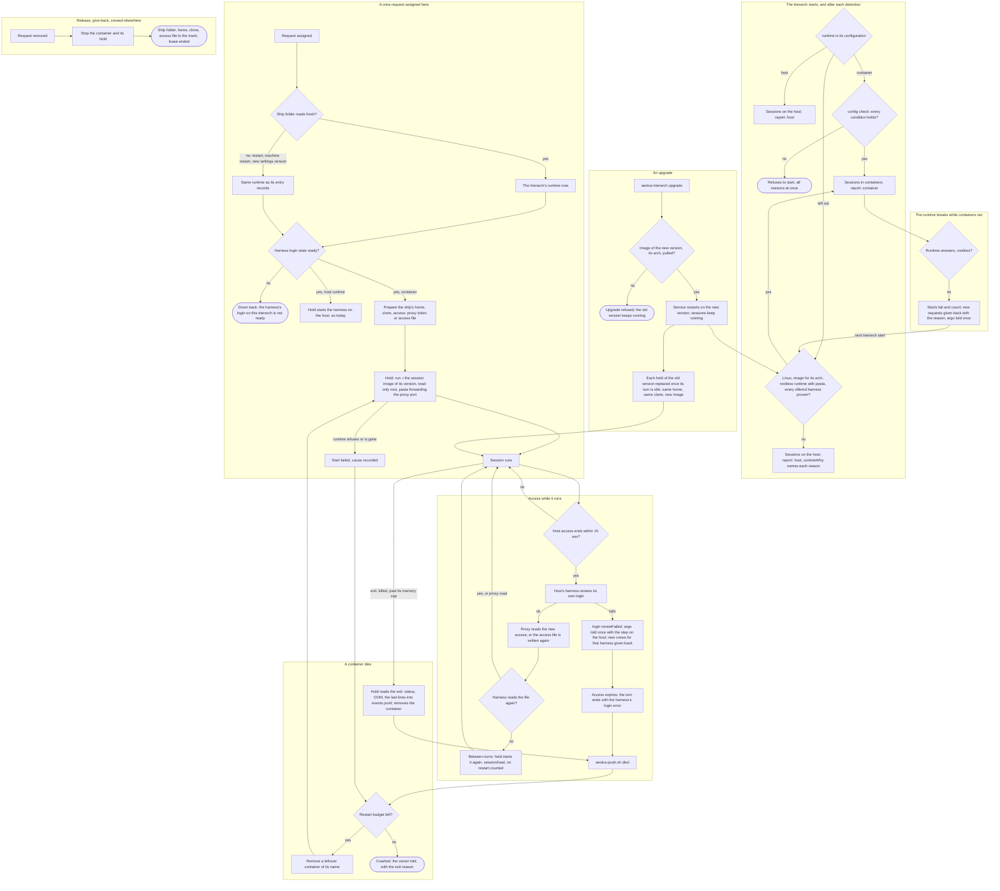

# Design: sessions in containers by default (#470)

Status: purpose and picks 1 to 4 approved by Thomas on 16 Nov (pick 3 as he changed it); this detailed design is for his approval. Nothing is built. Decision [0039](../decisions/0039-container-sessions.md) is rewritten in the same PR as the rule this design makes.

Inputs: #470 and its latest comment; decision 0039; [trierarch.md](../trierarch.md) (Session runtime, API keys, Crew-time MCP servers, What a trierarch reports); [architecture.md](../architecture.md); [harnesses/cursor-acp.md](harnesses/cursor-acp.md) and [harnesses/cursor-copilot.md](harnesses/cursor-copilot.md); [disk-under-control.md](disk-under-control.md); issues #114, #115, #295, #343, #350, #371, #372 and #471; and the research of 16 Nov on Cursor over ACP in a rootless Podman container (below, section 3).

## 1. Purpose (approved)

A person who runs a trierarch can let any ship work on their computer without that ship seeing anything that is not its own. By default every session, whatever its harness, runs in a container of its own: its own workspace, home, settings, login and repository key; never other ships, the person's own harness settings, their full login or the rest of the computer. Its login keeps working while the ship is crewed, without the person signing in again. Running on the host stays possible when the trierarch's configuration says so, and the trierarch reports it. For the ship's owner nothing changes.

The picks:
1. A trierarch switches to containers once every harness it offers is proven in a container; until then it stays on the host and says why.
2. The person's full login never enters a container: the trierarch keeps it on the host and hands each ship a short-lived access it renews. This reopens 0039's rejection of a credential proxy for subscription logins.
3. Thomas, verbatim: "The containers or not containers is per trierarchs not per computer (agent host 1 can have multiple trierarchs with each one the setting --> setting in the trierarchs config)".
4. Linux first; a Mac keeps the host, saying why, until Colima, an Apple-chip image and Mac logins are proven (#473).

Not the purpose: selling compute or a VM per tenant (0039's rejection stays); narrowing a container's egress; a machine without a person's login (#114); the Cursor adapter itself (harnesses/cursor-acp.md) and Copilot's host adapter, which this design puts into a container, not changes.

## 2. Lessons checked against

The fleet's:
- **0015, 0026.** No crew token in a session, its environment or its transcript: every fleet call goes over the ship's socket, the token added by the trierarch. A container keeps this as it is.
- **0016.** No protective rule the operator did not ask for. The container default is Thomas's own rule; every cap and size below either exists already or is a question (section 8).
- **0027, 0031.** A crew request never names where its session runs; placement never reads it. Per trierarch, still no label.
- **0028.** The report states facts. The runtime and why the trierarch is not on the one it was asked for are facts.
- **0011.** One version for the trierarch, the plugin and the image; a trierarch runs its own version's image.

The trierarch's:
- **0039, Why.** On the host every session runs as one user, so one breached session reaches every other ship's crew token, workspace, login and key. This is the reason for the default.
- **0039, Rejected.** The host's full login in every container, and a worktree with the main `.git` mounted: both stay rejected.
- **Headless H5, H10, H13; CC3, CC6, CC10.** A harness is offered only where every role is proven on its headless mode; the hold builds the environment from nothing; documented signals only. "Proven in a container" means the same proof, run in the image.
- **API keys K3, K5, K7, K8.** A key never enters a session, a container or the fleet; the model proxy swaps a session's own token for it, only towards the harness's vendor. Pick 2 gives subscription logins the same road where the harness allows it.
- **Crew-time MCP servers, #329.** A session gets only the servers its request names. In a container that holds by construction: the home is the ship's own (proven for Cursor, section 3).
- **#350.** Codex's ChatGPT login holds a refresh token that rotates: it cannot be copied per ship. The host keeps the one copy and the one renewal.
- **#471.** An upgrade lost a ship's plugin path and identity, and its restarts left no exit reason. In a container the plugin comes with the image and the identity lives in the ship's home; every exit records its reason.
- **#343, disk-under-control.md (approved).** A ship's scratch and test containers go when its session starts again; its folder goes when its workspace goes; a container's cache lives in its home (Q8 there); the owner is told once past a size, nothing stopped.
- **#295, #372.** Colima's network and its rootful daemon do not pass today's runtime check: the Mac stays on the host (pick 4).
- **#371.** An operator on API keys only must be able to set up a machine; the container default must not add a subscription requirement.

## 3. What is true today, and what the research proved

Today (0039): the configuration of the trierarch picks `host` (the default) or `container`. With `container`, `config check` refuses any harness but Claude Code (Copilot stays configured and is named in `notOffered`), a rootful or silent runtime, a Podman without pasta, a user in the docker group, and a missing model token. The subscription login is one long-lived `claude setup-token` token per machine, handed to every container in its env file. The image is one `linux/amd64` image with Claude Code, Node, the plugin, Playwright's dependencies and Podman. A per-turn harness (Codex, Copilot) has no container path at all: the hold's container runs one attached harness process.

The research of 16 Nov (Cursor CLI `2026.11.13-eacade1`, rootless Podman on Linux, the 0.40.0 image unchanged, Cursor mounted read-only):

| Proven | Not proven |
| --- | --- |
| An empty container home starts no MCP server; Cursor's login completes a turn | A login renewed during a session; a token past its expiry |
| A container home `~/.cursor/mcp.json` is the only MCP source; the request's empty list adds none | Fleet permission questions from inside the container |
| The real MCP proxy reached through pasta's proxy-port-only forward, its tool list and 401s held | Cursor, Codex and Copilot in the published image, on either architecture |
| Cursor runs on a file holding the access token alone (in both of its fields), with no refresh token, no API key, nothing in the environment | That a running `agent acp` reads that file again once it changes |
| A read-only mount of the person's full Cursor login works, and is what pick 2 rules out | Any of this on macOS, Colima or an Apple chip |

## 4. The design

### 4.1 The runtime is each trierarch's, containers by default

The trierarch's configuration keeps `runtime` (0039), now with three readings:

| `runtime` | Sessions run |
| --- | --- |
| left out | **in containers, when the default holds** (below); otherwise on the host, saying why |
| `{ "kind": "host" }` | on the host, as the configuration names; nothing is refused for it |
| `{ "kind": "container", ... }` | in containers; `config check` and the start refuse what would not hold (as today, widened to the proven harnesses) |

The default holds when all of these are true, read when the trierarch starts and again after each detection:
1. The trierarch runs on Linux (pick 4).
2. A session image of the trierarch's version exists for its architecture (`amd64` or `arm64`).
3. The container runtime answers, rootless, with pasta: `podman` unless the configuration names another binary, checked as 0039's check does today. No user in the docker group.
4. Every harness the configuration offers is proven in a container on that platform: listed in the trierarch's code as proven for that release's image, as Copilot's proven builds are today (`COPILOT_PROVEN_VERSIONS`). The image pins each harness's version, so the proof belongs to the release, not to what the person installed on the host.

The default does not need a login: a harness without one fails its sessions on either runtime, and its `login` state in the report says so (4.4).

Each condition that fails is one reason, all named at once, in the report and in `config check`: "macOS: containers are not proven on macOS yet", "no session image for arm64", "podman not found", "podman runs rootful", "podman has no pasta", "codex is not proven in a container".

**Per trierarch, not per computer.** Everything above is read from the configuration the trierarch runs with (`--config`, `AEOLUS_TRIERARCH_CONFIG`), so two trierarchs on one computer each pick their own. What the two share is the user's container runtime and its images; containers are named after their ship id, unique in the fleet, so they never clash. Whether several trierarchs on one computer work today is outside this design (#474).

**A crewed ship keeps the runtime it was crewed on** (Q3). Its entry in the state records the runtime its ship folder was made for (a worktree on the host, a clone in a container). A restart, a machine restart or a new settings version starts its session again on that runtime. A ship moves only when its folder is made fresh: crewed after a release, a give-back or a crew elsewhere. So switching the default, by an upgrade or a configuration change, never moves work between a worktree and a clone, and a trierarch can run ships on both at once while old ones finish. The report's note counts the ships on the other runtime.

**The runtime fails after containers ran** (Q2). While the trierarch runs with containers, a runtime that stops answering or turns rootful makes starts fail: each counts against its ship's restart budget, as any failed start does, and new crew requests are given back with the runtime's reason, so another trierarch can take them. argo is told once. The trierarch never moves new crews to the host by itself while it runs; at its next start the default is read again, and lands on the host only with the reason stated.

### 4.2 Logins: the host keeps them, a ship gets short-lived access

One rule for every harness: **the host's harness keeps its login and renews it; the trierarch never renews a login itself, never copies a refresh token, and gives a session only an access that ends with the session or within the hour.** A refresh token rotates (#350) or reaches the person's whole account; one copy on the host, used by the harness that made it, keeps the person signed in and every ship working.

Two roads, picked per harness by what it can be pointed at:

- **Through the model proxy.** The session's harness is pointed at the trierarch's proxy on the forwarded loopback port and given the session's own proxy token, fresh at each start, taken only while its hold runs (API keys, K-rules, as today). The proxy drops that token and sends the host's current access instead, only to that harness's vendor. The access never enters the container. It is renewed on the host, so the session never sees it expire.
- **Through an access file.** Where a harness cannot be pointed at a proxy, the trierarch writes the host login's current access token alone, in the shape the harness reads, into a file in the session's own folder (`sessions/<shipId>/access/<harness>`, mode 600), mounted read-only at the harness's login path in the container. No refresh token is in it. Before the access expires, the trierarch has the host's harness renew its login (a command the proof names) and writes the file again.

Per harness:

| Harness | Host login (kept by) | What the container gets | Renewal | Proof still needed |
| --- | --- | --- | --- | --- |
| **Claude Code**, subscription | the trierarch's `model-token` (`claude setup-token`), as today | the proxy road: `ANTHROPIC_BASE_URL` at the proxy, `ANTHROPIC_AUTH_TOKEN` the session's proxy token; the model token leaves `session.env` (Q1) | none per session; the token is long-lived on the host, and a refusal sets its login state `refused`, argo told with the step `claude setup-token` | Claude Code on a setup-token through a base URL: turns, usage limits, model aliases |
| **Claude Code**, API key | `keys/claude-code` | the proxy road, as today | as today | none |
| **Codex**, ChatGPT login | the host's Codex, in its `CODEX_HOME` or `~/.codex` (`auth.json`) | the proxy road: a Codex home of the ship's own whose `config.toml` names a model provider at the proxy's `/chatgpt/` path, its key read from the session's proxy token; no `auth.json` in the container | the proxy reads the current access and account from the host's `auth.json` per request; when the access ends within 15 minutes, the trierarch runs the host's Codex command that renews it | the provider at the proxy for a ChatGPT login; which host Codex command renews without a turn; concurrent sessions on one access |
| **Codex**, API key | `keys/codex` | the proxy road at `/openai/`, as on the host today | as today | Codex in a container at all (below) |
| **Cursor** | the host's Cursor login (`~/.config/cursor/auth.json` on Linux) | the access-file road: the access token alone at `~/.config/cursor/auth.json` in the container's home (proven, section 3) | the trierarch writes the file again when the host's access changes, and before it ends has the host's `agent` renew it; if a running `agent acp` does not read the file again, the hold starts it again with `session/load` between turns, counting no restart (Q5) | renewal on the host without an API key; whether a live process reads the file again; Cursor's refusal under 5 minutes left |
| **Copilot** | the host's Copilot login (`copilot login`) | to be proven (Q4): the proxy road if Copilot can be pointed at a base URL; else an access file with a short-lived Copilot token | as its road | every part |

The proxy road needs the proxy running whenever a container session runs on it, and every such container gets pasta forwarding the proxy's port alone (today only sessions on an API key or with MCP servers do). Requests the proxy forwards keep the harness's vendor as their only destination: `/anthropic/` to Anthropic, `/openai/` to OpenAI, `/chatgpt/` to ChatGPT's Codex backend. A token of a stopped session, of another harness, or for a host other than the vendor's is refused, as today.

What stays out of every container: the person's harness home (`~/.claude`, `~/.codex`, `~/.cursor`, `~/.config/cursor`, `~/.copilot`), their Keychain or keyring, every refresh token, the model token, every API key, every crew token, other ships' homes and workspaces, and the runtime's socket.

**A login that cannot be renewed.** The proxy answers the session as the vendor would answer an expired login, so the harness ends its turn with its own login error, which the launch window and the failed-turn reason already read: the session is restarted within its budget and then crashed, its owner told as today. The harness's `login` state in the report says `renewFailed`, with since when, and argo is told once per harness with the step on the host (`codex login`, `agent login`, `copilot login`, `claude setup-token`). New crews for that harness are given back while its login state is not `ready`, so another trierarch can take them. Once the host's login works again, the next renewal sets it `ready` and nothing else is needed: sessions restarted after that get access again.

### 4.3 Each harness in the image, per architecture

One image per release, `ghcr.io/thomashendrickx/aeolus-session:<version>`, published as a manifest for `linux/amd64` and `linux/arm64`, each built on a runner of its own architecture (no emulation), each tested by the image tests before the release publishes anything, as today (Q8):

| Harness | In the image | Its plugin | Its home in the container |
| --- | --- | --- | --- |
| Claude Code | `@anthropic-ai/claude-code`, pinned per release (today: `latest` at build) | installed into `/opt/aeolus-session`, linked into the home at every start, as today | `~/.claude`, `~/.claude.json` |
| Codex | `@openai/codex`, pinned, its native binary of that architecture | the aeolus-fleet Codex plugin installed into a template Codex home in the image, linked into the ship's `CODEX_HOME` at every start; its hooks trusted there at build, with the hash Codex gives them | `~/.codex` |
| Cursor | the Cursor CLI (`agent`), a pinned build downloaded per architecture and checked against its digest | none loaded (ACP loads no plugin); the plugin's scripts at a fixed path in the image, named by the start context (cursor-acp.md) | `~/.cursor`, `~/.config/cursor` |
| Copilot | `@github/copilot`, pinned to a build in `COPILOT_PROVEN_VERSIONS`, with its native binary | `copilot plugin install` into a template `COPILOT_HOME` at build, linked at every start | `~/.copilot` |

The ship's home holds only the files of the harness its request names. The image's `session-init` links that harness's plugin and nothing of the others.

Per-turn harnesses in a container. Codex and Copilot run one process per turn. Their container still lives as long as the hold: the hold runs it attached with the image's init waiting as its first process, and starts each turn with `<binary> exec` into it, the turn's stdout read by the hold as today. A turn is stopped by SIGINT to its process group inside the container (`<binary> exec <ship id> kill -INT -- -<group>`), since the runtime's `exec` does not pass signals on; its end is that `exec` ending. A long-lived harness (Claude Code, Cursor's `agent acp`) runs as the container's command, as Claude Code does today.

### 4.4 What the report and `config check` say

Report details (the type `trierarch`'s details in `common`):
- `runtime`, `host` or `container`: where new sessions of this trierarch run, as today, read now per trierarch.
- `runtimeWhy`, new, present only when `runtime` is `host` and the configuration leaves `runtime` out: the reasons of 4.1, each one string.
- each harness's `login` gains `subscription`, `ready`, `refused`, `renewFailed` or `none`, with `subscriptionStateAt` for a state an answer set, beside `key` as today; never a token.
- `notOffered` keeps naming a harness the trierarch cannot offer on its runtime, with why (for example Copilot while it is unproven and the configuration names `container`).
- the note counts ships still on the other runtime: "4 of 6 running, 2 on the host".

`config check` says where sessions run and why, in the same words:
- `runtime` left out: never refuses for the runtime; says `container`, or `host` with every reason.
- `{ "kind": "host" }`: says `host, as the configuration names`.
- `{ "kind": "container" }`: refuses, all reasons at once, what it refuses today, now with "not proven in a container" for each harness outside the proven list, and a host login it cannot read for a harness on its subscription road (a missing `model-token`, a Codex `auth.json` without a ChatGPT login, a missing Cursor login).
- On any runtime: `--remote-control` refused, as today.

### 4.5 Disk bounds for a container's home

What a container session writes lands in its ship's folder, counted and removed by the rules disk-under-control.md set, which the default now applies to every session:
- **The container's own layer:** run with a read-only root (`--read-only`) and a `/tmp` mounted from the ship's `tmp` (#347), so nothing it writes lands in the user's container storage where no ship's size counts it (Q7).
- **Scratch:** the ship's `tmp` and `containers` (its nested Podman's storage, #348) are emptied on every start, never under a running turn; its images are kept.
- **The home:** the harness's files of one harness, its conversations, and its cache (npm, Go, Playwright under `~/.cache`; disk-under-control Q8). Kept while the ship is crewed, since a restart continues the conversation. Counted in the ship's size; past the configured size, the owner is told once (#351). Nothing is trimmed under a crewed ship.
- **Removal:** the home goes with the ship's folder through the trash, as today (release, give-back, crew elsewhere), the trash emptied every pass, within the runtime's user namespace where needed.
- **Images:** a running container keeps its image until its next start. When the disk runs low, images of other versions no container uses are removed (#352).
- **Caps:** memory, CPUs and processes per container as today. With `runtime` left out, the caps come from defaults (Q6).

## 5. Flow

Unhappy paths beside the diagram:
- **A harness not proven** (an upgrade brings a configuration a harness the release does not prove, or the person adds one): with `runtime` left out, new crews go to the host with that reason, running containers stay; with `container`, `config check` refuses, so `upgrade` keeps the old version (as it does today for a configuration the new version refuses).
- **The proxy is down** while a session needs it: the session's next model call fails as with any outage; each pass starts the proxy again, as today.
- **A session tries the host's loopback**: it reaches the proxy's port alone (pasta, 0039 amendment); with another session's token, the proxy refuses.
- **A leftover container of the ship's name** (a hold killed before it removed it) blocks the next `run`: the start removes it first.
- **The image is missing for a new architecture** after the operator moved the trierarch: the default reads it at start and lands on the host, saying so.
- **An access file read by a session that copied it**: it holds an access that ends within the hour and no refresh token; the host login is not exposed.

## 6. Acceptance scenarios

- **Given** a Linux trierarch with rootless Podman and pasta, a configuration without `runtime`, and only proven harnesses, **when** it starts, **then** its report says `container` and its next crew runs in a container of the image of its version and architecture.
- **Given** the same trierarch configured with a harness not proven, **when** it starts, **then** it reports `host` with `runtimeWhy` naming that harness, and `config check` says the same.
- **Given** a macOS trierarch without `runtime`, **when** it starts, **then** it reports `host` with the macOS reason.
- **Given** `runtime` `{ "kind": "host" }`, **then** sessions run on the host, no `runtimeWhy`, nothing refused.
- **Given** `runtime` `{ "kind": "container" }` with podman rootful, **when** `config check` runs, **then** it refuses with every reason at once, and the trierarch does not start on it.
- **Given** two trierarchs on one computer, one configured `host`, the other without `runtime`, **when** both report, **then** each states its own runtime.
- **Given** a container session of each proven harness, **when** its container's environment, files and processes are read, **then** none holds a refresh token, the model token, an API key, a crew token or the person's harness home.
- **Given** a container session on a subscription login whose host access is renewed during the session, **when** it runs turns before and after, **then** every turn completes, and the person is not asked to sign in.
- **Given** a host login that cannot be renewed, **when** the access expires, **then** the session's turn fails with the harness's login error, the harness's login says `renewFailed`, argo is told once with the step on the host, and new crews for that harness are given back.
- **Given** a container killed past its memory cap, **when** the hold sees it end, **then** `events.jsonl` names the exit and the cap, the session is restarted within its budget, and a crash report names that reason.
- **Given** an upgrade, **when** the new version's image cannot be pulled, **then** the upgrade is refused and the old version keeps running; **when** it can, **then** running sessions are moved to the new image once their turns are idle, their conversations continued.
- **Given** a ship crewed on the host before the default changed, **when** it restarts, **then** it stays on the host; **when** it is crewed fresh, **then** it runs in a container.
- **Given** a ship released, **then** its container, home, clone and access file are gone, and nothing of it is in the user's container storage.

## 7. Build slices, Linux first

Each one PR, test first (the red commit first). C1 goes first; a point it cannot prove stops the slices that need it and goes to Thomas. Every slice updates trierarch.md and architecture.md for what it builds.

| # | Slice |
| --- | --- |
| C1 | **Login probes on Linux, both architectures.** Claude Code on a setup-token through the proxy; Codex on a ChatGPT login through the proxy, and the host command that renews it; Cursor's access file renewed under a live `agent acp`; Copilot's road (Q4); `exec` turns with SIGINT in a container. Each kept as a fixture with nothing personal; the result written into this design |
| C2 | **The image per architecture.** `linux/amd64` and `linux/arm64` built on their own runners, one manifest, the image tests on both, Claude Code pinned |
| C3 | **Claude Code's subscription through the proxy.** The proxy swaps a session's token for the model token; every container session on it gets pasta and the proxy; `session.env` holds no model token; the login state in the report |
| C4 | **A container's exit and leftovers.** No `--rm`: the hold reads the exit (status, OOM) into `events.jsonl`, then removes the container; a start removes a leftover of its name; the crash report names it |
| C5 | **Read-only root and the ship's `tmp`.** Depends on #347 and #348 |
| C6 | **The default and its gate.** `runtime` left out reads 4.1; `runtimeWhy`; `config check`'s words; the entry records its runtime and a crewed ship keeps it; the runtime failing gives requests back; default caps (Q6). After it, a Claude Code trierarch on Linux runs in containers |
| C7 | **Upgrade pulls the image first.** A failed pull refuses the upgrade |
| C8 | **Codex in a container.** In the image with its plugin and template home, `exec` turns and SIGINT, the ChatGPT login and API key through the proxy, renewal on the host; proven, so it joins the list |
| C9 | **Cursor in a container.** After cursor-acp.md's A7: in the image per architecture, the access file and its renewal, the container home's `mcp.json`; proven |
| C10 | **Copilot in a container.** As C1 decided its road; proven. Closes #115 |

macOS is #473, after these.

## 8. Questions, with my pick

**Q1. Claude Code's subscription in a container.** Today the long-lived setup-token sits in each container's environment.
1. Through the proxy (C3): the container holds only its session's proxy token, ended with the session.
2. Keep the token in the container: not the person's full login, but long-lived and usable from anywhere if a session leaks it.

**Pick: 1.** It is the only road that makes the access short-lived. If C1 shows Claude Code cannot run on a subscription through a base URL, 2 stays until it can, and the report says so.

**Q2. The runtime breaks while containers ran.**
1. Starts fail and count, new requests are given back, argo is told; the host is used only after a trierarch start reads the default again, saying why.
2. New crews go to the host at once, saying why.

**Pick: 1.** A trierarch never weakens a ship's isolation behind the operator's back mid-run; another trierarch can take the work.

**Q3. Ships crewed on the host before the default changed.**
1. They keep the host until their folder is made fresh (release and crew again).
2. Moved at their next idle turn: a clone made from the worktree, its uncommitted work carried over, the conversation moved into the ship's home.

**Pick: 1.** 2 moves work between a worktree and a clone, the risky step 0039 avoided; old ships end by themselves.

**Q4. Copilot's short-lived access.**
1. C1 proves whether Copilot can be pointed at the proxy (its GitHub and Copilot API hosts) or run on a short-lived Copilot token in a file; until one holds, Copilot is not proven, and a trierarch offering it stays on the host.
2. A fine-grained GitHub token per trierarch with Copilot requests only, in the container (#114): long-lived, renewed by hand.

**Pick: 1.** 2 is no short-lived access; it can follow #114 for a machine without a person's login.

**Q5. Cursor's renewal.**
1. The access file, renewed by the host's `agent`, and a reload with `session/load` between turns where the live process does not read it again.
2. A proxy intercepting Cursor's own OAuth exchange, as Docker's Cursor sandbox does, so no access token enters the container.

**Pick: 1.** Proven in part already, and it needs no knowledge of Cursor's private protocol; 2 is an issue if 1 fails in C1.

**Q6. Caps when `runtime` is left out.** Today `memory` and `cpus` are given by the operator with `container`.
1. Defaults: memory the machine's total over `caps.ships`, at least 2 GB; CPUs the cores over `caps.ships`, at least 1; the 4096 process cap as today. The configuration may set them.
2. No cap unless the configuration names one.

**Pick: 1.** 0039 makes caps per session a rule of the runtime; a default without them would let one session starve the rest.

**Q7. A read-only root for the container.**
1. Yes: every write lands in the ship's folder, counted and removed; a session cannot install system packages (it cannot as a rootless user today either).
2. No: writes outside the mounts land in the container's layer, gone with the container, but not counted while it runs.

**Pick: 1.**

**Q8. One image or one per harness.**
1. One image with all four harnesses: a few hundred MB more, one tag per release, one proof per release.
2. One per harness: smaller pulls, four images to build, test and pull per architecture.

**Pick: 1.** The image is pulled once per version per machine and shared by every ship.

**Q9. An explicit `{ "kind": "container" }`.**
1. Stays strict: refuses what would not hold, the trierarch does not start.
2. Reads as the default.

**Pick: 1.** An operator who names containers has asked for isolation, and should learn at once that it does not hold.
