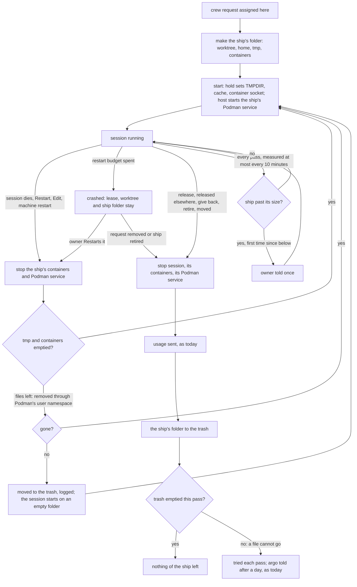
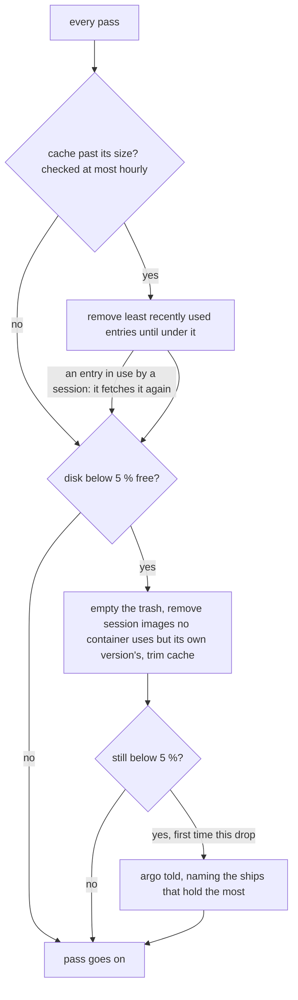

# Design: a trierarch keeps the disk its ships use under control (trierarch#343)

Status: complete for Thomas's approval. Purpose and Q1 to Q9 (each the first option of the question he answered) approved by Thomas on 12 Nov. Nothing is built.

## Purpose

A trierarch keeps every byte its ships' sessions write on its machine bounded and removes it by itself once no session uses it, so whoever installs one never cleans up after it.

Thomas, verbatim: "'Can this go' is not the right question 'How do we keep this under controll' is. Mostly if iy is produced by how trierarchs clean or not clean up after itself or after ships then it is an aeolus concern. If someone else installs a trierarch, they dont need to unclog the drain trierarch is filling."

## What the trierarch does

1. **Every file a ship's session writes lives in that ship's folder, `~/.aeolus/trierarch/ships/<shipId>/`** (Q1 and Thomas's note on Q6). Removing `ships/` removes every ship's files at once; the trierarch's own configuration, keys and state sit beside it, not in it (Q9). The limits are stated plainly in "Where the one folder holds, and where it does not".
2. **A ship's folder holds all its parts**: its worktree or clone, its harness home, its `tmp`, its `containers` (its own container storage, where its test containers and their volumes live), and its fleet socket. Today these sit in three parts (`worktrees/`, `homes/`, `sockets/`); they move into the ship's folder.
3. **No secret is in a ship's folder** (Thomas's note on Q9). The crew token, the model token, a proxy token, a repository's key and the hold's files (`sessions/<shipId>/`, with the env file that carries them into a container) stay in the trierarch's own files, beside `ships/`: they are the trierarch's, which it uses to act for the ship, not the ship's. The identity in a ship's home names its ship and socket, with no crew token, as a container's has it today. On the host a session can still open those files, as the same user; nothing it reads by accident in its own folder holds them.
4. **A session on the host is pointed there by its environment.** Its hold sets the temp folder, the cache and its own container runtime for the session (below). A session in a container is held there by its mounts (decision 0039). On the host the session is directed, not held: a command that writes elsewhere still can (Q7).
5. **Its scratch goes when its session starts again** (Q3): on a restart, Restart, Edit or a machine restart, its `tmp` and `containers` are emptied before the session starts, never under a running turn. Its worktree and home stay.
6. **A ship's folder goes when its worktree goes** (Q1): release, release elsewhere, give back, retire, a ship moved to another trierarch, a stray under the root (#89, #90). Order: stop the session, its containers and its Podman service, send its usage, then move the ship's folder to the trash; its hold's files go as today.
7. **One cache for the trierarch's sessions, `cache/`, apart from the person's own** (Q2; a session in a container: Q8), trimmed to a size the machine's configuration names, least recently used first.
8. **A ship past a size is told about once** (Q3): when its ship's folder passes a size the machine's configuration names, its owner is told once per crossing. The trierarch stops nothing.
9. **Low disk frees before it tells** (Q4): below 5 % free, the trierarch empties the trash, removes the session images no container uses (keeping its own version's), and trims the cache to its size; only if the disk is still low does it tell argo, naming the ships that hold the most.
10. **On the first pass after an upgrade the same rules apply to what they cover** (Q6): worktrees under the root, old session images, the cache. What sessions left elsewhere before stays the person's.
11. **The tests stop their own containers even when killed** (Q5): aeolus-fleet [#1581](https://github.com/ThomasHendrickx/aeolus-fleet/issues/1581) (its Postgres and LocalStack test runs), this repository #345 (its container e2e tests). The trierarch's removal of a ship's `containers` catches what they still leave.

## The trierarch's folder

```
~/.aeolus/trierarch/
  config, keys, state.json ...      the trierarch's own files (as today), with every token it holds for its ships
  sessions/<shipId>/                the hold's files and the env file carrying a container's tokens (as today), never in ships/
  ships/                            every ship's files: rm -rf ships/ removes them all
    <shipId>/
      worktree/                     its worktree or clone
      home/                         its harness home: Claude Code's files, its conversations, the plugin, its identity
      tmp/                          its temp folder, emptied on every start
      containers/                   its own container storage: images, containers, volumes, emptied on every start but its images
      podman.sock                   on the host, its own Podman service's socket
      fleet.sock                    its fleet socket
    .trash/                         as today, beside the ships
  cache/                            one cache for the trierarch's host sessions (npm, Go, Playwright), trimmed to its size
```

The configured worktree root becomes the configured place of `ships/`, `~/.aeolus/trierarch/ships` by default. A ship crewed before the upgrade keeps its folders where they are until it is crewed fresh (a release, a release elsewhere, a give back); they are removed on the same paths as today, and the first pass after the upgrade applies the rules to them (Q6).

A socket path is at most 104 bytes on macOS and 108 on Linux; `~/.aeolus/trierarch/ships/<shipId>/podman.sock` stays under it for a home path of up to about 35 characters; a machine with a longer home names a shorter place for `ships/` in its configuration.

## How a session is pointed at its folder

On the host, its hold starts it with:

| Variable | Points at |
| --- | --- |
| `TMPDIR`, `TMP`, `TEMP` | `ships/<shipId>/tmp` |
| `XDG_CACHE_HOME` | `cache/xdg` |
| `npm_config_cache` | `cache/npm` |
| `GOCACHE`, `GOMODCACHE` | `cache/go-build`, `cache/go-mod` |
| `PLAYWRIGHT_BROWSERS_PATH` | `cache/ms-playwright` |
| `CONTAINERS_STORAGE_CONF` | a storage file in `ships/<shipId>/containers` naming it as Podman's storage |
| `DOCKER_HOST`, `CONTAINER_HOST` | `ships/<shipId>/podman.sock` |
| `CLAUDE_CONFIG_DIR` | `ships/<shipId>/home/.claude`, with the machine's long-lived token (below) |

The hold runs the ship's own rootless Podman service on that socket (`podman system service`, with the ship's storage) beside the session, and stops it with the session. Testcontainers and `podman` in the session then start their containers there, and nowhere else the trierarch does not see.

In a container, `ships/<shipId>/home` is mounted as its home (as `homes/<shipId>` is today), `ships/<shipId>/tmp` as `/tmp` and `ships/<shipId>/containers` as the nested Podman's storage, so a restart empties them as on the host and the home keeps only the harness's files.

The cache in a container: see Q8.

## Where the one folder holds, and where it does not

Thomas asked for pushback where his note is not workable. Four places:

1. **On the host, the variables point a session at its folder; they enforce nothing.** A session runs as the machine's user, and a command that ignores `TMPDIR` or writes a path of its own still writes there. "It can only write there" needs a wall: the container runtime (decision 0039), or a sandbox of the operating system around the session (bubblewrap or Landlock on Linux, Seatbelt on macOS). Thomas chose no sandbox (Q7): on the host a session is pointed at its folder, not held there, and the container runtime is the one that holds a session to its folder. What a host session writes elsewhere anyway stays the person's (Q6).
2. **The harness's own files are in the user's home today on the host.** Claude Code keeps its conversations, settings, plugin and login in `~/.claude` (the login in the macOS Keychain on a Mac). `CLAUDE_CONFIG_DIR` moves all of it into the ship's `home`, as a container session has it, and the login comes along as the machine's one long-lived token (`claude setup-token`), as decision 0039 already does for containers; a session on an API key gets its proxy token, as today. Its conversations then go with the ship, after its usage is sent. Codex is different: its ChatGPT login lives in `~/.codex/auth.json` with a refresh token that changes on use, so a copy per ship breaks the login of every other copy. Codex's home stays the user's, with its conversations (`~/.codex/sessions`) outside the ship's folder; only a Codex session on an API key can move. So on the host: Claude Code moves, Codex on a ChatGPT login cannot without losing its login.
3. **`rm -rf ~/.aeolus/trierarch` also removes the trierarch's configuration, keys, crew token and state**: that is uninstalling the trierarch, not clearing its ships. All ships' files therefore sit in one folder, `ships/`, beside the trierarch's own files: `rm -rf ~/.aeolus/trierarch/ships` clears every ship and the trierarch crews them again from their requests; `rm -rf ~/.aeolus/trierarch` uninstalls it with everything it made. Whether Thomas means the second, the first, or both: Q9.
4. **A ship's own container storage costs disk, time and a process.** Each ship pulls its own images (about 0.3 GB for Postgres, 1 GB or more for LocalStack), so ten ships hold ten copies, and a fresh ship's first test run waits for its pulls and counts against the registries' pull limits. Its images are kept across its restarts (only containers and volumes are emptied on start), so the cost is once per ship, not per run. Each host ship also runs one idle Podman service. And Podman stores a container's files under ids mapped to the user, which `rm -rf` cannot remove: removal goes through Podman's user namespace (`podman unshare`), as the trash already does for a container's home. A read-only image store shared by all ships, filled by the trierarch, would save the copies but is a part to build and to trim; this design leaves it out.

## The whole life of a ship's folders





Unhappy paths:

- **A container's files cannot be removed by the user**: removal goes through Podman's user namespace, as the trash does for a home today; a folder that still cannot go waits in the trash and argo is told after a day.
- **The ship's Podman service does not start**: the session starts without it and a test run that needs containers fails in the session, as any missing tool does; the hold's log says why. The session is never pointed at the user's own runtime instead.
- **A session writes outside its folder anyway** (a tool that ignores `TMPDIR`, a hard-coded path): on the host nothing stops it, and what it writes stays the person's (Q6). In a container it cannot.
- **The trierarch stops mid-removal**: what was moved to the trash goes next pass; what was not is a stray under the root (#90).
- **The cache is trimmed while a session reads it**: npm and Go fetch or build a missing entry again; a removed Playwright browser is installed again by the session.
- **Size measuring is slow on a large folder**: measured at most every 10 minutes per ship and the cache at most hourly, never inside a pass's critical path.
- **The disk stays low after freeing**: argo is told once per drop, as today.

## Build slices

After #89 to #92 (row 1), each its own issue, in order:

1. The ship's folder: `ships/<shipId>/` holds its worktree, home and fleet socket, and no secret; ships crewed before keep theirs until crewed fresh.
2. Each ship's `tmp`: made with the ship, `TMPDIR`, `TMP`, `TEMP` set on the host, mounted as `/tmp` in a container, emptied on every start, removed with the worktree.
3. Each ship's own container storage and, on the host, its own Podman service on its socket; emptied on every start, removed with the worktree through Podman's user namespace.
4. The trierarch's cache, the variables pointing at it, and its trim to the configured size.
5. On the host, Claude Code's home in the ship's folder with the machine's token.
6. The ship's size and its owner told once.
7. Low disk frees before it tells: trash, old session images, cache.
8. The tests' own fixes: aeolus-fleet#1581, #345.

## What a machine holds today

One Linux machine running one trierarch on the host session runtime, 468 GB disk, 353 GB used (80 %), measured read-only on 12 Nov.

| What | Size | Count and kind | Who wrote it | Removed today |
| --- | --- | --- | --- | --- |
| Worktrees under the trierarch's root | 20 GB | 67 folders, each with its own `node_modules` | The trierarch, for its ships | Yes: release, the orphan pass and a clear request (#84, #89 to #93) |
| Scratch in `/tmp` | 38 GB | About 5,900 entries of the trierarch's user: review and pull request checkouts and builds of other repositories (1 to 3 GB each, the bulk), folders test suites make and leave (`mkdtemp` style, hundreds, small), browser profiles and test artifacts, and drafts and logs sessions write (review, pull request and lint files) | Sessions and the tests they run | No |
| Container volumes | 64 GB | 24 anonymous volumes, unlabelled, the data folders of Postgres containers (`postgres:16-alpine`), 1 to 11 GB each, made 7 to 12 Nov | Testcontainers runs (`org.testcontainers.lang=node`) started by host sessions | No |
| Containers | 0.3 GB, holding the volumes | 24: 20 Testcontainers Postgres and 1 LocalStack container, still running two days after their run; 3 of this repository's own e2e containers (label `aeolus.trierarch`, image `aeolus-trierarch-test`) running for 13 days; 1 build container | Test runs of ship sessions; no Ryuk reaper runs (rootless Podman runs need `TESTCONTAINERS_RYUK_DISABLED=true`), so a run that is killed or times out leaves its containers running | No |
| Shared caches | 20 GB | npm 9.4 GB, Go build 7.9 GB, Go modules 1.1 GB, Playwright browsers 1.4 GB | Every session of the user | No, and unbounded |
| Worktrees outside the trierarch's root | about 30 GB (issue's count) | Older worktrees of configured repositories | Earlier crews and people | No: outside its root the trierarch removes nothing (#84, point 4) |

The volumes are not leftovers of finished containers: 21 of 24 are held by containers still running. They outlive the session because the test run that started them was stopped before it stopped them, and nothing stops them after.

## What a session can write outside its worktree

- **Host session runtime** (the default, and this machine's): everything its user can write. The user's home (the harness's files, the shared npm, Go and Playwright caches), `/tmp`, and the rootless container runtime of the user, whose containers and volumes outlive the session. The trierarch knows only its root.
- **Container session runtime** (decision 0039): a container started `run --rm -i`, which sees its clone, its ship's own home (`~/.aeolus/trierarch/homes/<shipId>/`), its ship's socket folder and its read-only checkouts, nothing else. Its `/tmp` is the container's own and goes when the container goes. Its caches and its nested rootless Podman's images, containers and volumes live in its ship's home (the image's `storage.conf` names no other place), so they go with the home on release, give back or a ship no longer assigned here, through the trash. While the ship is crewed they grow unbounded inside the home, and a crashed ship keeps its home.
- **Both runtimes**: older versions of the session image are never removed; the trierarch's code runs no `image`, `volume` or `network` command, only `kill` and `rm --force` of its ship's own container.

## How the open issues fit

| Issue | What it does | Its part of the disk |
| --- | --- | --- |
| #84 | The approved design [worktrees-end-with-their-session.md](worktrees-end-with-their-session.md): a worktree ends with its session, a branch with its work | Row 1 of the table, worktrees under the root |
| #89 | Every path removes the worktree whatever it holds (today give back and the orphan pass keep one with unsaved work) | Row 1: the kept worktrees |
| #90 | Every folder under the root that no crewed ship uses is removed | Row 1: strays, plain clones, folders git does not know |
| #91 | `git worktree prune` on each configured repository every pass | Records only, almost no bytes; row 6 stays |
| #92 | A local branch checked out nowhere whose remote branch is gone is deleted | Refs only, almost no bytes |
| #93 | The scheduled ship that sweeps remote branches | No disk on the machine |

Rows 2 to 6 (`/tmp`, containers and their volumes, shared caches, worktrees outside the root) and old session images are in none of them. #343 is the rest, and #89 to #92 stay its first slices for row 1.

## Lessons to check against

1. **What a machine holds is there only while a session uses it** (approved #84 design, Thomas 2 Nov: "When a session finishes and there is work left that work can be seen as not valuable"). Today it holds only for worktrees under the root; the purpose extends it to everything a session writes.
2. **The trierarch removes only what it made, and outside its root nothing** (trierarch.md, gap rule 1; #84 design, point 4). Rows 2 to 6 are all outside its root. Either the trierarch learns what its sessions made elsewhere, or its sessions write only where the trierarch keeps control.
3. **On the host every session runs as one user** (decision 0039, Why). The trierarch cannot tell which session wrote a `/tmp` folder or started a container, nor a session's from the person's own work on the same account. Removing by owner alone would reach a person's own files.
4. **The container runtime already holds a session to its own folder and home** (decision 0039): its `/tmp` goes with `--rm`, its nested Podman's containers and volumes go with its home. It is the machine's choice, host by default, and offers Claude Code only. What is left there is growth while a ship stays crewed.
5. **No protective rules without the operator asking** (core decision 0016). A cap or a quota on what a session may write is such a rule; keeping the disk under control has to come from the end of use, not from limits nobody asked for, unless Thomas asks for limits.
6. **The disk alert says "The trierarch stops no session for it": freeing disk is the operator's** (trierarch.md, "Machine load"; argo told once per drop below 5 % free, read at most once a minute). The purpose reverses the second half; the alert stays the signal that control failed.
7. **The leak is in how tests run, not only in what sessions keep.** Testcontainers on rootless Podman runs with Ryuk off, so a test run that is killed or times out leaves its containers running and their volumes held. This repository's own e2e containers (label `aeolus.trierarch`) leak the same way. Part of rows 3 and 4 is fixed where the tests are, not by the trierarch.
8. **Removal goes through the trash, emptied every pass, argo told after a day when one cannot go** (architecture.md, the trash; trierarch.md, "Session runtime"). A removal that can fail already has a shape to reuse; argo is told about a failure, never about what was discarded (#84 design, point 3).
9. **A crashed ship keeps its lease and its folder, and Restart, Edit and a machine restart keep them too** (#84 design, point 1). Whatever ends with a session has to follow the same moments, or a Restart finds its state gone.
10. **The `.trash` beside the clones sits under the root** (architecture.md). #90's "every folder under the root" would reach it; a design that removes by place has to name what under that place is the trierarch's own.
11. **A guarantee without a test does not exist** (CLAUDE.md). Each removal path, its restart and its failure needs its own test, as #89 to #92 have.

## Questions

Each with its options; Thomas's answer is marked.

**Q1. Where may a session write?** Today a session on the host writes anywhere its user can: the trierarch removes its worktree, and nobody removes the rest.
1. *(Thomas's answer)* On both runtimes, everything a session writes besides its work goes to places the trierarch gave that ship: its scratch, its test containers and their volumes. They go when the ship's worktree goes. A session in a container has this already; a session on the host gets the same.
2. Only the container runtime is kept under control; the host runtime stays as it is, and the trierarch says so when it starts.
3. The container runtime becomes the default, and the host runtime is kept for machines that cannot run it.

Why 1: the operator chooses the runtime for the hardware (decision 0039), and the purpose holds on both.

**Q2. What does bounded mean for the shared caches** (npm, Go, Playwright)? They make every session's installs and builds fast, and they are the user's as much as the sessions'.
1. *(Thomas's answer)* The trierarch keeps one cache per machine for its sessions, apart from the user's own, and trims it to a size the machine's configuration names, least recently used first. The user's own caches are not the trierarch's.
2. Each ship gets its own cache, gone with the ship: nothing to trim, but each new ship downloads and builds everything again.
3. The caches stay shared with the user and unbounded.

**Q3. What does bounded mean for a ship that stays crewed for weeks?** Its worktree, scratch and test containers grow while it works.
1. *(Thomas's answer)* A ship's scratch and test containers are removed whenever its session starts again (a restart, Restart, Edit, a machine restart), never under a running turn. When the ship's folders pass a size the machine's configuration names, its owner is told once, and the trierarch stops nothing.
2. Over that size the trierarch stops the session and starts it again with empty scratch.
3. No bound while a ship is crewed; only its end frees the disk.

**Q4. When the disk runs low (below 5 % free), what does the trierarch do?** Today it tells argo and stops nothing.
1. *(Thomas's answer)* It first removes what no session uses (leftovers a removal could not finish, old session images, the cache down to its size), then tells argo only if the disk is still low, naming the ships that hold the most.
2. As today: it tells argo and frees nothing more.

**Q5. What is fixed in the tests themselves?** Testcontainers on rootless Podman runs with its reaper off, so a test run that is killed or times out leaves its containers and volumes behind.
1. *(Thomas's answer)* Both: each repository's tests stop their own containers even when a run is killed, and the trierarch's removal of a ship's test containers (Q1) catches what they still leave. In aeolus-fleet (the Postgres and LocalStack test runs that hold most of the 64 GB, to be confirmed there) and in this repository (its e2e containers, label `aeolus.trierarch`), an issue each.
2. Only the trierarch: the tests stay as they are.
3. Only the tests: the trierarch removes no containers.

**Q6. What about what is already on a machine when it upgrades?** Thomas asks for the permanent control, not a one-off cleanup.
1. *(Thomas's answer)* The same rules apply on the first pass after the upgrade to whatever they cover: worktrees under the root (#89, #90), old session images, the trierarch's cache. Worktrees outside the root and the user's own `/tmp`, caches and containers stay the person's, as #84 point 4 says.
2. The first pass after the upgrade also removes, once, what sessions left in `/tmp` and the user's container runtime before.

Thomas's note on Q6, verbatim: "An important one: Lets have a format that all file writes need to be put in a dedicated folder. For example .aeolus/trierarch/... each ship get a temp folder in that trierarch folder with <ship_id> as the name. It can only write to that location. It has a tmp sub folder by default as its own tmp folder. Push back if this is not workable. But the idea would be that a rm -rf ~/.aeolus/trierarch would delete all trierarch folders. Making it all easy to remove even by non Aeolus approved practices."

**Q7. Is one folder per ship workable, and is a host session held to it?** (points 1 to 4 above)
1. *(Thomas's answer)* One folder per ship, its limits written down as above. A container sees only its ship's folder; on the host the session is pointed there, not held, with no sandbox; test containers go through the trierarch's removal, not `rm -rf`.
2. As 1, and a host session runs in the harness's own sandbox (Claude Code's sandbox, Codex's `workspace-write`), writing only its ship's folder and the cache.

Thomas, verbatim: "ok, also makes it clear that the best solution long term is containerized setup"

**Q8. Which cache does a session in a container use?** Thomas: each container ship downloads its packages again; the trierarch's cache serves sessions on the machine itself. One cache shared by every session lets one breached session plant a package another session then installs, the very thing a container holds a session away from (decision 0039, Why).
1. *(Thomas's answer)* A session in a container keeps its cache in its own home, gone with the ship and counted in its size (Q3); the trierarch's one cache serves host sessions, which share the user anyway.
2. The trierarch's one cache is mounted into every container, read and write.
3. It is mounted read-only into every container, and a container's own downloads go to its home.

**Q9. What should `rm -rf` clear?** (point 3 above)
1. *(Thomas's answer)* Both, each stated in the trierarch's README: `rm -rf ~/.aeolus/trierarch/ships` clears every ship's files and the trierarch crews them again; `rm -rf ~/.aeolus/trierarch` uninstalls the trierarch with everything it made.
2. Only `rm -rf ~/.aeolus/trierarch`, the uninstall: ships' files may stay in several parts under it.

Thomas, verbatim: "One thing to make sure is that ship tokens etc stay out of it. Those do not belong to the ship, they belong to the trierarch to act as the proxy. I want to prevent the ship of looking at it as much as possible (even though it can always open that file, let's not let it do so by accident)"
