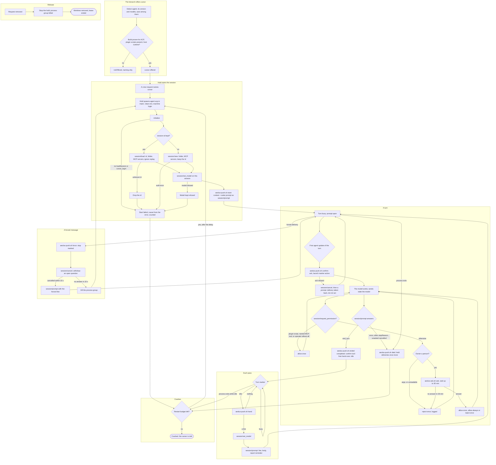

# The trierarch crews Cursor over ACP

Status: for Thomas's approval. Nothing is built. It replaces S9 of [cursor-copilot.md](cursor-copilot.md) (the Cursor adapter) and changes CC3 and CC4 for Cursor only; Copilot stays as that design says.

Inputs: Thomas's choice (16 Nov) to run Cursor ships on `agent acp` instead of `agent -p`; the hands-on ACP research and adapter plan on [aeolus-fleet#1462](https://github.com/ThomasHendrickx/aeolus-fleet/issues/1462); the approved [Cursor and Copilot design](cursor-copilot.md); the merged S7 (#456) and S8 (#461); draft PR #462 (S9 on `agent -p`); [trierarch.md](../../trierarch.md), [architecture.md](../../architecture.md) and [permission-asks.md](../permission-asks.md).

## 1. Purpose

A Cursor ship crewed by a trierarch works as a Claude Code ship does: one Cursor session per ship that lives across its turns, woken when a delivery arrives, confirming each delivery in its turn, stopped at once by a forced message, asking its owner before an action that needs permission, and restarted with its conversation when it dies.

Why ACP and not `agent -p` (research on #1462):
- `agent -p` fires no `stop` hook, so its turns only end at process exit, and a forced message is SIGINT to a process group then `--resume`.
- `agent -p` cannot be held to its crew request's MCP servers: `mcp.json` is shared with the user.
- `agent -p` runs every tool (`--force`) or none: nobody can be asked.
- `agent acp` gives all three: `stopReason` at the end of a turn, `mcpServers` per session, and `session/request_permission` answered by the client. It runs on the machine's own login (`cursor_login`), as CC6 asks.

For whom: the person who runs a trierarch on a machine where Cursor is the licensed harness, and the ship's owner, who gets the same ship as on Claude Code.

Not the purpose:
- A hand-crewed Cursor session (S10) and Cursor's crew line in core (S11): they stay as cursor-copilot.md says.
- The Cursor SDK (`run.steer`): it needs a user API key, which CC6 refuses.
- Copilot over ACP.
- The container runtime: Cursor stays host only (CC10).

## 2. What the research proved, and what it did not

Proven on Cursor CLI `2026.11.13-eacade1` on Linux (#1462, latest comment):

| Need | ACP |
| --- | --- |
| End of turn | the `session/prompt` response's `stopReason`: `end_turn`, or `cancelled` |
| A new turn on the same session | another `session/prompt` after `end_turn` |
| A message into a running turn | none: a second `session/prompt` cancels the running turn (8 ms) and runs |
| Stop a turn | `session/cancel`, the prompt answers `cancelled` |
| MCP servers per session, and only those | `session/new` `mcpServers` (stdio with env, http, sse); a project `.cursor/mcp.json` was not loaded |
| Model | listed by `session/new`; `session/set_model` works but writes `~/.cursor/acp-config.json`, so a new session in another process inherits it |
| Resume | `session/load` in a new process; the history replays as `session/update`; the model remembered |
| Permission | `session/request_permission` with `allow-once`, `allow-always`, `reject-once`, for tools not on Cursor's allowlist, MCP tools too; answered 3 s late worked |
| Hooks | **none fired** in ACP: no `sessionStart`, `preToolUse`, `stop`, `sessionEnd` |
| Login | `initialize` names `cursor_login`; `session/new` worked without `authenticate` |

Not proven, each a probe in slice A1 below: a turn that fails (the `stopReason` or error it answers), a process killed mid-turn, a permission request held 30 minutes, `session/set_model` on one live session while another process holds a live session, a model named in `session/new`, `session/load` of an id Cursor no longer has, a user-level `~/.cursor/mcp.json`, no login and an expired login, the memory of an idle process, workspace trust, and a prompt that stays open on a background shell (changelog v2026.10.08).

## 3. Lessons checked against

The fleet's:
- **0040, 0001.** The promise ends at the agent's confirmation. Today a hook acks when the message comes into the turn; the trierarch never acks itself. In ACP no hook fires (Q1).
- **0015, 0026.** The crew token stays in the plugin's identity, out of the model, its transcript and the session's environment. The plugin's scripts make every fleet call. So the fleet is **not** an MCP server in `session/new`, unlike the plan on #1462: the session reaches the fleet through the plugin's scripts, as every other harness does.
- **0016.** No policy: the operator's risk flags stay the operator's. `agent acp` takes no flags, so `--force` has no place; its equivalent is answering every permission request with allow (Q5).
- **0018, CC9, CC11.** Every send states the model: the id the session runs, or `auto`.
- **0057.** A permission question goes only to a person owner; an argo-owned ship is refused.

The trierarch's:
- **H5, CC3.** A harness is offered only when every role of the hook table is proven in its headless mode. ACP has no hooks, so the roles are played by the hold from ACP events (Q3).
- **H10, CC6.** The hold builds the environment from nothing; the machine's own login, no `CURSOR_API_KEY`.
- **H13.** Documented signals, never the screen: ACP's JSON-RPC is documented and each message is captured as a fixture.
- **Release.** A session is a process that owns its work: stopping the hold stops it (Q2).
- **The trierarch reaches the plugin only through `aeolus-identity.sh` and `aeolus-push.sh`.** The hold calls those to play the hooks' roles, never a copy of what they do.
- **Only those servers (#329).** A session gets the MCP servers its crew request names and no other.
- **permission-asks.md.** A Claude Code permission call becomes a question to the ship's owner, 30 minutes at most, refused for argo. Cursor's permission requests take the same road (Q5).
- **Crashed and Restart.** A died session restarts within its budget; `aeolus-push.sh died` keeps confirmed messages to hand once more.

## 4. The design

### One ACP process per ship

The ship's hold runs one `agent acp` as its child, in its process group, as it runs `claude -p` today. One ACP session lives in it, for that ship only. Why per ship and not one per computer:
- **Release and crash stay per ship.** Stopping the hold stops the process and all its work (Release). In a shared process, one ship's release could not end its running tools, and one crash would end every Cursor ship of the machine.
- **The hold is already per ship,** detached in its own systemd scope (#479): it keeps stdin and stdout and survives a restart of the trierarch. A shared process would need a new daemon with its own supervision.
- **Environment per ship.** Each process gets the hold's clean environment for its ship (H10).
- **The cost** is one idle Node process per Cursor ship; A1 measures it. A shared process buys nothing the fleet needs: `session/set_model` is global either way.

### The session

At start, the hold:
1. spawns `agent acp` in the ship's `main/` with the clean environment, and sends `initialize`; a missing `loadSession` or `cursor_login` fails the start with that cause;
2. with a `session-id` kept, sends `session/load` with it, the ship's folder and its MCP servers, and ignores the replayed updates until `session/load` answers; else `session/new` with the same, and keeps the id it answers in `session-id`;
3. sets the model (below) and sends the first prompt: the plugin's start context, which `aeolus-push.sh start` prints (what the `sessionStart` hook adds today), then the wake prompt.

`agent acp` takes no `--plugin-dir`, so Cursor loads no plugin: the plugin's scripts are run by the hold and by the model through the paths the start context names, as for Codex. A machine without the plugin's scripts is `notOffered` (#1212).

### The hold plays the hooks

ACP fires no hook, so each role of the hook table is played by the hold at an ACP event, through a call of `aeolus-push.sh` (new subcommands, in the plugin, for this):

| Role | Cursor CLI `-p` (S8) | Cursor over ACP |
| --- | --- | --- |
| Start context, launch marker `started` | `sessionStart` | `session/new` or `session/load` answered: `aeolus-push.sh start` prints the context for the first prompt and marks `started` |
| Turn busy | the turn's process starts | `session/prompt` sent (`hand` and `force` already mark busy) |
| Confirm a hand-over; launch marker `active` | `preToolUse` deny with the message | the turn's first `session/update` from the agent: `aeolus-push.sh confirm` acks and marks `active` (Q1) |
| Turn idle; confirm a tool-free hand-over | process exit, `sessionEnd` completed | `stopReason: end_turn`: `aeolus-push.sh ended completed` confirms what is still handed, marks idle |
| A died turn | `sessionEnd.final_status`, exit status | a `session/prompt` error, a `stopReason` other than `end_turn` and `cancelled`, a `cancelled` the hold did not ask for, or the process exiting: `aeolus-push.sh died` |
| The report reminder | `postToolUse` context | nothing can add context mid-turn: the reminder goes at the end of each hand-over prompt (Q6) |
| The model a send states | `aeolus-model.sh` reads the hook's model | `aeolus-push.sh model <id>` with the model the hold set, or `auto` |

The hold writes `aeolus.turn` busy and idle lines and every ACP message it reads into `events.jsonl`, where the launch window, activity and the failed-turn reason are read, as for the other harnesses.

### A hand-over

The pass hands a message only while the turn marker says idle: `aeolus-push.sh hand` prints the line, and the hold sends it, with the message's body (Q1), as one `session/prompt`. Busy is that open request; idle is its response. A message arriving during a turn waits for `end_turn`, as with every harness.

### End of turn

`stopReason: end_turn` ends the turn. A `cancelled` the hold asked for (a forced message) is no died turn. A prompt that stays open while a background shell runs keeps the turn busy: the hold waits as for any long turn. An update the agent sends outside an open prompt is logged and changes no marker.

### A forced message

`aeolus-push.sh force` marks the stop first, as today. A busy turn gets `session/cancel`; when the prompt answers `cancelled`, the hold sends the forced line as a new `session/prompt`. With no answer within 10 s, the hold kills the process group, starts `agent acp` again with `session/load`, and sends the forced line as the first prompt. No SIGINT, no new process in the normal case. ACP's preemption (a second prompt cancels the first) is not relied on: it is unproven across builds, and an explicit cancel tells a stopped turn from a died one.

### MCP servers per session

`session/new` and `session/load` carry the servers the crew request names, as `http` entries pointing at the MCP proxy's `/mcp/<ship id>/<server>` with the session's random proxy token in a header, as Claude Code's `--mcp-config` file holds today. Nothing goes on disk or on a command line: the list travels on the hold's stdin. No other server loads: A1 proves a user-level `~/.cursor/mcp.json` stays out too; if it does not, Cursor is `notOffered` with a server named (as #329 requires) until it does. Cursor reports every server of the configuration in `mcpServers`, as Copilot does. This answers PR 462's open MCP scope question.

### Permission requests

Cursor sends `session/request_permission` for a tool not on its allowlist. The hold answers it:
- **without asking**, `allow-once`, for a shell command that runs the ship's own plugin scripts by their path, and for a tool of a server the crew request names (its `tools` list already scopes it);
- **without asking**, `allow-once`, for everything, when the operator chose to allow every action for Cursor in the configuration (the equivalent of `--force`, decision 0016; `config check` names it a risk);
- **otherwise as a question to the ship's owner,** through the road permission-asks.md built for Claude Code: `aeolus-ask.sh ask` from the ship's folder, options "Allow once" (`allow-once`), "Allow for this session" (`allow-always`) and "Deny" (`reject-once`), 30 minutes at most, the report saying `waiting for its owner: <title>`, the answer taken through `aeolus-push.sh`. An argo-owned ship, an owner that cannot be read, or no answer in time: `reject-once`, logged with the reason. A cancelled turn withdraws the open question.

The turn stays busy while it waits; a forced message cancels it.

### The model

A crew request names a model or `auto`. `session/set_model` writes `~/.cursor/acp-config.json` and every new session of the machine starts on it. So the hold never trusts the default: it calls `session/set_model` on its own session after `session/new` or `session/load` and before every prompt, then records the model with `aeolus-push.sh model`. A1 proves that this changes no other live session; if it does, a machine offers Cursor on one model at a time (Q4). A model Cursor refuses is read from the error, as PR 462 reads it, and kept refused.

### Resume, crashes and idle processes

- **The process exits or the hold restarts.** The next start sends `session/load` with the kept id and the same MCP servers; replayed updates before its answer are ignored. A process that exits mid-turn is a died turn: `aeolus-push.sh died`, then a restart within the budget. A process that exits while idle is restarted the same way and counts against the budget, as Claude Code's long-lived process does.
- **`session/load` refuses the id.** The start fails with that cause and counts; the id is dropped, so the next start sends `session/new`.
- **The login is missing or expired.** `session/new`, `session/load` or a prompt answers an auth error: the start fails with it as cause, and no key is asked for (CC6).
- **The trierarch restarts.** The hold and its process run on; nothing changes.
- **Idle processes** stay running between turns, as Claude Code's do (Q7). A1 measures an idle process's memory.
- **Release** stops the hold, which kills the process group.

### What of S7, S8 and PR 462 stays

| Piece | Fate |
| --- | --- |
| S7 (#456): `agent -p` hook fixtures and their tests | **kept** as they are: they prove the `-p` hooks the plugin's Cursor manifest maps, which S10 (hand crew) may use. Nothing in the ACP adapter reads them |
| S8 (#461): `.cursor-plugin` manifest, `cursor-hooks.json`, `~/.aeolus/crews/cursor/`, the Cursor branches in the scripts | **kept**. An ACP session uses the same identity folder and scripts with `AEOLUS_HARNESS=cursor`; its hooks file stays for S10. The plugin README's paragraph on the trierarch (busy at process start, idle at exit) is rewritten for ACP in slice A7 |
| PR 462: detector, `agent models` with `auto`, the build gate, captured no-login stderr, model refusal reading, `login cursor --api-key` refused, `harnesses.ts` registration, the Go detector | **carried** into slices A6 and A7, each by test first again |
| PR 462: turn per process, `--print`, `--trust`, `--resume`, SIGINT force, `cursor-hold` process turns, stream-json activity | **dropped** |
| PR 462 itself | **closed unmerged** once A7 merges, linking this design |

## 5. Flow

Unhappy paths the diagram does not show:
- **The hold dies between `hand` and `session/prompt`.** The message is handed and not confirmed: `died` hands it once more at the next start. One duplicate at most, nothing lost.
- **The ack is refused after the model saw the body** (the delivery is no longer the ship's). The hold cancels the turn before the model's first tool runs in most cases, and its next prompt tells the model the delivery was taken back. A tool that already ran is logged (Q1).
- **The ack is not answered** (the fleet is down). As the hooks do today: the plugin keeps the delivery `acking`, the turn goes on, and the next pass settles it.
- **A turn that ends with no update at all** confirms at `end_turn`.
- **A permission request while the process dies.** The open question is withdrawn by `died`; the restarted turn asks again if it needs to.
- **`session/load` replays a turn that never ended.** The replay is ignored; the turn is held as died by `died` before the restart.
- **The Cursor CLI is upgraded** to a build A1 did not prove: `cursor` goes to `notOffered`, naming the build; running sessions are left until they exit.
- **The user changes `acp-config.json`** or runs Cursor ACP in an editor: the hold sets its model before every prompt, so only the user's default moves.

## 6. Acceptance scenarios

- **Given** a proven Cursor build, the plugin's scripts and the host runtime, **when** the trierarch reports, **then** `cursor` is offered with the CLI's models, `auto` among them; **given** an unproven build or the container runtime, **then** it is in `notOffered`, naming why.
- **Given** a crew request naming `cursor`, **when** the trierarch crews it, **then** one `agent acp` runs under the ship's hold, one session is created with the request's MCP servers and no other, and the launch window sees `started` and `active`.
- **Given** an idle Cursor session, **when** a delivery arrives, **then** one `session/prompt` carries it, and it is acknowledged at the turn's first agent update, or at `end_turn` with none.
- **Given** a busy session, **when** a forced delivery arrives, **then** the turn is cancelled and the forced line is the next prompt within 10 s, and the stopped turn is not counted as died.
- **Given** a person-owned ship, **when** Cursor asks permission for a tool outside the allowed set, **then** the owner gets the question, and the answer reaches Cursor as the matching option; **given** an argo-owned ship, **then** it is rejected at once.
- **Given** two Cursor ships on one machine on different models, **when** both run turns, **then** each send states its own ship's model.
- **Given** a session whose process is killed, **when** the hold starts it again, **then** `session/load` restores it, held deliveries are handed once more, and the restart counts.
- **Given** a machine where Cursor is not signed in, **when** a session starts, **then** the start fails with Cursor's error as cause, and no key is asked for.
- **Given** any Cursor session, **when** its environment, the hold's command line and the session's transcript are read, **then** none holds the crew token or a proxy token.

## 7. Open questions, with my pick

**Q1. Where a hand-over is confirmed, now that no hook can put the body into a running turn.** ACP has no way to add text to a turn, and a permission reject carries no reason, so the body must go in the prompt or be fetched by the model.
1. The prompt carries the line and the body; the hold confirms through `aeolus-push.sh confirm` at the turn's first agent update (or `end_turn` with none). A refused ack cancels the turn and tells the model the delivery was taken back. Changes CC3's "never at the prompt" for Cursor: it confirms when the agent shows it took the prompt, before its first tool in practice.
2. The prompt carries only the line; the model runs a plugin command that acks and prints the body, as the protocol's own "act only if the ack succeeded". The trierarch never acks, but every message costs a tool call, and a model that skips it leaves the message to be handed once more.
3. The hold acks before the prompt. Simplest, but confirms at the prompt, which CC3 refuses.

**Pick: 1.** It keeps the body in the turn as the hooks do today, confirms on the agent's own signal, and the refused ack, which is rare, is handled. 2 is the fallback if Thomas wants the trierarch never to call an ack.

**Q2. One ACP process per ship or per computer.** **Pick: per ship,** for the reasons in section 4. Per computer only if A1 shows an idle process costs more than the machine can carry, and then as its own design.

**Q3. H5 for ACP.** H5 says a harness is offered when every role has a hook proven headless. **Pick:** restate it as "a hook, or a documented protocol event the hold reads, proven on the captured build", so Cursor over ACP is offered with the role table in section 4 and no Cursor hooks.

**Q4. The model.** `session/set_model` is global.
1. Set it on the ship's session before every prompt, accepting that it moves the default in `acp-config.json` for the user's own ACP clients.
2. One model per machine for Cursor ships, chosen in the configuration.
3. A separate Cursor config folder per ship: unproven, and it would likely lose the machine's login (CC6).

**Pick: 1,** if A1 proves it changes no other live session; else 2.

**Q5. Who decides a permission request.** **Pick:** allow the ship's own plugin scripts and the named MCP servers' tools without asking; everything else to the owner as in permission-asks.md; an operator's "allow all" for Cursor as the `--force` equivalent (0016). Thomas to confirm the allowed set, and whether "Allow for this session" (`allow-always`) may be offered, since Cursor may keep it beyond the session (A1 checks where it is written).

**Q6. The report reminder,** which `postToolUse` adds mid-turn today. **Pick:** append it to every hand-over prompt; drop it when the turn is long rather than add mid-turn tricks.

**Q7. Idle processes.** **Pick:** keep `agent acp` running between turns, as Claude Code. Stopping it after an idle time and loading on the next hand-over saves memory at the cost of a slower wake; only if A1's measure asks for it.

**Q8. PR 462.** **Pick:** close it unmerged after A7, carrying its detector, model, gate and login pieces into A6 and A7 test first; keep S7 and S8 merged as they are.

## 8. Slices, test first

Each one PR, in this repository, a red commit with the failing test first, then the code. A1 goes first; A2 and A3 may run beside each other.

| # | Slice |
| --- | --- |
| A1 | **The ACP probe and fixtures.** On the captured build, on Linux and macOS: every unproven point of section 2, each kept as a JSON-RPC fixture with personal data removed, and the result written into this design. A point that fails stops the slices and goes to Thomas |
| A2 | **The ACP connection.** A newline-delimited JSON-RPC reader and writer over the hold's stdio: requests with ids, notifications, the agent's requests to the client, replay windows. Tested against the fixtures and a stand-in ACP server that replays them |
| A3 | **The plugin's hold calls.** `aeolus-push.sh start`, `confirm`, `ended` and `model`, sharing the hook scripts' code: plugin tests first, then the scripts, the README |
| A4 | **The session and turn.** Start (initialize, new or load, model, first prompt), hand-over, confirmation at the first agent update, `end_turn`, a died turn, the launch window, `events.jsonl`, the MCP servers in `session/new`. Tests with the stand-in server and in-memory ports |
| A5 | **Force and model per prompt.** Cancel then prompt, the 10 s bound and kill, `set_model` before every prompt |
| A6 | **Permission requests.** The allowed set, the owner's question through permission-asks.md's road, argo and unreadable owner refused, 30 minutes, withdrawal on cancel and death |
| A7 | **The adapter.** `cursor` in `harnesses.ts`: detector, models with `auto`, the ACP build gate, `notOffered` reasons, `config check` (the allow-all choice named a risk), `login cursor --api-key` refused, supervision and `session/load` on restart, the Go side; `trierarch.md`, `architecture.md` and the plugin README. PR 462 closes |
