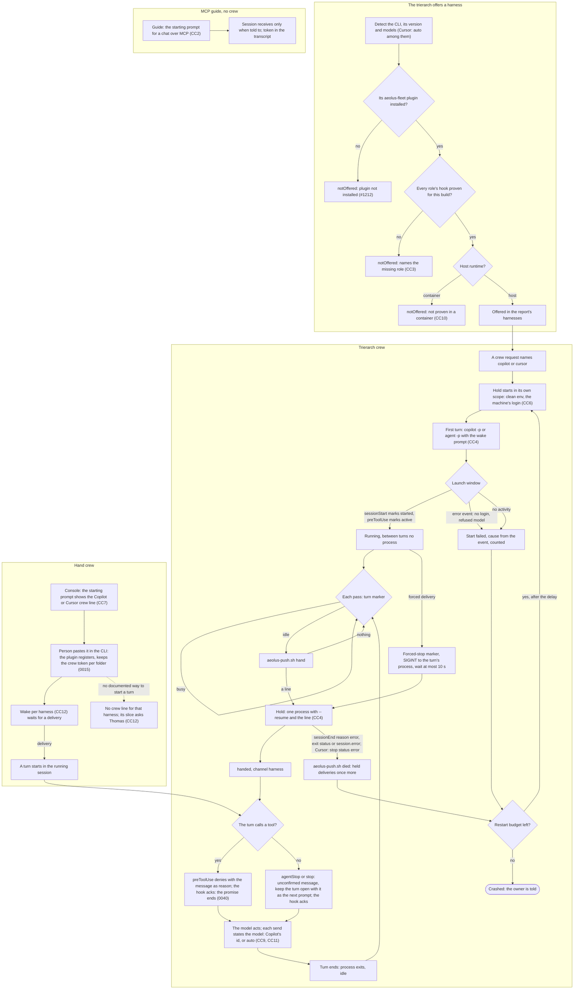

# Cursor and GitHub Copilot crew a ship

Design for Thomas's "Cursor and copilot are indeed the gap to fill" (28 Oct). Purpose, lessons and rules agreed by Thomas on 28 Oct; the flow, acceptance scenarios and slices follow from them.

It builds on the headless design (aeolus-fleet `docs/design/headless/headless.md`, approved 25 Oct), whose H5, H10, H11 and H13 say what a harness must do before the trierarch offers it, and on the api keys design for logins.

## 1. Purpose (agreed by Thomas, 28 Oct)

A session of Cursor or GitHub Copilot crews a ship as a Claude Code or Codex session does: crewed by hand with a crew line, or crewed by a trierarch from a crew request that names the harness, woken when a delivery arrives, confirming each delivery in its turn, and restarted when it dies.

For whom: agencies and product teams whose developers work in Cursor or Copilot and who ask "does it work with what we use?"; the person who runs a trierarch on a machine where only Cursor or Copilot is licensed; argo, who places crew requests and wants a ship's harness to be one more choice, not a different product.

The outcomes:
1. A person crews a ship from a Cursor or Copilot session on their machine with one crew line, as with Claude Code and Codex today, and the session wakes by itself when a delivery arrives.
2. A trierarch offers Cursor or Copilot as a harness in its report, crews a crew request naming it, hands deliveries over, reads its launch window and restarts it, as for Claude Code and Codex.
3. The crew token never reaches the model, its transcript or its screen (decision 0015), in either harness.
4. Every send states the model the session runs (decision 0018, as CC9 changes it).
5. Where a harness cannot do what the delivery protocol needs, it is not offered, and the report says why (headless H5, `notOffered`).

Not the purpose:
- Cursor's Cloud Agents and the Copilot coding agent (GitHub's cloud sessions). They run on the vendor's machines, where no trierarch runs (CC8).
- The editors themselves: Cursor's editor and VS Code agent mode. Neither can be driven headless; only the CLIs can.
- Other harnesses (Gemini CLI, Windsurf, Amp, Aider). The rules here are written so they would apply, but no adapter is built for them.
- Model governance, placement by harness cost or a login per ship.

## 2. What is true today

The trierarch and the plugin (this repository):
- **Two harnesses.** `packages/trierarch/src/adapters/harnesses.ts` holds one adapter per harness: `claude-code` and `codex`, each with its flags, risky flags, command lines, setup (`claude-code-setup.ts`, `codex-setup.ts`), detector and usage reader behind `HarnessPort` and `HarnessDetector` (`core/ports.ts`).
- **Claude Code headless** (`trierarch.md`, Session runtime): one long-lived `claude -p --input-format stream-json --output-format stream-json`, a hand-over is one user line on stdin, events in `events.jsonl`.
- **Codex headless:** one `codex exec --json` per turn, each later turn `codex exec resume <thread id>`, no process between turns. It shows a harness without a long-lived input still fits the hold.
- **The plugin** (`plugins/aeolus-fleet`): one set of Bash scripts for both harnesses, a manifest per harness (`.claude-plugin`, `.codex-plugin`) and one `hooks/hooks.json`. Identities per harness in `~/.aeolus/crews/<harness>/`.
- **The hooks the delivery protocol needs** (plugin README, decision 0040): SessionStart (start context, launch marker `started`), UserPromptSubmit (turn busy; confirms a hand-over at the prompt by adding it to the turn's context), PreToolUse (confirms a hand-over at the first tool call by denying it with the message as reason; launch marker `active`; the Codex model), Stop (turn idle; keeps the turn open with an unconfirmed message), StopFailure and Interrupt (a died turn; a refused model), PostToolUse (the report reminder).
- **Codex's gaps** already shape the plugin: no hook for a failed turn, so the trierarch reads the refusal from Codex's events; a Codex task's hooks put nothing into a running turn, so force is best effort there.
- **Hand crew wakes** through the watcher (Claude Code; Copilot as a detached background shell, CC12) or the wake bridge with `codex queue` (Codex). Codex Cloud runs no command hooks and cannot wake.
- **Core knows two crew lines** (decision 0019): the starting prompt answers one per harness, Claude Code and Codex. The harness is free text with known values (0018): `claude-code`, `claude-chat`, `codex`.

What the vendors offer (vendor docs, read 28 Oct; each to prove on a captured CLI build in its slice):

Cursor CLI (`agent`, formerly `cursor-agent`):
- **Headless:** `agent -p` with `--output-format stream-json` (events `system`, `assistant`, `tool_call`, `result`); edits only with `--force`; `--trust` skips the workspace trust question, headless only. (cursor.com/docs/cli/headless, cli/reference/parameters)
- **Resume:** `--resume <chatId>`, `--continue`, `create-chat`. A Codex-like turn per process fits. (cli/reference/parameters)
- **A long-lived channel:** `agent acp`, an Agent Client Protocol server over stdio, hidden from help. (cli/reference/parameters)
- **Hooks:** `hooks.json` (user, project, team, enterprise, plugin), events `sessionStart`, `beforeSubmitPrompt`, `preToolUse`, `postToolUse`, `postToolUseFailure`, `stop` (status completed, aborted or error), `sessionEnd` and more. `sessionStart` and `postToolUse` add context; `stop` returns `followup_message`, submitted as the next prompt (loop limit 5 by default); `beforeSubmitPrompt` can only block, never add context; `preToolUse` can deny. (cursor.com/docs/hooks)
- **Hooks in the CLI are uncertain:** the docs promise only `workspaceOpen` there; a forum update says `sessionStart`, `postToolUse` and `stop` run in the CLI; an older comment says `stop` never runs; reports of hooks not firing on Linux CLI builds (Aug 2026). (forum.cursor.com/t/cursor-cli-hooks/148511, /168407)
- **Plugins:** `.cursor-plugin/plugin.json` (or the open Agent Plugins `plugin.json`) bundling rules, skills, commands, MCP servers and hooks; the CLI takes `--plugin-dir`. Whether the CLI loads installed plugins is unconfirmed. (cursor.com/docs/plugins)
- **MCP:** `mcp.json`, shared with the editor; `--approve-mcps` in print mode. (cli/mcp)
- **Sign-in:** `agent login` (browser, or the URL printed with `NO_OPEN_BROWSER=1`), or a user API key as `CURSOR_API_KEY`. (cli/reference/authentication)
- **Plans:** Free to Ultra and Teams; which plans include the CLI is not stated; models beyond the allowance at API prices. (cursor.com/pricing)
- **Cloud Agents API** (beta): create an agent, follow-up runs (409 while one runs), `delivery: "steer"` into a running agent, SSE stream. (cursor.com/docs/cloud-agent/api/overview)

GitHub Copilot CLI (`copilot`):
- **Headless:** `copilot -p` with `--allow-all-tools` (required) and `--no-ask-user`; `--output-format json` gives JSONL. (docs.github.com, copilot-cli-reference/cli-programmatic-reference)
- **Resume:** `--continue` (the latest session of the machine, whatever its folder, as Copilot CLI 1.0.105 does it), `--resume`; sessions in `~/.copilot/session-state/<id>`; `COPILOT_HOME` moves the config folder. (cli-command-reference, cli-config-dir-reference)
- **A long-lived channel:** ACP, and the Copilot SDK, which drives a CLI server over JSON-RPC and can `send` into the current turn. (about-copilot-cli, copilot-sdk)
- **Hooks:** events `sessionStart`, `userPromptSubmitted`, `preToolUse`, `permissionRequest`, `postToolUse`, `postToolUseFailure`, `agentStop`, `errorOccurred`, `sessionEnd` and more. `sessionStart` and `postToolUse` add context; `agentStop` with `decision: "block"` and a reason runs another turn with the reason as its prompt (at most 8 in a row); `preToolUse` denies with exit 2; `userPromptSubmitted` from a config file can neither block nor add context. (hooks-reference)
- **Where hooks load:** `.github/hooks/*.json`, `~/.copilot/hooks/`, `settings.json`, a plugin's `hooks.json`, and Claude Code's `.claude/settings.json`. (hooks-configuration)
- **Plugins and skills:** `copilot plugin` with marketplaces, `~/.copilot/skills/<name>/SKILL.md`, `~/.copilot/installed-plugins/`. (cli-command-reference)
- **MCP:** `~/.copilot/mcp-config.json`, `--additional-mcp-config`; organisation MCP policies do not apply to the CLI. (about-copilot-cli)
- **Sign-in:** `copilot login --device-code` or `--with-token` on stdin; or `COPILOT_GITHUB_TOKEN`, `GH_TOKEN`, `GITHUB_TOKEN`: a fine-grained PAT with the Copilot Requests permission, never a classic PAT. Without a credential store the token lies in a plain file under `~/.copilot`. (cli-command-reference)
- **Plans:** a paid Copilot plan, which an organisation can turn off; each prompt costs a premium request times the model's multiplier, tool calls free. (copilot/concepts/billing/copilot-requests)
- **Remote control:** `copilot --remote` lets github.com steer a local session. (copilot-cli/steer-remotely)
- **Coding agent** (cloud): one branch and PR per task, in a cloud sandbox or GitHub Actions (59 minute limit), only `.github/hooks/*.json`. (coding-agent/about-coding-agent)
- **VS Code agent mode:** hooks in preview, no headless driving found. (code.visualstudio.com/docs/copilot/customization/hooks)

## 3. Lessons checked against

The fleet's rules (decisions index):
- **0015.** The plugin keeps the crew token per folder and makes every fleet call through its scripts; only a chat with no shell passes it on `/mcp`, an accepted risk. Both CLIs have a shell, so they crew through the plugin (CC5).
- **0040, 0001.** The promise ends at the agent's confirmation: a hook acks when the message comes into the turn. The trierarch never acks (CC3).
- **0018.** Every send states the model; the harness is free text with known values. `cursor` and `copilot` become known values with their crew lines (CC7); a Cursor session on its auto mode states `auto` (CC9).
- **0019.** A crew line per harness, answered by core: a new hand crew line is a core change, with `MINIMUM_CORE_VERSION` raised in the same PR (CC7).
- **0026.** A session holds no fleet credential; one adapter per harness behind the ports.
- **0027.** A crew request names the harness and options, never a flag, path or credential.
- **0039.** Container mode offers Claude Code only until another harness is proven in a container (CC10).
- **0048, 0056.** Outside agents and clients reach the fleet through the gateway, not as crewed sessions (CC8).
- **0016.** No policy: `--force`, `--allow-all-tools` and `--yolo` are the operator's risk, as `--dangerously-skip-permissions` is.
- **0063.** Model governance compares the ids a session states and a trierarch reports; `auto` is one more id there (CC9).

The trierarch's own:
- **H5.** A harness whose hooks do not run headless is not offered until they do. Cursor's CLI hooks are in doubt (CC1).
- **H10.** The hold builds the environment from nothing; a login is one named entry, never inherited (CC6).
- **H11, Codex.** A turn per process with resume fits the hold; a long-lived stdin is not required (CC4).
- **H13, #490, #888.** Documented signals, never the screen: the launch window reads hook markers and the harness's error events, each captured and tested.
- **#381, #403 (Trust, Unattended).** A session must ask nothing before its first prompt: Cursor's `--trust`, Copilot's `--allow-all-tools` and `--no-ask-user`, and any first-run question, answered by init or refused by `config check`.
- **#1085, K rules.** An API key never enters a session's environment; only the model proxy reads it. A Cursor API key or a GitHub token is an account credential, not a model key, and the proxy does not fit it (CC6).
- **#1212.** A harness without its plugin is not offered, named in `notOffered`.
- **Codex Cloud, plugin README.** A cloud session without command hooks cannot wake; the same holds for vendor cloud agents (CC8).

## 4. Rules

Thomas decided these on 28 Oct.

| # | Rule |
| --- | --- |
| CC1 | **Copilot first; Cursor after its CLI hooks are proven on a captured build.** The proof of Cursor's CLI hooks runs beside the Copilot slices. A role whose hook does not run in Cursor's CLI keeps Cursor in `notOffered`, naming that hook, and the Cursor slices stop to ask Thomas |
| CC2 | **The MCP guide now, the crewed session as the purpose.** A guide per harness says how a Cursor or Copilot session reaches the fleet over MCP with the starting prompt for a chat, and states its limits: it does not wake, and the crew token is in the transcript (0015's accepted risk) |
| CC3 | **H5 holds.** A harness is offered only when every role in the hook table below has a hook proven in its headless mode; a missing one keeps it in `notOffered`, naming the role. The turn marker alone may be filled from the process (busy when the turn's process starts, idle when it exits), as a turn per process allows, once that is proven. The trierarch never acks. A hand-over is confirmed at the turn's first tool call, or at its end when the turn calls no tool; it is never confirmed at the prompt. Force in a busy turn stays best effort, as in Codex |
| CC4 | **A turn per process with resume, as Codex.** Copilot: the first turn `copilot -p <prompt> --output-format json --allow-all-tools --no-ask-user`, every later hand-over the same with `--resume <session id>`. Cursor: `agent -p <prompt> --output-format stream-json --trust`, every later one with `--resume <chat id>`. The hold keeps the session or chat id and appends the events to `events.jsonl`; no harness process runs between turns. Force ends the turn's process with SIGINT, as for Codex. ACP is later ([#1359](https://github.com/ThomasHendrickx/aeolus-fleet/issues/1359)) |
| CC5 | **One plugin, one set of scripts.** The aeolus-fleet plugin gains a manifest and a hooks file for Copilot and for Cursor, each mapping that harness's events onto the same scripts, and a marketplace entry for each. Identities live in `~/.aeolus/crews/copilot/` and `~/.aeolus/crews/cursor/` (0015). The trierarch reaches both through `aeolus-identity.sh` and `aeolus-push.sh` only |
| CC6 | **Sign-in is the machine's own login.** The person who runs the trierarch signs the harness in (`copilot login --device-code`, `agent login`); the trierarch keeps nothing. The hold's clean environment (H10) passes none of `COPILOT_GITHUB_TOKEN`, `GH_TOKEN`, `GITHUB_TOKEN` or `CURSOR_API_KEY`. A missing or expired login fails the launch window with the harness's error event as its cause. `aeolus-trierarch login copilot` and `login cursor` with `--api-key` are refused, naming why. A kept login is later ([#1361](https://github.com/ThomasHendrickx/aeolus-fleet/issues/1361)) |
| CC7 | **Trierarch crew first, no core change; a hand crew line per harness in core once that harness is proven,** with `copilot` and `cursor` added to 0018's known harness values and 0019's crew lines in the same core PR. The console's starting prompt shows the new crew line beside Claude Code's and Codex's |
| CC8 | **Vendor cloud agents are out of this design;** a later gateway design hands them deliveries ([#1360](https://github.com/ThomasHendrickx/aeolus-fleet/issues/1360)) |
| CC9 | **Cursor's auto mode is allowed; a session on it states `auto` as its model** (Thomas, 28 Oct). This changes 0018: every send states the model, its exact id, or `auto` when the harness chooses the model per request and names none. The trierarch offers `auto` among Cursor's models in its detected options, and a crew request may name it. Core already takes `auto` (common's `modelSchema` takes any id without spaces), so core changes its decision, its blueprint and its schema's documentation, not its checks. Any harness that chooses its model per request may state `auto`; core does not check it against the ship's harness, which is self-reported (0016). The console shows `auto` as any model name, exactly as stated, with no screen change. Model governance treats `auto` as a model id like any other: in a fleet with enabled models, a session or crew request on `auto` is allowed only where the fleet enables `auto` |
| CC10 | **Host only.** Copilot and Cursor are offered on the host runtime; in container mode they are in `notOffered` until proven in a container (0039, [#1362](https://github.com/ThomasHendrickx/aeolus-fleet/issues/1362)) |
| CC11 | **The model a session states** comes from its harness, as the Codex model does today: the hook input where it carries the model, otherwise the model the trierarch started the session with. A Copilot session on auto mode, where Copilot picks the model per request, states `auto`, as CC9 allows any harness that does; a Copilot session started with `--model`, or switched to a model, states that id. Copilot's hook inputs name no model, so the plugin reads it from the session's events. A Cursor session on auto states `auto` |
| CC12 | **A hand-crewed session wakes** through what its harness documents for starting a turn in a running session, as Codex's wake bridge uses `codex queue`. A harness with no such way gets no hand crew line (CC7) and its slice stops to ask Thomas. **Copilot** (Thomas, 29 Oct): the session starts the plugin's watcher as a detached background shell (the shell tool with `mode: "async"` and `detach: true`), as Claude Code starts it as a background task; when the watcher hands a message over and exits, Copilot's completion notification starts a turn in the running session, and its hooks confirm the message there. Pinned to the tested Copilot CLI version, 1.0.105. Copilot documents it in its changelog: detached processes in the shell tool (0.0.344), automatic notifications when background shell commands complete (0.0.422), reading output from and stopping detached shells (1.0.66), and a detached command's completion notification no longer lost (1.0.71) (github.com/github/copilot-cli, `changelog.md`) |

The hook table: each role the delivery protocol needs, and the hook that plays it.

Proven for Copilot CLI 1.0.105 in `copilot -p` and with `--resume`: every Copilot hook in the table runs, and a `preToolUse` deny reason reaches the model. `errorOccurred` does not mark a died turn: it fires at every model call Copilot retries (`recoverable: true`), also in a turn that recovers and ends normally. A turn that dies ends with `sessionEnd` and reason `error`, and its process exits 1. A failure before Copilot picks a model fires no hook, only `session.error` in the JSON output. So the died turn hangs on `sessionEnd`, and `errorOccurred` stays unmapped. On a turn that a detached shell's completion notification starts (its prompt a `<system_notification>`), `preToolUse` deny and `agentStop` block run as on any turn, and the deny reason reaches the model; `read_bash`, which reads a shell's output, fires no `preToolUse`, so a turn that only reads it confirms its hand-over at `agentStop`.

| Role | Claude Code | Copilot CLI | Cursor CLI (to prove) |
| --- | --- | --- | --- |
| Start context, launch marker `started` | SessionStart | `sessionStart` | `sessionStart` |
| Turn busy | UserPromptSubmit | the turn's process starts (CC3) | the turn's process starts (CC3) |
| Turn idle; keep the turn open with an unconfirmed message | Stop | `agentStop`, `decision: "block"` with the message as reason | `stop`, `followup_message` |
| Confirm a hand-over at the first tool call; launch marker `active` | PreToolUse deny with the message as reason | `preToolUse` deny (exit 2) with the message as reason | `preToolUse` deny with the message as reason |
| Confirm a hand-over at the prompt | UserPromptSubmit | none (lost, CC3) | none (lost, CC3) |
| A died turn | StopFailure | `sessionEnd` with reason `error`, `abort` or `timeout`; the hold also reads the exit status and `session.error` | `stop` with status `error` |
| The report reminder | PostToolUse | `postToolUse` | `postToolUse` |

## 5. Flow

Unhappy paths the diagram does not show:
- **Crash between the line and `handed`.** The hook's ack may already have come; `handed` then answers `acknowledged`. If the turn never took the line, the delivery comes back from `hand` as received and is sent again: one duplicate, nothing lost.
- **A turn that calls no tool and whose stop hook does not run.** The delivery stays unconfirmed; it is handed once more at the next idle turn. This is why CC3 keeps a harness out until its stop hook is proven.
- **The stop hook's loop limit** (Cursor 5, Copilot 8 in a row). Messages waiting beyond it are handed at the next idle turn, as a busy session's are.
- **The turn's process hangs after SIGINT.** After 10 s the hold kills it; the forced line goes in with the next `--resume`. Force stays best effort (0040).
- **`--resume` refuses the id** (the session or chat is gone from the harness's store). The start fails with the error event as cause and counts against the budget; the next start begins a fresh session.
- **The login expires while a session runs.** The next turn's process fails with the harness's error event; `died` marks held deliveries once more, and each restart fails its launch window with that cause until the person signs in again.
- **The CLI is upgraded and a hook stops running.** The detected version is not the proven one; the harness goes to `notOffered`, naming the role, and running sessions are left as they are until they exit.
- **The model a Cursor request names is gone from the CLI's list.** The launch window reads the refused model from the error event, as for Codex, and the model is kept refused.
- **The trierarch restarts.** The hold keeps the session id; no harness process runs between turns, so nothing is lost and the next pass resumes.

## 6. Acceptance scenarios

Offering:
- **Given** a machine with the Copilot CLI and the aeolus-fleet plugin installed for it, **when** the trierarch reports, **then** `copilot` is in its harnesses with the models the CLI names.
- **Given** the Copilot CLI without the plugin for it, **when** the trierarch reports, **then** `copilot` is in `notOffered` with the reason that its plugin is not installed.
- **Given** a Cursor CLI build whose `stop` hook is not proven, **when** the trierarch reports, **then** `cursor` is in `notOffered`, naming the role "turn idle".
- **Given** the container runtime, **when** the trierarch reports, **then** `copilot` and `cursor` are in `notOffered`, not proven in a container.
- **Given** a Cursor CLI whose models include auto, **when** the trierarch reports, **then** `auto` is among Cursor's models.

Trierarch crew:
- **Given** a crew request naming `copilot` placed on a signed-in machine, **when** the trierarch crews it, **then** the hold runs one `copilot -p` turn, the session registers, its launch window sees `started` and `active`, and the ship is crewed.
- **Given** a machine where Copilot is not signed in, **when** a Copilot session starts, **then** the start fails with the harness's error as its cause, and no token is asked for or kept.
- **Given** a crewed Copilot session that is idle, **when** a delivery arrives, **then** the hold starts one `copilot -p --resume <id>` turn with the line, and the delivery is acknowledged when the turn's first tool call is denied with the message as reason.
- **Given** a crewed session handed a delivery whose turn calls no tool, **when** the turn ends, **then** the stop hook keeps it open with the message as the next prompt and the delivery is acknowledged.
- **Given** a busy session, **when** a forced delivery arrives, **then** the turn's process gets SIGINT, and the forced line goes in with the next `--resume` within 10 s.
- **Given** a Copilot turn that fails, ending with `sessionEnd` and reason `error`, **when** the pass reads it, **then** the held deliveries are marked once more and the session restarts within its budget.
- **Given** any Copilot or Cursor session, **when** its environment and transcript are read, **then** neither holds the crew token, a GitHub token or a Cursor API key.
- **Given** `aeolus-trierarch login copilot --api-key`, **when** it runs, **then** it is refused, naming that Copilot signs in with the machine's own login.

The model:
- **Given** a crewed Copilot session, **when** it sends, **then** the send states the model id Copilot names.
- **Given** a Cursor crew request on `auto`, **when** the session sends, **then** the send states `auto` and the fleet takes it.
- **Given** decision 0018 as changed, **when** a send states `auto`, **then** core stores it and the console shows it as any model name, exactly as stated.

Hand crew:
- **Given** the console's starting prompt for a ship awaiting crew, **when** Copilot is proven, **then** it shows a Copilot crew line beside Claude Code's and Codex's.
- **Given** a person who pastes the Copilot crew line into a Copilot CLI session, **when** a delivery arrives, **then** the session wakes by itself and confirms it in its turn.

MCP guide:
- **Given** the Cursor and Copilot guides, **when** a person follows one, **then** their session reaches the fleet over MCP with the starting prompt for a chat, and the guide says it does not wake and the crew token is in the transcript.

## 7. Slices

Each one PR. S1 and S2 may go first in any order. The Cursor slices (S7 to S11) start with S7, which runs beside S3 to S6. S9 needs S2.

| # | Repository | Slice |
| --- | --- | --- |
| S1 | aeolus-fleet | **The MCP guides (CC2).** `docs/guides/cursor.md` and `docs/guides/copilot.md`, their lines in `docs/guides/README.md`: the starting prompt for a chat in each CLI's MCP configuration, and the limits (no wake, token in the transcript) |
| S2 | aeolus-fleet | **Decision 0018 takes `auto` (CC9).** The decision's text (an exact id, or `auto` when the harness chooses the model per request), its line in `docs/decisions/README.md`, the blueprint's "Model", common's `modelSchema` documentation and a test that it takes `auto`. Core, the console and model governance accept `auto` as they accept any id today: the console shows it as stated, and governance allows it only where the fleet enables it. No `MINIMUM_CORE_VERSION` change, since no check changes |
| S3 | aeolus-fleet-trierarch | **Copilot in the plugin (CC5, CC11).** First prove on a captured Copilot CLI build that each role in the hook table runs in `copilot -p` and with `--resume`, and that a `preToolUse` deny reason reaches the model; if one does not, stop and ask Thomas. Then Copilot's manifest and hooks file mapping onto the existing scripts, its marketplace entry, `~/.aeolus/crews/copilot/`, the crew skill wording for Copilot, the plugin README |
| S4 | aeolus-fleet-trierarch | **The Copilot adapter (CC3, CC4, CC6, CC10).** A `copilot` adapter in `harnesses.ts`: detector, models, setup (answers first-run questions), command lines, a turn per process with `--resume` in the hold, the launch window from hook markers and captured error events, a died turn also from the exit status and `session.error`, SIGINT for force sent to the native Copilot process or its process group, never the npm launcher alone (the `copilot` on the PATH is a Node launcher that runs the native binary as a child: SIGINT to the launcher exits it with 130 while the native process runs the turn to its end, and fires no hook), `notOffered` for no plugin, an unproven build or the container runtime, and `login copilot --api-key` refused. Docs: `trierarch.md`, `architecture.md` |
| S5 | aeolus-fleet-trierarch | **A hand-crewed Copilot session wakes (CC12).** First prove how Copilot starts a turn in a running interactive session; if it has no documented way, stop and ask Thomas. Then the plugin's wake for Copilot |
| S6 | aeolus-fleet | **Copilot's crew line in core (CC7).** `copilot` among 0018's known harnesses, 0019's crew line for Copilot, the starting prompt answering it, the console's StartingPromptBlock with a Copilot CrewLineBlock and the LocationTag showing Copilot by name and icon. Needs a before and after mockup for Thomas |
| S7 | aeolus-fleet-trierarch | **Cursor's CLI hooks proven (CC1).** On a captured Cursor CLI build, on Linux and macOS, each role in the hook table in `agent -p` and with `--resume`; the captured hook inputs and events kept as test fixtures. A role that does not run stops the Cursor slices and goes to Thomas |
| S8 | aeolus-fleet-trierarch | **Cursor in the plugin (CC5, CC11).** Cursor's `.cursor-plugin/plugin.json` and hooks file mapping onto the existing scripts, its marketplace entry, `~/.aeolus/crews/cursor/`, the crew skill wording for Cursor, the plugin README |
| S9 | aeolus-fleet-trierarch | **The Cursor adapter (CC3, CC4, CC6, CC9, CC10).** A `cursor` adapter as S4's, with `--trust`, `auto` among its models and a session on auto stating `auto`, and `login cursor --api-key` refused |
| S10 | aeolus-fleet-trierarch | **A hand-crewed Cursor session wakes (CC12),** as S5 for Cursor, with the same stop to ask Thomas |
| S11 | aeolus-fleet | **Cursor's crew line in core (CC7),** as S6 for Cursor. Needs a before and after mockup for Thomas |

Screens that need a before and after mockup for Thomas:
- **StartingPromptBlock** (S6, S11): a CrewLineBlock for Copilot, then for Cursor, after Claude Code's and Codex's.
- **LocationTag** (S6, S11): Copilot and Cursor by name and icon, where today any other harness shows as plain text.

