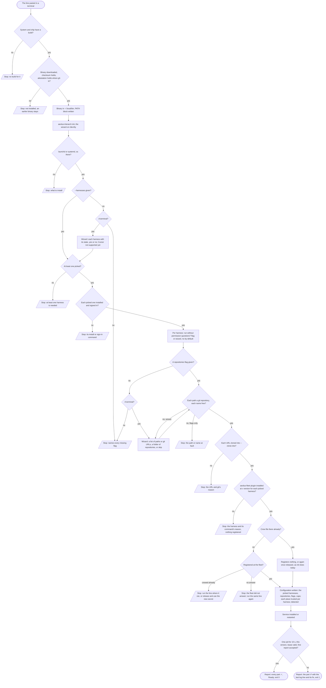

# Design: one line joins a machine, picking its harnesses and repositories (trierarch#373)

Status: purpose and Q1 to Q12 approved by Thomas on 13 Nov, each the pick below. One question is open (at the end). The flow and the dialog mockups ([overview](join-machine/mockups/README.md)) wait for his approval. Nothing is built.

This design covers the trierarch (install.sh, `init`, `start`, `status`) and, in aeolus-fleet, the trierarch plugin's setup line and the console's Join a machine dialog.

## Purpose

A person copies one line from the console's Join a machine and runs it on a fresh computer. When it ends, the computer is joined to the fleet, the trierarch runs and is on PATH, and the aeolus-fleet plugin is installed for every harness picked. A wizard asks whatever the line leaves out. The closing report says plainly what is ready and, for anything that is not, the step that fixes it. A machine that could crew nothing stops before anything is registered, and the line never says the trierarch runs while its service restarts in a loop.

## Acceptance criteria (Thomas, 13 Nov, [verbatim on #373](https://github.com/ThomasHendrickx/aeolus-fleet-trierarch/issues/373))

1. The one line from the console's Join a machine leaves the computer running and joined to the fleet.
2. At install a wizard asks, per harness, yes or no; at least one must be picked, else the whole install stops.
3. The wizard offers adding repositories: a comma separated list of local paths or git URLs, or a folder whose git repositories are all added; or skipped with a flag.
4. The aeolus-fleet plugin is installed automatically for each harness picked.
5. `aeolus-trierarch` is on PATH everywhere, and the service is started.
6. Every wizard option can also be given as a flag, so the dialog can build one complete command; the wizard stays for options left out.
7. Extra: the dialog shows only that one command.

## Lessons it is checked against

- **Claude Code is assumed.** A fresh configuration always offers it (`config.Initial`), while `init` accepts a machine with only Codex signed in. At start a missing Claude Code or Codex plugin fails the whole start (`harnessesOf`), and `Restart=always` turns that into a restart loop. Copilot's plugin is already looked up per crew, so a missing one stops nothing.
- **Nothing installs the plugin but `upgrade`**, for Claude Code and Codex at the release tag (decision 0011). Copilot's `copilot plugin install aeolus-fleet@aeolus-fleet` is only printed.
- **`init` asks nothing** and needs `--fleet-url`, `--ship-id` and `--secret`. It needs a signed-in harness, so an API-key-only machine cannot pass it (#371). Its "The trierarch runs" is printed before any check. `status` shows a restart loop as "installed, not running", with no reason.
- **Under `curl | sh`, stdin is the script**: a wizard reads `/dev/tty`. No child changes its parent shell's PATH.
- **A folder in the configuration is a place used as it is.** AC3's folder is a folder of repositories, each added as a repository: called "a folder of repositories" here, never "a folder".
- **The setup line is the trierarch plugin's** (docs/trierarch.md, "A machine joins"), and the dialog is the console's. Both are in aeolus-fleet.
- The issue's "no `KillMode=process`" does not match the unit written since v0.37.0 (#479): it is checked again on a fresh install, not designed for.

## Decisions

1. **Go only.** The Node package stays as it is, for existing machines.
2. **The harnesses offered are those with an adapter**: Claude Code, Codex and Copilot. A Cursor CLI found on the machine is listed as not supported yet and cannot be picked, so a Cursor-only machine stops at the wizard with that reason.
3. **A picked harness not installed or not signed in stops the install** before anything is registered, naming the vendor's install or sign-in command. The installer installs no vendor CLI. An API key alone stays with #371.
4. **Only the picked harnesses are written to the configuration**, and no harness is a default. Each harness's plugin is looked up per crew, as Copilot's is: a missing one is named in the report's `notOffered`, never a failed start.
5. **The plugins are installed before registering**, for each picked harness at tag `v<this version>`: Claude Code and Codex by upgrade's plugin step, Copilot by `copilot plugin install`. Any failure stops the install with nothing registered.
6. **Repositories**: `--repositories <list>` (comma or semicolon separated, each a local path or a git URL), `--repositories-in <folder>` (every git repository directly in the folder, none deeper), `--no-repositories` to skip. Each is named by its folder's or URL's last part; two of one name make the wizard ask again, or with flags only stop the install. A URL is cloned into `--clone-into <folder>`, `~/repositories` by default.
7. **No terminal and an option left out stops the install**, naming every missing flag, with nothing registered. `--yes` takes every default except the harnesses, which are always picked.
8. **PATH**: a marked block, written once, in the login file of the person's `$SHELL` (`~/.zprofile` or `~/.bash_profile`) and in `~/.profile`. The report says the current shell needs a new terminal.
9. **Running and joined means**: the service keeps one pid for 10 seconds, running.json says this version, the lease is valid and the first report was accepted. Otherwise the line says what failed, with the last log line, and exits 1. `status` reads the same: a restart loop with its count and its last error.
10. **Per picked harness the wizard asks "run without permission questions?"**, no by default, as `--unattended <harness,...>`. Caps are flags only (`--max-ships`, `--max-running`, 4 and 2 by default) and the report shows them.
11. **The closing report** is one aligned line per part, marked ✓, ✗ or !, in the style's tones (below). `--json` keeps its shape and gains a `checks` list.
12. **The dialog**: its name step gains optional Harnesses and Repositories fields; each one filled becomes a flag, so a dialog filled in full builds a line that asks nothing. Once joined it shows only the one line. The trierarch plugin's join takes the options and builds the whole line; the console builds none.

### Flags

| Flag | Wizard step | Without it, and no terminal |
| --- | --- | --- |
| `--fleet-url`, `--ship-id`, `--secret`, `--plugin-ship-id` | none, from the setup line | stops, as today |
| `--harnesses <list>` of `claude-code`, `codex`, `copilot` | Harnesses | stops |
| `--unattended <list>`, a subset of the harnesses | Harnesses, per harness | none run without permission questions |
| `--repositories <list>`, `--repositories-in <folder>`, `--no-repositories` | Repositories | stops |
| `--clone-into <folder>` | Repositories, when a URL is given | `~/repositories` |
| `--max-ships <n>`, `--max-running <n>` | none | 4 and 2 |
| `--yes` | every step with a default | |

## The flow



Nothing is registered before the plugins are installed, so every stop above registration leaves the fleet unchanged, and running the same line again starts over. After registration, the same line goes on where the setup stopped, as `init` does today.

## The closing report

Before (0.38.10):

```
Installing aeolus-trierarch 0.38.10 for linux amd64
Installed /home/<user>/.local/bin/aeolus-trierarch, having checked its checksum only
gh is not installed, so the attestation was not checked. To check it by hand (https://cli.github.com):
  gh attestation verify /home/<user>/.local/bin/aeolus-trierarch --repo ... --signer-workflow ...
Note: /home/<user>/.local/bin is not in your PATH
Registered shp_... at https://fleet.example: its crew token is kept in ..., readable by you only. The secret is written nowhere.
It takes the trusted repositories from the trierarch plugin's ship shp_....
Configuration written at /home/<user>/.aeolus/trierarch/config.json.
It has no repository or folder yet, so it can crew no request: add one with aeolus-trierarch add.
Claude Code trusts /home/<user>/.aeolus/trierarch/ships, so a session there starts with no trust question, ...
The trierarch runs, and starts again at every login (...). See it with aeolus-trierarch status.
The new process has not said its version after 30 seconds: aeolus-trierarch status shows the version it runs once it does.
```

After, ready:

```
aeolus-trierarch 0.39.0: trierarch-mac joined https://fleet.example

  ✓ Installed     ~/.local/bin/aeolus-trierarch, checksum and attestation checked
  ✓ On PATH       added to ~/.zprofile and ~/.profile (this terminal: open a new one)
  ✓ Fleet         trierarch-mac registered, lease valid, first report accepted
  ✓ Claude Code   2.1.4, signed in, aeolus-fleet plugin 0.39.0, runs without permission questions
  ✓ Codex         0.60.0, signed in, aeolus-fleet plugin 0.39.0, asks before each command
  ✓ Repositories  web (~/code/web), api (~/code/api), docs (cloned to ~/repositories/docs)
  ✓ Service       running for 10 s, pid 4242, starts again at every login
    Caps          4 ships, 2 running

Ready. Check it any time with: aeolus-trierarch status
```

After, not ready (exit 1):

```
  ✗ Service       not running: restarted 6 times in 30 s, last saying
                  "the aeolus-fleet plugin is not installed for Claude Code (...)"

Not ready: fix the line marked ✗, then run the same line again.
```

## Open question

- Does anything still need the trierarch's starting prompt (decision 0019) once the dialog shows only the line? The dialog mockups drop it and the crew lines.
