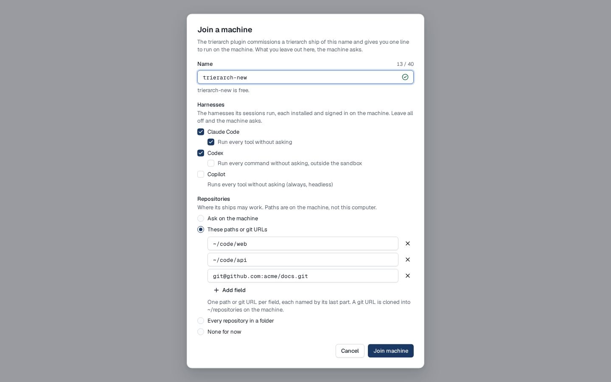
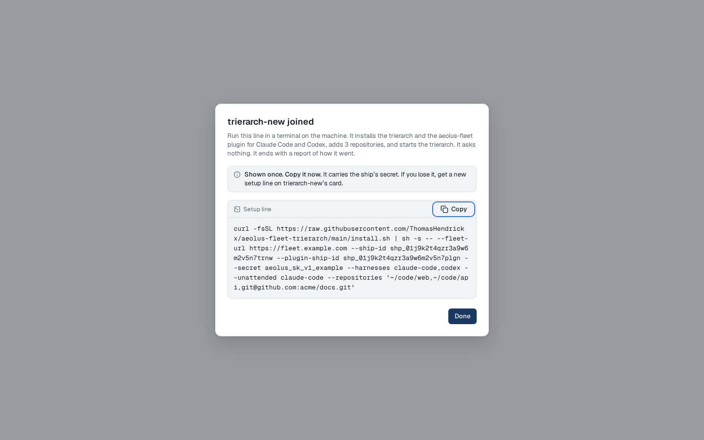

# Join a machine dialog: before and after

Mockups for decision 12 of the [join-machine design](../../join-machine.md). They wait for Thomas's approval. The dialog is aeolus-fleet's `packages/console/features/trierarchs/ui/organisms/join-machine-dialog.tsx`; its setup line is built by the trierarch plugin.

Drawn with the console's own parts (Dialog, Input, Checkbox, RadioGroup, InlineError, SetupLineBlock, Button), the path or git URL rows as the console's SubRepositoriesField draws its rows, rendered in the console's Storybook in Chromium at 375 × 812 and 1440 × 900, light and dark. The before frames are today's JoinMachineDialog stories. On phone the dialog is full screen, as today; where the form runs past the screen, a second phone frame shows it scrolled to its end. Addresses, ids and the secret are placeholders.

## What changes

- **The name step gains two optional fields.** Harnesses: Claude Code, Codex and Copilot, each with "without asking" beneath it (Copilot always runs without asking, headless, so it shows that as a line). Ticking a harness's "without asking" also ticks that harness; unticking the harness unticks its "without asking". Repositories: Ask on the machine (default), These paths or git URLs, Every repository in a folder, None for now. Each one filled becomes a flag of the line; each one left out is asked on the machine.
- **These paths or git URLs is one field per path or git URL**, each with its own remove, and Add field adds an empty one. A comma separated list is for the command line only.
- **The dialog does not ask where git URLs are cloned.** A git URL is cloned into `~/repositories` on the machine, and the hint under the fields says so; only the command line's `--clone-into` picks another folder.
- **The joined step shows only the one line**, with what it will do and whether it asks anything. The starting prompt and the crew lines leave this dialog (the open question in the design: does anything still need the starting prompt, decision 0019).
- Cursor is not offered: it has no adapter yet (design decision 2).

## Frames

| Frame | What it shows | Files |
| --- | --- | --- |
| before-name | Before: the name step, today | [375 light](before-name-375-light.png) [375 dark](before-name-375-dark.png) [1440 light](before-name-1440-light.png) [1440 dark](before-name-1440-dark.png) |
| before-joining | Before: joining, the action busy | [375 light](before-joining-375-light.png) [375 dark](before-joining-375-dark.png) [1440 light](before-joining-1440-light.png) [1440 dark](before-joining-1440-dark.png) |
| before-failed | Before: the plugin refused, the input kept | [375 light](before-failed-375-light.png) [375 dark](before-failed-375-dark.png) [1440 light](before-failed-1440-light.png) [1440 dark](before-failed-1440-dark.png) |
| before-joined | Before: joined, the setup line, the starting prompt and the crew lines, each shown once | [375 light](before-joined-375-light.png) [375 dark](before-joined-375-dark.png) [1440 light](before-joined-1440-light.png) [1440 dark](before-joined-1440-dark.png) |
| after-empty | The name step as it opens: Name, Harnesses all off with each "without asking" off beneath it, Repositories on Ask on the machine. Joined like this, the line asks for both on the machine | [375 light](after-empty-375-light.png) [375 dark](after-empty-375-dark.png) [1440 light](after-empty-1440-light.png) [1440 dark](after-empty-1440-dark.png) |
| after-named | A free name; nothing else filled | [375 light](after-named-375-light.png) [375 dark](after-named-375-dark.png) [1440 light](after-named-1440-light.png) [1440 dark](after-named-1440-dark.png) |
| after-taken | A name an active ship has: the field error, Join machine off | [375 light](after-taken-375-light.png) [375 dark](after-taken-375-dark.png) [1440 light](after-taken-1440-light.png) [1440 dark](after-taken-1440-dark.png) |
| after-filled | Filled in full: Claude Code (without asking) and Codex, three fields (two paths and a git URL), each with its remove, Add field beneath, and where git URLs are cloned. Joined like this, the line asks nothing | [375 light](after-filled-375-light.png) [375 dark](after-filled-375-dark.png) [1440 light](after-filled-1440-light.png) [1440 dark](after-filled-1440-dark.png) [375 scrolled light](after-filled-375-scrolled-light.png) [375 scrolled dark](after-filled-375-scrolled-dark.png) |
| after-field-added | After Add field on after-filled: a fourth, empty field, with its remove | [375 light](after-field-added-375-light.png) [375 dark](after-field-added-375-dark.png) [1440 light](after-field-added-1440-light.png) [1440 dark](after-field-added-1440-dark.png) [375 scrolled light](after-field-added-375-scrolled-light.png) [375 scrolled dark](after-field-added-375-scrolled-dark.png) |
| after-unattended-ticked | After ticking Claude Code's "Run every tool without asking" on after-named: Claude Code is ticked with it | [375 light](after-unattended-ticked-375-light.png) [375 dark](after-unattended-ticked-375-dark.png) [1440 light](after-unattended-ticked-1440-light.png) [1440 dark](after-unattended-ticked-1440-dark.png) |
| after-harness-unticked | After unticking Claude Code on after-filled: its "Run every tool without asking" is unticked with it | [375 light](after-harness-unticked-375-light.png) [375 dark](after-harness-unticked-375-dark.png) [1440 light](after-harness-unticked-1440-light.png) [1440 dark](after-harness-unticked-1440-dark.png) [375 scrolled light](after-harness-unticked-375-scrolled-light.png) [375 scrolled dark](after-harness-unticked-375-scrolled-dark.png) |
| after-folder | Codex only, every repository in ~/code | [375 light](after-folder-375-light.png) [375 dark](after-folder-375-dark.png) [1440 light](after-folder-1440-light.png) [1440 dark](after-folder-1440-dark.png) [375 scrolled light](after-folder-375-scrolled-light.png) [375 scrolled dark](after-folder-375-scrolled-dark.png) |
| after-no-repositories | Copilot only (it always runs without asking, headless), None for now | [375 light](after-no-repositories-375-light.png) [375 dark](after-no-repositories-375-dark.png) [1440 light](after-no-repositories-1440-light.png) [1440 dark](after-no-repositories-1440-dark.png) |
| after-invalid-list | A field that is no path from / or ~ and no git URL: the error under that field, Join machine off | [375 light](after-invalid-list-375-light.png) [375 dark](after-invalid-list-375-dark.png) [1440 light](after-invalid-list-1440-light.png) [1440 dark](after-invalid-list-1440-dark.png) [375 scrolled light](after-invalid-list-375-scrolled-light.png) [375 scrolled dark](after-invalid-list-375-scrolled-dark.png) |
| after-joining | Joining: the action busy, every field and Cancel off | [375 light](after-joining-375-light.png) [375 dark](after-joining-375-dark.png) [1440 light](after-joining-1440-light.png) [1440 dark](after-joining-1440-dark.png) [375 scrolled light](after-joining-375-scrolled-light.png) [375 scrolled dark](after-joining-375-scrolled-dark.png) |
| after-failed | The plugin refused or did not answer: the reason, nothing changed, the input kept | [375 light](after-failed-375-light.png) [375 dark](after-failed-375-dark.png) [1440 light](after-failed-1440-light.png) [1440 dark](after-failed-1440-dark.png) [375 scrolled light](after-failed-375-scrolled-light.png) [375 scrolled dark](after-failed-375-scrolled-dark.png) |
| after-joined-complete | Joined, filled in full: only the one line, with every flag but `--clone-into` (the git URL goes to `~/repositories`), and what it will do. Starting prompt and crew lines are gone | [375 light](after-joined-complete-375-light.png) [375 dark](after-joined-complete-375-dark.png) [1440 light](after-joined-complete-1440-light.png) [1440 dark](after-joined-complete-1440-dark.png) |
| after-joined-asks | Joined, nothing but the name filled: the line, and that the machine asks for the harnesses and repositories | [375 light](after-joined-asks-375-light.png) [375 dark](after-joined-asks-375-dark.png) [1440 light](after-joined-asks-1440-light.png) [1440 dark](after-joined-asks-1440-dark.png) |
| after-joined-copy-failed | Copy failed: select the text and copy it by hand | [375 light](after-joined-copy-failed-375-light.png) [375 dark](after-joined-copy-failed-375-dark.png) [1440 light](after-joined-copy-failed-1440-light.png) [1440 dark](after-joined-copy-failed-1440-dark.png) |

## For the build

- Each field is checked in the console for shape only (a path from `/` or `~`, or a git URL); whether they exist is checked on the machine.
- Each harness's "without asking" checkbox is labelled with what it does, never with the flag.
- The fields are joined into `--repositories` by the trierarch plugin; an empty field is left out.
- The line is built by the trierarch plugin from the options, never by the console, and each path is shell-quoted there.
