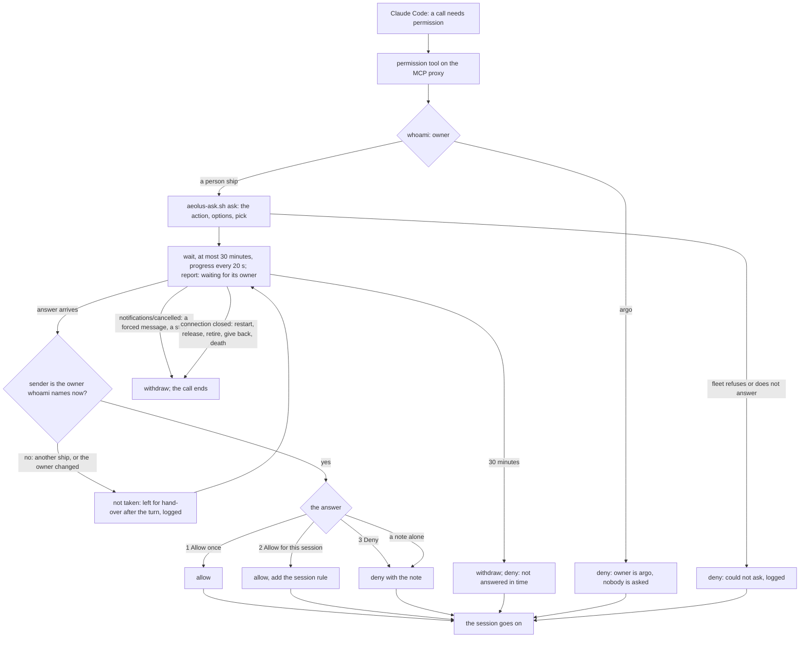
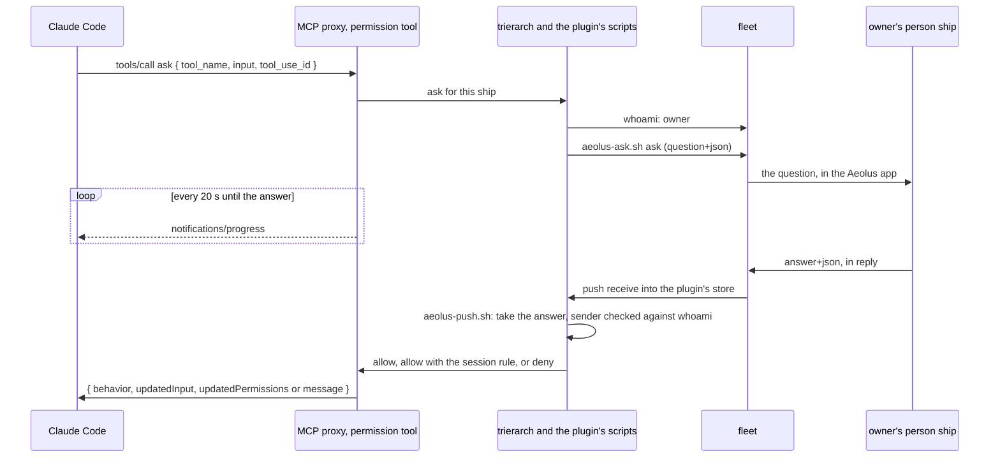

# Design: a session's permission question reaches its owner in the Aeolus app (#374)

Status: purpose and step 1 approved by Thomas on 13 Nov; this flow is for his approval. Nothing is built.

## Purpose

Thomas: "the fix is to have the ask for permissions linked to the app for asking permissions is here the structural fix".

When a Claude Code session the trierarch crews needs permission for an action its permission mode does not allow (editing a file, running a command), the question goes to the ship's owner as a question in the Aeolus app, answered from the owner's person ship. The session waits, then goes on with the owner's answer. Only the owner's answer counts. Without it a session either gets a refusal, its turn ending without an answer, or with the bypass flags acts without asking anyone.

Not in it: Codex and Copilot (each its own design), what a harness counts as needing permission, and the operator's choice to run with the bypass flags, which stays the operator's risk.

## Lessons to check against

- **argo is the fail-safe** (decision 0057). A permission ask goes only to a person ship; an argo-owned ship keeps the refusal. Ordinary work is never routed to argo, which is why ships a person commissions must get that person's ship as owner (below).
- **No policy** (0016). The tool is mechanism, like `--disallowedTools`: it narrows what a session does without a person, and the bypass flags stay the operator's.
- **Nobody watches the pane** (#457, #460, #585). Nothing waits in a terminal.
- **The crew token stays out of the session** (decision 0026). The trierarch asks, over the ship's socket.
- **The trierarch reaches the plugin only through its scripts.** It asks with `aeolus-ask.sh` and takes the answer through `aeolus-push.sh`.
- **Hand-over** (decision 0040). An answer to an open ask is never handed to the session as a prompt.
- **A guarantee without a test does not exist.** Owner-only approval, the 30-minute limit and the withdrawal on every end each get one.

## What Claude Code does (2.1.312, tried)

- `claude -p --permission-prompt-tool mcp__<server>__<tool>` puts every call that would ask a person to that MCP tool, after hooks, deny rules, ask rules, the mode and allow rules. A deny rule always wins.
- The tool gets `{ "tool_name", "input", "tool_use_id" }`, and `_meta["claudecode/toolUseId"]`; no permission suggestions. It answers one text content holding JSON:
  - `{ "behavior": "allow", "updatedInput": <input> }`: the call runs.
  - `{ "behavior": "allow", "updatedInput": <input>, "updatedPermissions": [{ "type": "addRules", "rules": [{ "toolName": "Write" }], "behavior": "allow", "destination": "session" }] }`: the call runs, and a later call the rule matches runs without asking, for this process. A rule `Bash` with the exact command as `ruleContent` did not match that command again when it held a redirection (`date +%Y > year.txt`): it asked again.
  - `{ "behavior": "deny", "message": "..." }`: the call is refused, the model sees the message as the tool's error, and the result lists it in `permission_denials`.
- The tool is not in the model's tool list: the model cannot call it.
- An interrupt (the hold's `control_request` `interrupt`) while the tool waits sends the server `notifications/cancelled` for that call; nothing runs.
- A long wait holds only while the tool sends progress. Claude Code aborts a call that "sent no response or progress" for a while, and the model sees a tool error, not a denial: after 1800 s over stdio, after 60 s over HTTP answered as one JSON body, and after 300 s with `MCP_TOOL_TIMEOUT` raised. Over HTTP as a stream (server-sent events) with `notifications/progress` every 20 s on the call's `progressToken`, a wait of 31 minutes held and the call ran.

## What the trierarch does

1. **Every Claude Code session it starts without a bypass flag** (`--dangerously-skip-permissions`, `--permission-mode bypassPermissions`) gets the permission tool: the MCP proxy serves it for the ship as server `aeolus-permissions`, in the `--mcp-config` file the trierarch already writes per session, and the command line names it with `--permission-prompt-tool mcp__aeolus-permissions__ask`. The MCP proxy now runs whenever a Claude Code session does.
2. **Only for a person-owned ship.** On each call it reads the owner with whoami. Owned by argo, the call is denied at once with "this ship's owner is argo: nobody is asked", as today's refusal.
3. **It asks.** It runs the plugin's `aeolus-ask.sh ask` from the ship's folder, stating the session's model, with:
   - title: the tool and the action, such as "Run `npm install`" or "Edit `src/a.ts`";
   - context: the ship, its task's message if one is handed, and the tool's whole input, cut at 4 KB with how much was cut;
   - options: 1 "Allow once"; 2 "Allow for this session", whose detail names the rule; 3 "Deny";
   - pick: open question P1.
4. **It waits** at most 30 minutes, the ship's report saying "waiting for its owner: <title>". It answers the call as a stream and sends `notifications/progress` every 20 seconds, so Claude Code never aborts it as silent. Meanwhile the session's turn is busy, as any running tool call.
5. **It takes the answer before hand-over.** A reply of `application/vnd.aeolus.answer+json` to the ask's question is taken out of the plugin's store through `aeolus-push.sh` and never handed as a line. It counts only when its sender is the owner whoami names when it arrives.
6. **The answer becomes the tool's result.** 1 allows the call. 2 allows it and adds the rule for the session; the rule names the exact command for `Bash`, the exact path for the file tools, else the tool. 3 denies it with the owner's note, or "The owner denied it." A note alone denies it with the note, so the session can explain and try again.
7. **Every other end withdraws the question** (`aeolus-ask.sh withdraw`) and the call ends:
   - after 30 minutes: denied with "not answered in 30 minutes; the question was withdrawn". The session goes on;
   - `notifications/cancelled`, from a forced message's interrupt or any other stop of the turn;
   - the connection closes: a restart, a release, a retire, a give back, the session dying.
8. **An answer that does not count** is not the tool's result. It is acknowledged and left in the store, handed to the session as an ordinary message after its turn, and logged with its sender. An answer to a question already withdrawn is the same.
9. **The session rule ends with the process.** A restart (`--continue`) asks again.

## The flow

## Open questions for Thomas

- **P1. The question's pick.** (a) Deny, with why "nothing runs without your yes". (b) Allow once, with why "the session needs it for its task". **Pick (a)**: the pick is one tap away, and a tap should never let something run unseen.
- **P2. The owner changed while the question was open.** (a) The former owner's answer does not count and the ask waits out its 30 minutes. (b) On such an answer the question is replaced to the new owner, for the time left. **Pick (b)**: (a) leaves the session waiting on a question nobody can answer.

## Not known

- Whether the MCP proxy's process may use the ship's socket, which takes only processes of the session or of the trierarch, or must hand the ask to the trierarch.
- Whether `aeolus-push.sh` can take one answer out of the store today, or needs a call of its own.
- The exact rule form for a file path in `updatedPermissions`: tried for the whole tool only.

## The core change: ships a person commissions are that person's (aeolus-fleet)

Decision 0045 already gives an account's commission the account's person ship as owner. Today most ships are argo's anyway: the person commissions from the console signed in as argo, or through an agent ship that argo owns, such as an orchestrator, whose ships get its owner. With argo as owner, the permission tool asks nobody (step 2 above), so this change is what makes it reach a person. It lands in aeolus-fleet, as a change to 0045 and 0057.

- **O1. Who is "the person" when the console is signed in as argo**, which is no account? (a) Commission asks for the owner, a person ship, preselecting the last one picked. (b) A console sign-in as argo names a person ship once, used for each commission. (c) Only accounts (pagasae) count; argo's commissions stay argo's. **Pick (a)**: it says at the moment it matters who answers for the ship, without a new kind of sign-in.
- **O2. Ships an agent ship commissions for a person** (an orchestrator): (a) they keep the commissioner's owner, so the orchestrator itself must be the person's; (b) the commission names the person ship it is for, with `fleet:on-behalf`. **Pick (a)**: 0045 already does it; only the orchestrator's owner changes.
- **O3. Ships that exist now.** (a) Only new commissions. (b) Also set each argo-owned ship's owner once with `fleet.setOwner`, by hand. **Pick (b)**, by hand: it needs no migration and is a few calls.
