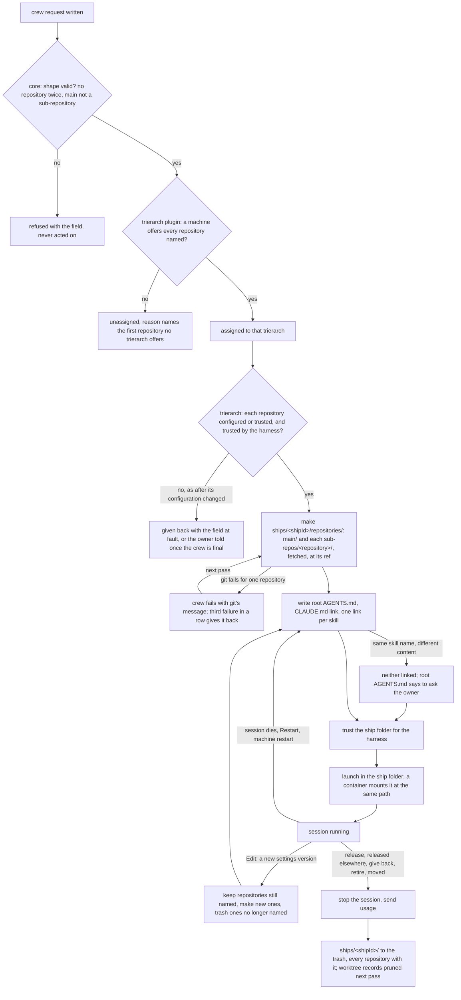

# Design: a ship folder with a main repository and sub-repositories (aeolus-fleet#1759)

Status: approved by Thomas on 12 Nov (purpose, Q1 to Q7 each the first option, Q8 his own option 2; the one-time rewrite of point 2, the name `repositories/` and no limit on sub-repositories). Nothing is built.

This design covers core (the crew settings, their check, placement, the console) and the trierarch (the folder, the harnesses, containers, the aeolus-fleet plugin).

## Purpose

A ship works in one folder of its own that holds its main repository, which says how it works, and the repositories it works on beside it, so its session, whatever its harness, is told the same at its start to work from the main repository, and works in every repository it needs without one ever sitting inside another.

Thomas, 12 Nov, settled (aeolus-fleet#1759):

1. The crew request names a main repository and its sub-repositories.
2. The trierarch builds one folder per ship: `main/` and `sub-repos/<repo>/` side by side, the session starting in the ship folder, so no repository ever sits inside another and nothing can be committed into the wrong one.
3. The trierarch writes a fixed root CLAUDE.md and AGENTS.md in the ship folder at every start, pointing into `main/` to start there, plus the basic facts of the layout that hold for every ship: "this is aeolus so it maximum descibes how the trierarch structure needs to be used."
4. Container sessions mount the ship folder, same layout inside.
5. It replaces today's per-repository read-only checkouts: "No use in patching it, it reads like a fundamental difference so no use in reusing code it feels like." Before 1.0 there is no compatibility work (decision 0013).
6. It builds on the per-ship folder of the disk design (#343, slices #346 to #352).

Thomas, 12 Nov, on the lessons below:

7. On the harnesses (lesson 15): "AGENTS.md and a sim linked CLAUDE.md (points to AGENTS.md) both are written in root. Behaviour is the same across all session types. No difference. CLAUDE.md is simlinked to have minimal differences." The root holds one AGENTS.md and CLAUDE.md as a symlink to it, for every harness; no harness gets an import or a file of its own.
8. On placement (lesson 3): "indeed all need to be available or it is refused." A crew request naming a repository a machine lacks is refused there.
9. Lessons 12 (two levels) and 7 (a container gets clones, decision 0039): agreed.

## What changes

### In core (aeolus-fleet)

1. **The workspace names repositories** (Q2): `{ kind: worktree, repository, ref? }` becomes `{ kind: repositories, main: { repository, ref? }, subRepositories: [{ repository, ref? }] }` in `common`'s crew settings, each a `trierarchNameSchema` name. `{ kind: folder, name }` stays as it is (Q3). Core refuses settings that name a repository twice or the main repository among the sub-repositories (decision 0029); the number of sub-repositories has no limit of its own, the 16 KB settings cap bounds it; it never checks a name against a machine. Settings still carry no path or flag (decision 0027).
2. **No compatibility path** (decision 0013): crew requests and squadrons templates stored with a `worktree` workspace are rewritten in the same release as `repositories` with that repository as main and no sub-repositories, so no standing request becomes settings no trierarch can read.
3. **The console's crew settings fields** pick the main repository and any sub-repositories from what the machines offer, each with an optional ref, and show them back on the ship and trierarch pages.

### In the trierarch plugin

4. **Placement places a request only on a machine that offers every repository it names** (Thomas: "all need to be available or it is refused"): the main repository and each sub-repository among the report's `workspaces.repositories` (configured or trusted). Otherwise the reason names the first one no trierarch offers, such as `no trierarch offering claude-code has repository skills`.

### In the trierarch

5. **The ship folder takes the place of `worktree/`** (Q1): `ships/<shipId>/repositories/`, beside the ship's `home/`, `tmp/`, `containers/` and sockets of the disk design, which stay out of it.

```
ships/<shipId>/
  repositories/               the ship folder: the session starts here
    AGENTS.md                 written by the trierarch at every start
    CLAUDE.md -> AGENTS.md
    .claude/skills/<skill>    one link per skill, to a repository's own (Q6, Q8)
    .agents/skills/<skill>    the same for Codex
    main/                     the main repository
    sub-repos/<repository>/   each sub-repository
  home/  tmp/  containers/  podman.sock  fleet.sock     as the disk design has them
```

6. **Every repository is a working one** (Q4): on the host each is its own git worktree of its configured or trusted repository, in a container its own clone (`--reference` with `--dissociate`, decision 0039); each fetched first and detached at `origin/<ref>`, or origin's default branch with no ref, as a worktree is made today, with its origin to push to. The ship folder itself is no git repository, so nothing is committed outside one.
7. **The root AGENTS.md is the same for every harness** (Thomas, point 7): CLAUDE.md is a symlink to it. It says that the session works from `main/` and reads `main/AGENTS.md` (its CLAUDE.md where it has none) first; names each sub-repository and says to read its AGENTS.md (or CLAUDE.md) before working in it; and gives the facts of the layout every ship shares: each repository commits, branches and pushes on its own, the ship folder holds no repository of its own, and the files and links at the root are the trierarch's, written again at every start.
8. **Skills by one link per skill** (Q6, Q8): the root's `.claude/skills/<skill>` links to each repository's `.claude/skills/<skill>`, and `.agents/skills/<skill>` to each `.agents/skills/<skill>`, from `main/` and every sub-repository, written again at every start. A skill name two repositories share: with the same content, one link and nothing said; with different content, neither linked, and the root AGENTS.md names both and where they are and says to ask the ship's owner for guidance before using either. The first slice proves that Claude Code and Codex load a linked skill; for a harness that does not, the root AGENTS.md says where each skill is instead.
9. **A container mounts the ship folder** at its own path, the same layout inside (purpose, point 4), in place of the workspace and the checkouts' read-only mounts.
10. **Trust**: the ship folder is trusted for every configured harness before every launch, as a place is today (#381), and the trust goes with the ship's folder.
11. **A new settings version** crews the ship again in the same ship folder, as today (docs/trierarch.md, "Crashed and Restart"): a repository still named stays as it is, one newly named is made, one no longer named goes to the trash, and a main naming another repository replaces `main/`.
12. **Read-only checkouts go** (purpose, point 5; Q5, Q7): the `checkouts` setting, `checkouts/<shipId>/`, `--add-dir`, the `:ro` mounts, the identity's `--checkout`, the plugin's start-context lines about checkouts, `aeolus-checkouts.sh refresh` and `POST /trierarch/checkouts/refresh`. A configuration still naming `checkouts` is refused at start and by `config check`, naming the line to remove and that sub-repositories come from the crew request.

## The whole life of a ship folder



Unhappy paths:

- **A repository cannot be made** (fetch fails, a ref origin lacks, a trusted clone the machine has no access to): the crew fails with git's message, the repositories already made stay for the next pass, and the third failure in a row gives the request back (#827).
- **A machine stops offering a named repository** while its ship runs: the next launch's check finds it and handles it as settings it cannot crew, as today.
- **Two repositories ship a skill of one name with different content**: the session starts, neither is linked, and the session asks its owner before using either.
- **A harness does not follow a linked skill**: found by the first slice's test before anything is built on it; that harness gets the root AGENTS.md's words saying where each skill is.
- **A session writes into the ship folder's root**: it is no repository, so nothing there is committed; the trierarch's own files and links are written again at the next start.

## Build slices

In build order; each is an issue linked under aeolus-fleet#1759 and states when it is done.

1. [aeolus-fleet-trierarch#359](https://github.com/ThomasHendrickx/aeolus-fleet-trierarch/issues/359): prove Claude Code and Codex load a linked skill from a folder of repositories.
2. [aeolus-fleet#1760](https://github.com/ThomasHendrickx/aeolus-fleet/issues/1760): a crew request's workspace names a main repository and its sub-repositories (core, `common`, console).
3. [aeolus-fleet-squadrons#46](https://github.com/ThomasHendrickx/aeolus-fleet-squadrons/issues/46): squadron templates name a main repository and its sub-repositories.
4. [aeolus-fleet-trierarch-plugin#73](https://github.com/ThomasHendrickx/aeolus-fleet-trierarch-plugin/issues/73): placement places a request only where every repository it names is offered.
5. [aeolus-fleet-trierarch#360](https://github.com/ThomasHendrickx/aeolus-fleet-trierarch/issues/360): a ship works in `ships/<shipId>/repositories/` with `main/` and `sub-repos/<repository>/`; after #346.
6. [aeolus-fleet-trierarch#361](https://github.com/ThomasHendrickx/aeolus-fleet-trierarch/issues/361): one link per skill from every repository, and a clash asks the owner.
7. [aeolus-fleet-trierarch#362](https://github.com/ThomasHendrickx/aeolus-fleet-trierarch/issues/362): read-only checkouts go, and a configuration naming `checkouts` is refused.

## Lessons to check against

### The crew request in core

1. **Settings never carry paths or command-line flags** (decision 0027): a workspace names a repository or folder from the trierarch's configuration. Today the workspace is one of `{ kind: worktree, repository, ref? }` or `{ kind: folder, name }` (`packages/common/src/trierarch/crew-settings.ts`), each name a `trierarchNameSchema` (lowercase, no slash). There is no field for a second repository. The settings are at most 16 KB.
2. **Core checks the settings' shape and never acts on them; what fits a trierarch stays placement's to explain** (decision 0029). `requestCrew` checks size, shape and machine labels, never a repository name against a machine.
3. **Placement matches the workspace against what each machine offers**: the report's `workspaces: { repositories, folders }` (`packages/common/src/trierarch/report-details.ts`), read by the trierarch plugin. A refusal reads `no trierarch offering claude-code has repository aeolus-fleet`. The company worktrees design (31 Oct) found the gap of today's checkouts: "Placement never reads checkouts", so a machine without them still crewed a company ship. Every repository a request names has to be one placement can match.
4. **Three writers build crew settings**: the console's crew settings fields and commission dialog (`crew-settings-fields.tsx`, `commission-ship.tsx`), squadrons (`crewRequest` is on its row of docs/compatibility.md) and any requester through `POST /api/v1/fleet/crewRequest`. The trierarch only reads them, through `fleet.assignedCrewRequests`. A changed shape reaches each writer, and the Go trierarch, which has no `common` to import and writes the shapes again.
5. **No compatibility path before 1.0** (decision 0013), and `MINIMUM_CORE_VERSION` is raised in the same PR that needs the newer core (CLAUDE.md).

### The trierarch today

6. **A ship's workspace is one folder, and that folder is the ship** (core decision 0015: "One ship per folder; a worktree is its own folder"). The session starts there; the aeolus-fleet plugin's identity file lives there; the launch and turn markers, the trust check, the folder's processes and the Claude Code conversation (`--continue` reads the conversation of that folder) are all keyed by it.
7. **On the host the workspace is a git worktree** under `worktrees/<repository>/<ship>`, fetched first and detached at `origin/<ref>` or origin's default branch (`go/internal/workspace/workspace.go`). **In a container it is a per-ship clone**, `--reference` with `--dissociate`, never a worktree: a worktree points into the configured repository's `.git`, its hooks and every other ship's worktree data, so mounting it would let a session plant a hook that runs on the host (decision 0039). A container sees its workspace, its home, its socket folder, its read-only checkouts and nothing else of the host.
8. **Read-only checkouts** (#1182, docs/trierarch.md "Read-only checkouts") are the machine's: a configured repository names other configured repositories as `checkouts` in `config.json`, and a crew request never names them, so placement never reads them. Each is a clone with no remote and no write bits under `checkouts/<shipId>/<repository>`, outside the workspace; Claude Code gets `--add-dir` for each; a container mounts each `:ro`; the identity carries `--checkout <repository>=<path>` and the plugin's SessionStart hook names them; `aeolus-checkouts.sh refresh` calls `POST /trierarch/checkouts/refresh` on the ship's socket. All of it is what point 5 of the purpose replaces, in the trierarch and in the aeolus-fleet plugin.
9. **Why the company wanted read-only copies on `main`** (company worktrees design, 31 Oct; aeolus-fleet#1449, superseded by #1759): its bootstrap checks that the company worktree and the skills worktree are on `main` with no local change, and refreshes both before every new assignment. Whatever replaces checkouts either meets those checks or the company's bootstrap changes with it.
10. **Trust before every launch** (#381): a harness never starts a session in a place it does not trust, since its trust question has no one to answer it. Adding a place trusts it for every configured harness (Claude Code in `~/.claude.json`, Codex in `config.toml`; for a worktree both ask about the repository's own checkout). A place is offered only while every configured harness trusts it. A trusted repository (aeolus-fleet#384) is cloned on demand and trusted before it exists.
11. **A worktree ends with its session, whatever it holds** (#84 design, #89): removal on every path discards what it holds, logs it, tells argo nothing; a crashed ship keeps its folder for Restart. Saving is the session's job. The clear request names a worktree by ship and repository (core decision 0032) and is answered `not-kept`.

### The disk design (#343)

12. **Every file a ship's session writes lives in `ships/<shipId>/`**: `worktree/` (its worktree or clone), `home/`, `tmp/`, `containers/`, `podman.sock`, `fleet.sock` (slice #346 onward; none built yet). The session starts in `worktree/`, not in `ships/<shipId>/`, so its home, scratch and socket are not in its start folder. Thomas's "ship folder" of #1759 and the disk design's `ships/<shipId>/` are two different folders at two levels; the layout has to say which one `main/` and `sub-repos/` sit in.
13. **The ship's folder goes as one, through the trash** (disk design point 6); removal of everything under it, worktrees and clones alike, follows the same moments. Removing a worktree also needs its record in the configured repository gone (`git worktree prune` each pass, #91).
14. **A container mounts the ship's parts at known places** (disk design, "How a session is pointed at its folder"): `home/` as its home, `tmp/` as `/tmp`, `containers/` as Podman's storage. The ship folder of #1759 is one more such mount, the same layout inside.

### The harnesses

15. **What Claude Code and Codex load from a start folder that holds several repositories**: see the section below. The root CLAUDE.md and AGENTS.md of point 3 of the purpose only work as far as each harness loads them, and the skills of `main/` load only as far as each harness looks for them.
16. **Container mode offers Claude Code only** (decision 0039), until Codex is proven in a container; Codex runs on the host.

### The house rules

17. **Ubiquitous language**: ship, crew, crew request, workspace, worktree, release. "Main repository" and "sub-repository" are Thomas's words in #1759; this design invents no other.
18. **The trierarch reaches the plugin only through the plugin's own scripts** (CLAUDE.md): what the plugin's SessionStart hook says of the layout changes in the plugin, not as a copy in the trierarch.

## What Claude Code and Codex load

Verified on 12 Nov with Claude Code 2.1.312 and Codex 0.163.0: a test folder holding a CLAUDE.md, an AGENTS.md and a skill each at its root, in `main/` and in `sub-repos/foo/` (both git repositories, the root not one, then one), each with its own marker word; each harness run headless from each level and asked for the markers and skills it holds without reading a file; then checked against the harness docs, quoted below. Each cell is one run and the model's own report of what it holds.

| Started in the ship folder (no git repository), it loads | Claude Code | Codex |
| --- | --- | --- |
| The root CLAUDE.md | At start | Never: it reads no CLAUDE.md |
| The root AGENTS.md | Never while a CLAUDE.md is there ("Your CLAUDE.md files only") | At start: "If Codex cannot find a project root, it only checks the current directory" |
| The root's skills | `.claude/skills` at start; never `.agents/skills` | `.agents/skills` at start; never `.claude/skills` |
| `main/CLAUDE.md`, `main/AGENTS.md` | `main/CLAUDE.md` once the session reads or writes a file in `main/`, not at start ("Files in subdirectories load on demand") | Never: "Codex stops searching once it reaches your current directory" |
| `main/`'s skills | `.claude/skills` once the session reads a file in `main/` ("Skills in a `.claude/skills/` directory below where you started don't load at startup") | Never |
| An import in the root file | `@main/CLAUDE.md` loads it at start, up to four hops | None: no import syntax, `@main/AGENTS.md` is plain text |

Started in `main/` instead (a git repository in a folder that is none), Claude Code loads `main/CLAUDE.md` and the root CLAUDE.md above it, and `main/`'s skills but not the root's; Codex loads `main/AGENTS.md` and `main/`'s skills only, its walk stopping at `main/`'s git root. Claude Code's `--add-dir <folder>` loads that folder's skills, and its CLAUDE.md only with `CLAUDE_CODE_ADDITIONAL_DIRECTORIES_CLAUDE_MD=1`; Codex has no such flag (not tested).

Not verified: whether Codex loads a sub-folder's AGENTS.md once the session reads a file there; where Claude Code's skill climb ends above a start folder that is no git repository.

Sources: https://code.claude.com/docs/en/memory, https://code.claude.com/docs/en/skills, https://developers.openai.com/codex/guides/agents-md, https://developers.openai.com/codex/skills.

So with one root AGENTS.md and CLAUDE.md a symlink to it (Thomas, point 7), both harnesses load the same root file at start, and what it says is all either is given at start: neither loads `main/`'s own instruction file at start, and Codex never loads `main/`'s skills.

## Questions

Each pick was this design's recommendation; Thomas's answer is marked.

**Q1. Which folder is the ship folder?** The disk design (#343) gives each ship `ships/<shipId>/`, holding its `worktree/` (where the session starts today), its harness `home/`, `tmp/`, `containers/` and its sockets. The ship folder of #1759 (root AGENTS.md and CLAUDE.md, `main/`, `sub-repos/<repo>/`) has to sit at one of these two levels.
1. *(Thomas's answer)* The ship folder takes the place of `worktree/` inside `ships/<shipId>/`: the session starts there and sees only the root files, `main/` and `sub-repos/`; its home, scratch, container storage and sockets stay beside it, out of its start folder, as the disk design has them. The whole of `ships/<shipId>/` still goes as one.
2. `ships/<shipId>/` itself is the ship folder: the session starts there, and its home, `tmp/`, `containers/` and sockets sit beside `main/` and `sub-repos/` in its start folder.
3. None of these.
Pick 1: the session's start folder holds only its repositories and the root files, and the disk design's removal stays as approved.

**Q2. How does a crew request name its repositories?** Today `workspace` is `{ kind: worktree, repository, ref? }` or `{ kind: folder, name }`, names only (decision 0027).
1. *(Thomas's answer)* The worktree workspace becomes `{ kind: repositories, main: { repository, ref? }, subRepositories: [{ repository, ref? }] }`: each a name with an optional ref, as today's worktree has; no repository named twice, `main` never among the sub-repositories, at most a fixed number of sub-repositories; core refuses anything else (decision 0029).
2. `workspace` stays as it is, naming the main repository, and a new optional setting `subRepositories: [names]` sits beside it, each at its origin's default branch, no ref.
3. One list of repositories, the first being the main one.
4. None of these.
Pick 1: one place says everything the ship folder holds, every repository can start at a branch, and nothing of the old shape stays (decision 0013).

**Q3. What happens to the folder workspace?** Today `{ kind: folder, name }` uses a configured folder as it is, shared by every ship in it, with no worktree.
1. *(Thomas's answer)* It stays as it is, outside the ship folder: no sub-repositories, no root files, no change.
2. It goes: every ship gets a ship folder of repositories.
3. A configured folder can be the main of a ship folder, beside sub-repositories.
4. None of these.
Pick 1: a shared folder cannot be one folder per ship, and nothing in #1759 asks to change it; keeping it is the smallest design.

**Q4. Can a session change, commit and push in its sub-repositories?** Today's read-only checkouts (#1182) have no remote and no write bits, and the company bootstrap checks its copies are on `main` with no local change (#1449). #1759 says "nothing can be committed into the wrong one", and calls them the repositories the ship works on.
1. *(Thomas's answer)* Every repository in the ship folder, main and sub-repositories alike, is a working one: on the host its own worktree, in a container its own clone (decision 0039), each with its origin, so the session branches, commits and pushes in each. Staying on `main` is the main repository's own rule where it wants that, as the company's bootstrap is.
2. Sub-repositories are read-only, as checkouts are today; only `main/` is a working one.
3. The crew request says per sub-repository whether it is read-only.
4. None of these.
Pick 1: they are the repositories the ship works on, and one kind of repository keeps the build to one path.

**Q5. What replaces the checkouts' refresh?** Today `aeolus-checkouts.sh refresh` brings each read-only checkout to the latest main over the ship's socket.
1. *(Thomas's answer)* It goes with the checkouts: each repository has its origin, and the session fetches and moves on with git itself. The script, the socket call and the plugin's start-context lines about checkouts go too.
2. A refresh stays, bringing each repository the session has not changed to the latest default branch.
3. None of these.
Pick 1, if Q4 is 1: with an origin in each repository, the trierarch adds nothing git does not.

**Q6. How do the main repository's skills reach the session?** Verified: started in the ship folder, Claude Code loads `main/.claude/skills` only once the session reads a file in `main/`, and Codex never loads `main/.agents/skills`. The root AGENTS.md (CLAUDE.md a symlink to it) is the same for both harnesses.
1. *(Thomas's answer)* The trierarch links the root's `.claude/skills` and `.agents/skills` to `main/`'s own, as it links CLAUDE.md to AGENTS.md, so both harnesses load the main repository's skills at start. That both harnesses follow a linked skills folder is not verified yet: the first slice proves it with a test of each harness, and falls back to option 2 if one does not.
2. The root AGENTS.md says where the main repository's skills are, and the session reads them as files when it needs one.
3. None of these.
Pick 1: the same skills at start for every harness, the purpose's "told the same", with no copy that can go stale.

**Q7. A machine's configuration that still names `checkouts`.**
1. *(Thomas's answer)* Refused at start and by `config check`, saying the line to remove and that sub-repositories now come from the crew request (decision 0013, no compatibility).
2. Accepted and ignored, with a warning in the log.
3. None of these.
Pick 1: a setting that does nothing should not look as if it does.

**Q8. How do a sub-repository's instructions and skills reach the session?** A build ship's product repository is a sub-repository, and its own CLAUDE.md or AGENTS.md calls its skills mandatory. Verified: started in the ship folder, Codex never loads `sub-repos/<repo>/AGENTS.md` nor `sub-repos/<repo>/.agents/skills`; Claude Code loads `sub-repos/<repo>/CLAUDE.md` and its `.claude/skills` only once the session reads or writes a file there. Each harness then follows its own path, which the agreed purpose ("told the same") rules out leaving as it is.
1. Both: the root AGENTS.md names each sub-repository and says to read its AGENTS.md (its CLAUDE.md where it has none) before working in it; and the root's `.claude/skills` and `.agents/skills` hold one link per skill, to the main repository's skills and every sub-repository's, so both harnesses load them all at start. A skill name two repositories share keeps the main repository's, else the first sub-repository's in the request's order, and the root AGENTS.md names each one left out and where it is. This turns Q6 option 1 into links per skill rather than per folder, and the same test proves both.
2. Words only: the root AGENTS.md names each sub-repository, its instruction file and its skills folder, and says to read them before working there; no links. Same for both harnesses, but a skill loads only when the session reads it as a file.
3. Links only: per-skill links as in option 1, and nothing in the root file about the sub-repositories' instruction files.
4. None of these.
5. *(Thomas's answer, his option 2)* As option 1, except on a skill name two repositories share: with the same content it is one link and nothing is said; with different content two repositories disagree, so neither is linked, the root AGENTS.md names both and where they are, and the session asks its owner for guidance before it uses either, rather than an order picking one.
Pick 1: the skills a repository calls mandatory are loaded at start by both harnesses, and its instructions are read by the same words for both; a clash is said, never silent.
