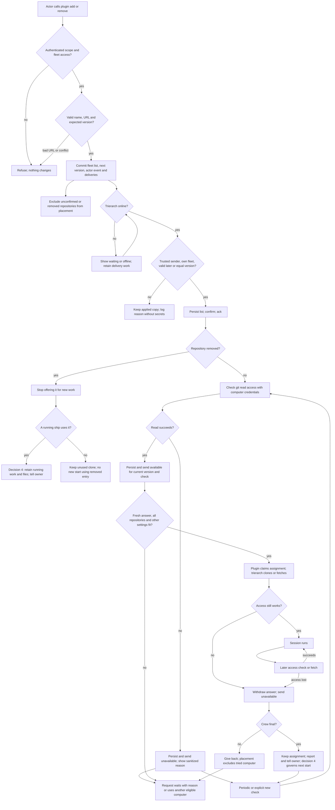

# Trusted repositories over the fleet (#452)

Approved. The purpose and three choices below are fixed by [Thomas's 16 November approval](https://github.com/ThomasHendrickx/aeolus-fleet-trierarch/issues/452#issuecomment-6926472931). On 16 November Thomas approved this detailed design with all five picks, recorded under Decisions, with one change to the cutover. No implementation is included.

## Purpose

An operator holding the right scope, a person or an agent ship, adds a repository by its git URL through the trierarch plugin, over the fleet. Each trierarch answers whether it can reach that repository, and the operator sees the answers.

The list belongs to the operator's own fleet, as the MCP configuration does. Placement uses the access answer: a request naming the repository goes only to a trierarch that said it has access. Both add and remove go through the plugin.

## Lessons

- [Trusted repositories](../trierarch.md#trusted-repositories) and [aeolus-fleet#384](https://github.com/ThomasHendrickx/aeolus-fleet/issues/384): adding permits remote code to run. `fleet:manage` on a crew request must not itself let a requester trust arbitrary URLs. Credentials stay on the computer; permitted git transports and noninteractive execution still apply.
- [0030](https://github.com/ThomasHendrickx/aeolus-fleet-trierarch-plugin/blob/main/docs/decisions/0030-trierarch-plugin.md) and [Crew-time MCP servers](../trierarch.md#crew-time-mcp-servers): the plugin owns per-fleet configuration and sends a version until each trierarch confirms. A send or delivery acknowledgement is no proof of application. Reordered deliveries must not restore a removal.
- [0026](../decisions/0026-trierarch.md), [0029](https://github.com/ThomasHendrickx/aeolus-fleet/blob/main/docs/decisions/0029-crew-request.md): the plugin picks; the trierarch executes. A final assignment never moves automatically. A give-back before final remains subject to the tried-trierarch exclusion for that settings version.
- [Blueprint](https://github.com/ThomasHendrickx/aeolus-fleet/blob/main/docs/blueprint.md), [0046](https://github.com/ThomasHendrickx/aeolus-fleet/blob/main/docs/decisions/0046-scope-catalogue.md), [0057](https://github.com/ThomasHendrickx/aeolus-fleet/blob/main/docs/decisions/0057-actors.md): core carries opaque messages. Rights supplied in a message are not authority. Every actor can hold the scope; normal work needs no argo exception.
- [Plugin architecture](https://github.com/ThomasHendrickx/aeolus-fleet-trierarch-plugin/blob/main/docs/trierarch-plugin.md) and [compatibility](https://github.com/ThomasHendrickx/aeolus-fleet/blob/main/docs/compatibility.md): use the public contract, not core storage. The present console-cookie API alone does not establish agent authorization.

## Design

### Scope, calls and storage

Propose `trierarch:repositories`, declared and enforced by the plugin in its existing namespace: read the list and answers, add, remove, and request a fresh check. Grant it through the ordinary scope catalogue to any actor. A person uses their account; an agent calls through its existing authenticated fleet connection. A trierarch-crewed session holds no crew token (0026). `trierarch:join`, `fleet:manage` and message send reach alone grant no repository management.

Expose the same plugin operations through authenticated API and fleet-connected tools: `repositories.list`, `add`, `remove`, `check`, `access`. Add takes `{ name, url, expectedVersion }`; remove takes `{ name, expectedVersion }`; check takes `{ name }`. Names follow the current repository-name schema. Keep the present HTTPS and SSH URL validation, rejecting paths, credentials, remote helpers and option-like SSH hosts or users before storing or probing. A name already bound to another URL conflicts: remove then add makes that change explicit. Identical add and absent remove change nothing. A stale expected version conflicts without changing anything.

The plugin resolves the authenticated actor and fleet at the boundary, checks the live scope and access to the plugin, and records that actor. Never accept a caller-supplied scope array or fleet as proof. A message may request information about these calls, but cannot authorize a mutation. Decision 1 settles the authentication contract.

The plugin database holds one list per fleet, version 0 empty, a version increased by one per change, entries `{ name, url }`, and an event naming actor, operation, repository and version. The change, event and delivery work commit together. Index by fleet and repository name; deliveries and answers by fleet and trierarch ship. Switching the plugin off keeps the list; forgetting its fleet deletes it. Core holds no repository list.

### Delivery and access answers

Use new versioned message types so an old unversioned delivery cannot undo a removal:

| Message suffix under `application/vnd.aeolus.trierarch.` | Required payload |
| --- | --- |
| `repository-configuration+json` | `{ fleetId, pluginShipId, version, repositories: [{ name, url }] }` |
| `repository-configuration-applied+json` | `{ fleetId, pluginShipId, version }` |
| `repository-configuration-request+json` | `{ fleetId, pluginShipId }` |
| `repository-access-check+json` | `{ fleetId, pluginShipId, version, checkId }` |
| `repository-access+json` | `{ fleetId, pluginShipId, version, checkId, repositories: [{ name, access, checkedAt, reason? }] }` |

`access` is `available` or `unavailable`; waiting, offline and expired are plugin-derived states, never affirmative answers. A check covers the complete version's list. The plugin persists a new `checkId` before sending; only answers for its latest check and current version count. It verifies the sender is that fleet's active, crewed trierarch, and stores before ack. No supplied ship id substitutes for the actual sender.

Reuse 0030's durable delivery attempts: retries use the same idempotency key until accepted, then a new copy after five minutes without confirmation. Send empty lists too. A new machine or request gets the current version. Offline machines remain waiting; online ones proceed independently. A new lease invalidates its old confirmation and access answers. A plugin restart resumes stored attempts.

The trierarch takes configuration only from its configured plugin ship, for its own fleet. Validate the whole list, then atomically persist fleet, plugin, version and entries in `trusted-repositories.json`. Reject mismatches and invalid lists without changing the applied copy. Later versions replace; equal identical versions confirm again; equal versions with different content are refused; older versions never apply. Confirm persistence before ack. At start confirm the saved version and request the current one; clear a saved copy for another fleet or plugin before launching anything. Ignore the old unversioned message after this upgrade.

After application, and on a check request, the trierarch runs bounded `git ls-remote` checks with the computer's own git access, the existing HTTPS/SSH restrictions, terminal prompts disabled and SSH batch mode. No clone, shell command from the URL, credential upload or permission grant is needed. Use argument arrays, a ten-minute timeout per check and limited concurrency; a slow repository blocks neither the inbox nor other machines. Sanitize git's one-line reason so URLs containing secrets, credential-helper output and raw diagnostics never enter a fleet answer. Trust the clone paths for the configured harnesses as today, but offer a trusted repository only after an affirmative access check and current harness trust.

This proves read access at that time, not push access, a requested ref's existence or future availability. Check again at start, periodically and on explicit `check`; decision 2 sets the interval. Persist a result before sending and retry a failed send. The plugin exposes each computer's answer, check time and reason, with waiting/offline/expired states. Add returns the new version with checks waiting, never waits for all computers. `access` returns subsequent results; an agent can call it just as a person can.

### Placement and changes while crewed

For every main and sub-repository taken from the fleet list, require a current-version confirmation and a fresh affirmative answer from the same trierarch, plus the existing harness, trust, capacity, labels and model checks. A stale report advertising a removed repository cannot override the list or its answers. All repositories must fit together on one computer. A configured local repository still follows its current trust rules; it is not silently rebound to a URL with the same name. Decision 3: that local offering needs no remote-access answer.

Unknown, offline, expired and unavailable answers exclude that computer. Explain which repository lacks access, or that checks are still waiting, in the unassigned request's reason. When a check becomes available, placement runs again; existing give-back exclusions still apply.

Recheck actual git access during clone/fetch as today. On failure withdraw the affirmative answer and send unavailable immediately. Before final, give back with the cause under 0029. After final, never move the assignment: report the failure and tell the ship's owner; Decision 4 settles running sessions and subsequent starts. A successful later check restores eligibility for new assignments.

Removal immediately excludes the name from placement, invalidates its answers and distributes a new version. Do not delete a machine-configured repository of the same name. Decision 4 preserves already running work and its files; removal must not silently erase uncommitted work or claim it removed access on an offline machine.

### Existing installation-wide list

Decision 5: remove the `TRUSTED_REPOSITORIES` setting. Nothing reads it, imports it or refuses startup because of it; no migration code exists. The operator adds the repositories again to each fleet through the plugin. Old trierarch cache files without fleet/version identity are discarded as authority; clones and work stay on disk. Until a machine confirms the new contract and answers its check, it receives no new assignment depending on the fleet list. Locally configured repositories keep their existing behaviour.

## Flow

## Acceptance scenarios

1. A scoped account and a scoped agent each add, inspect, check and remove through the same operations. A caller without the scope, a forged actor in a message and another fleet's token cannot change or read the list. Each successful change records its actual actor.
2. Bad URLs, credentials in URLs, duplicate names with another URL, stale versions and oversized lists change nothing and start no git command. Concurrent writes from one version commit only one change. The complete serialized list must fit core's 256 KB message limit.
3. One online and one offline computer receive a new version independently. The online computer confirms and answers; the offline computer remains visibly waiting and catches up after reconnect. A crash before confirmation, plugin restart, duplicate delivery and reordered older removal/addition cannot lose or restore entries.
4. A private repository is available only on the computer whose own credentials can read it. No credentials appear in messages, reports or logs. A timeout answers unavailable without blocking other work. Read access is never presented as push access.
5. Placement requires fresh affirmative answers for main and every sub-repository together. Waiting, unavailable, stale-version and expired answers never qualify. Reconnection or a successful new check can make waiting work eligible, without clearing 0029's give-back records.
6. Access lost between check and clone withdraws the answer and gives back before final. Access lost after final leaves the assignment in place and reports the cause. No automatic release or reassignment occurs.
7. Removal blocks new placement immediately, including stale reports and an offline computer. A running ship's treatment follows decision 4; its work is never silently discarded. A later old delivery cannot restore the repository.
8. After upgrade the installation-wide setting is gone and grants nothing to any fleet. Clones and running work are preserved, old unversioned authority is rejected, and old trierarchs are visible as waiting for the new contract.

## Thin build slices

1. **Core, only if decision 1 needs it:** authenticated actor verification for plugin calls using existing token kinds and live scope checks. No repository policy or storage in core. Update common's contract, compatibility.md and the consuming package's minimum core version together.
2. **Trierarch plugin:** declare the scope; per-fleet store, actor events, optimistic add/remove, limits and authenticated tools/API. Prove isolation, authorization and competing writers first. Do not enable new placement yet.
3. **Trierarch and plugin:** versioned configuration, durable attempts, application confirmations and cutover from unversioned messages. Prove restart, rollback on invalid input, duplicates, reordering and offline recovery across the two processes.
4. **Trierarch and plugin:** noninteractive access checks and durable answers; authenticated result reads; placement filtering and reasons; loss, removal and owner messages according to decisions 2 to 4. Prove check/clone races and final-assignment behaviour before enabling placement.

Each slice gets its own implementation issue after design approval; this PR creates no additional feature scope. At 3,000 ships and 10,000,000 messages per fleet, configuration is read once per fleet pass; placement uses indexed current answers, never message history. Page computer answers by cursor, 20 at a time. Bound checks and delivery batches; measure the completed reads against p95 100 ms and p99 500 ms, under 1% errors.

## Decisions

Approved by Thomas on 16 November.

1. **Agent authentication: A.** Plugin calls go through the authenticated fleet tool connection; core establishes the actor for the plugin over an authenticated server connection. Messages convey no rights (0046) and a trierarch-crewed session holds no token (0026). The plugin enforces its scope from verified actor context, including current scopes and fleet. Slice 1 specifies the boundary, replay protection and revocation check first, reusing an existing contract if one fits. No token goes in a message or becomes visible to a session.
2. **Access answer expiry: A.** Check every five minutes, expire after ten, and check at start and on demand. A newly issued check marks the old answer waiting.
3. **Machine-configured repository with the same name: A.** It keeps its local trust and offering rules; access answers are required only for repositories from the fleet list. Show which source supplied each offering.
4. **Existing work after removal or lost access: A.** A running session finishes with its files and assignment preserved, and its owner is told. Subsequent starts requiring a removed entry are refused; failed git access waits rather than starting with stale code. This overrides today's wording that removed repositories' worktrees are removed. Removal is not credential revocation and cannot instantly reach an offline computer.
5. **Installation-wide list: removed.** The setting is deleted and the operator re-adds repositories through the plugin; no import, startup refusal or migration code. This replaces the proposed explicit import (A) and automatic seeding (B).
