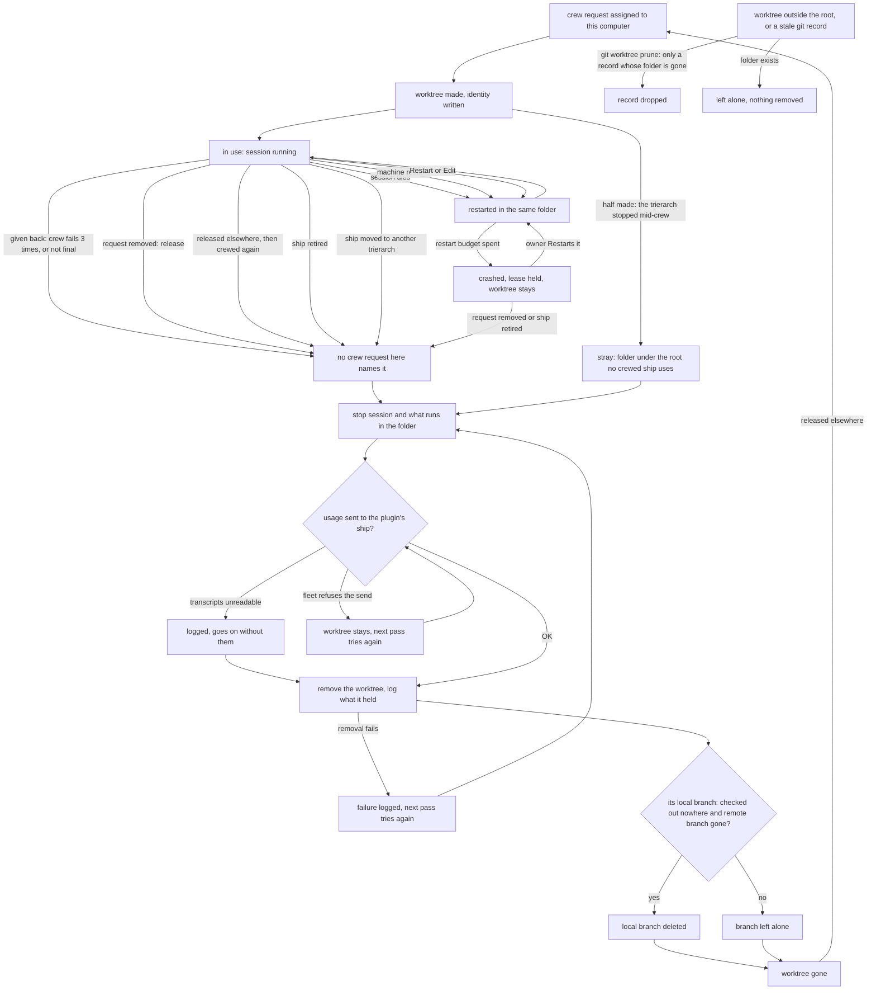

# Design: a worktree ends with its session, a branch with its work (trierarch#84)

Status: approved by Thomas on 2 Nov (purpose, and Q1 to Q7 each the first option). Nothing is built.

## Purpose

Saving is the session's job, and what a machine holds is there only while a session uses it. Thomas: "A work tree with non saved work can be deleted. When a session finishes and there is work left that work can be seen as not valuable".

- **Saving is the session's job.** A session commits and pushes small and often to its issue's branch (the skill rule, part 1 of #84). Work it leaves unpushed when it finishes is not valuable.
- **A worktree ends with its session.** Once no session uses a worktree, the trierarch removes it, whatever it holds, on every path: release, release elsewhere, give back, retire, a ship moved to another trierarch. No worktree waits for a human.
- **Branches end with their work.** A branch is deleted when its pull request merges, and a branch of a closed issue goes too.

## What the trierarch does

1. **A session uses a worktree while a crew request on this computer names it.** A release, a release elsewhere, a give back, a retire and a ship moved to another trierarch each leave a worktree that no crew request on this computer names, and it is removed on that pass. A crashed ship (restart budget spent) keeps its lease and its worktree: its owner can Restart it into the same folder. A session that dies, a machine restart, Restart and Edit keep it in place too.
2. **Removal discards whatever the worktree holds.** Order on every path: stop the session and whatever runs in the folder, send the ship's last usage to the plugin's ship, then remove the worktree. The send is the only wait: a send the fleet refuses keeps the worktree and the removal goes on the next pass; transcripts that cannot be read are logged and removal goes on without them. A give back removes the worktree like a release does; nothing is "kept".
3. **Nobody is told what was discarded.** The trierarch logs what the worktree held (changes, commits no remote has), on every path; it sends argo nothing about it. The log is for anyone checking whether sessions push.
4. **Under its root, every folder no crewed ship uses goes**, whether the trierarch made it or not: a worktree of a repository it has, a session's own clone, a folder git does not know. Whatever runs in it is stopped first. **Outside its root it removes nothing**; each pass it runs `git worktree prune` on each configured repository so a record whose folder is gone goes.
5. **A local branch is deleted** in a configured repository's checkout when it is checked out in no worktree and its remote branch is gone. A branch whose remote branch exists, and a branch a person keeps with no remote, are left alone.
6. **The clear request stays in core and the console** (decision 0032). With nothing kept, the trierarch answers every clear request `not-kept`, and the report's `kept` and `orphans` stay in their shape, empty.
7. **Remote branches are not the trierarch's.** Delete on merge is switched on in every repository the fleet works in. A sweep of remote branches whose pull request merged or closed, or whose issue closed, is a separate scheduled ship, with its own small design.
8. **The trierarch does not create the issue's branch.** The skill rule covers it: a session starts from the issue's remote branch if one exists, else creates and pushes it first.

## A worktree's whole life on a computer

Unhappy paths: the fleet refuses the usage send (the worktree waits, the ship's lease is already ended, so nothing waits on it), the trierarch is offline during a release (removal goes once it is back), a folder cannot be removed (logged, tried again each pass), the trierarch stops mid-crew (a half-made folder is a stray on the next pass, a lost `register` reply is crewed again as before).

## Build slices

The slices are GitHub issues in this repository, in order; each states when it is done.

1. [#89](https://github.com/ThomasHendrickx/aeolus-fleet-trierarch/issues/89): every path removes the worktree whatever it holds, logged, argo told nothing.
2. [#90](https://github.com/ThomasHendrickx/aeolus-fleet-trierarch/issues/90): every folder under the root that no crewed ship uses is removed.
3. [#91](https://github.com/ThomasHendrickx/aeolus-fleet-trierarch/issues/91): `git worktree prune` on each configured repository every pass.
4. [#92](https://github.com/ThomasHendrickx/aeolus-fleet-trierarch/issues/92): delete a local branch checked out nowhere whose remote branch is gone.

Outside the trierarch: [#93](https://github.com/ThomasHendrickx/aeolus-fleet-trierarch/issues/93) designs the scheduled sweep ship, [#94](https://github.com/ThomasHendrickx/aeolus-fleet-trierarch/issues/94) is Thomas's step to switch on delete on merge.

## Trains

- **Trierarch (this repository)**: items 1 to 6; docs/trierarch.md lifecycle rows 7, 9 and 11 and gap rules 1 and 2.
- **Skills repository**: part 1 of #84 (the session rules, item 8).
- **Repository settings**: delete on merge in every repository (a step for Thomas per repository).
- **A scheduled ship**: the remote branch sweep (item 7), its own design.
- **Core (aeolus-fleet)**: nothing changes.
