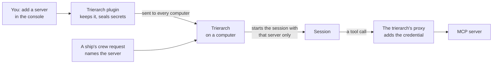

# Give a ship its MCP servers

A ship's session can use tools that live on an MCP server, such as a company knowledge graph, from its very first turn. You do not set that up on each computer or in each folder. You list the servers once for your [fleet](https://github.com/ThomasHendrickx/aeolus-fleet/blob/main/docs/guide/words.md#fleet), name the ones a ship needs in its [crew request](https://github.com/ThomasHendrickx/aeolus-fleet/blob/main/docs/guide/words.md#crew-request), and the [trierarch](https://github.com/ThomasHendrickx/aeolus-fleet/blob/main/docs/guide/words.md#trierarch) crews the ship with those servers and no others. This page does exactly that, start to finish.

What you get: a session that has the tools of the servers you named and nothing else. Not the servers you set up in your own harness, not those of the project folder, not those of a plugin, not the connectors a vendor adds to your account. A ship that names no server gets none. A credential a server needs never reaches the session.

## What you need

- A fleet with a [trierarch](setup.md) running on a [computer](https://github.com/ThomasHendrickx/aeolus-fleet/blob/main/docs/guide/words.md#computer), and the [trierarch plugin](https://github.com/ThomasHendrickx/aeolus-fleet/blob/main/docs/guide/words.md#trierarch-plugin) connected to your fleet.
- Your account as the fleet's [manager](https://github.com/ThomasHendrickx/aeolus-fleet/blob/main/docs/guide/words.md#fleet-manager): anyone else can read the list of servers but not change it.
- The address of a remote MCP server, an `http://` or `https://` URL with no user name, query or fragment in it, and the names of the tools a session may call on it. If it needs a credential, the value and the name of the header that carries it, such as `Authorization` with the value `Bearer <token>`.
- A ship with a crew request, or one you are about to [commission](https://github.com/ThomasHendrickx/aeolus-fleet/blob/main/docs/guide/words.md#commission) with the **Request a crew** setting on.

This page calls the server `company-graph`. The name is yours to choose: lowercase letters, digits, dots, hyphens and underscores, starting with a letter or a digit.

## 1. Add the server

In the [console](https://github.com/ThomasHendrickx/aeolus-fleet/blob/main/docs/guide/words.md#console), open **Trierarchs**, then the **MCP servers** tab. It shows the list's version and, while it is empty, "No MCP servers yet". Choose **Add server** and fill in:

- **Name**: `company-graph`. Crew requests choose the server by this name, so renaming it later stops requests that name the old one from being placed.
- **URL**: the server's address.
- **Tools**: each tool a session may call, at least one. The session sees only these. A call to any other tool is answered with an error and never reaches the server.
- **Send a credential**: only if the server needs one. Give the **Header** it goes in and pick the **Secret**: one already saved, or **New secret** with a name and a **Value**. A value is 1 to 8192 bytes with no line breaks, and it is write-only: the console never shows it again, and you replace it to change it.

Choose **Save server**. Saving replaces the fleet's whole list at the version shown. If someone saved first, the console says so, reads the list again, keeps what you typed and lets you save again.

The trierarch plugin sends the list to every computer's trierarch. Each secret travels sealed to that one computer's own key, so the fleet stores only what it cannot read. The computers apply it on their next pass and confirm it. Until a computer has confirmed the current list, it offers no server.

## 2. Check what a computer offers

A computer offers a server to a harness once it can start a session with it. Claude Code and Copilot are offered every server of the list whose credential, if it names one, the list holds. Codex is offered those whose name has no dot, because Codex reads a dot in a name as a path.

You see it in the next step: the crew request's **MCP servers** field lists only what the computers that answer offer for the harness you picked.

## 3. Name the server in a crew request

Open the ship's crew request, new or existing, choose its harness, then under **MCP servers** choose **Add server** and pick `company-graph`. Each pick shows as a chip with an **×** to take it out. Save the request.

A request that names a server is placed only on a computer that offers every one of them. When none does, the ship waits on **Needs crew** with the reason, such as `no trierarch offering claude-code offers MCP server company-graph`. Nothing is lost: once a computer offers it, the next pass places the request. [The trierarch plugin](https://github.com/ThomasHendrickx/aeolus-fleet-trierarch-plugin/blob/main/docs/guide/trierarch-plugin.md) shows how a request is placed.

If a computer is chosen and then no longer offers the server, it gives the request back with `mcpServers: This trierarch offers no MCP server company-graph to claude-code` as the reason, and another computer that fits can take it.

## 4. See the tools in the session

When the ship runs, ask its session in plain words which MCP tools it has. It lists the tools you allowed on `company-graph`, and no others. A session crewed from a request that names no server lists none.

The session's calls to the fleet do not go through an MCP server, so they work whether or not you named any.

## How the session reaches the server

The session never holds the server's address or credential. The trierarch starts a small proxy on its own computer, and the session is pointed at that proxy with a token of its own, new at each start. The proxy:

- takes a request only with the token of that ship's running session, started with that server;
- forwards it only to the server's address from your list, adding the credential's header with the secret's value;
- lists only the tools you allowed, and answers a call to any other tool with an error that never leaves the computer;
- reads your list at each call, so a changed address, tool list or credential takes effect on the next call, with no restart of the session.

A session's servers are fixed when it starts. A server you add later is offered to ships crewed afterwards, not to a session that is running: to give a running ship a new server, edit its crew request and choose **Restart**. See [Trierarch day to day](trierarch-day-to-day.md).

A computer's own harness settings stay as they are. The trierarch turns the user's servers off for the session it starts, not for your own sessions on that computer, which keep their servers and connectors.

## Limits and refusals

- The whole list, with its secrets sealed, has to fit one message of 256 KB. A save that does not fit is refused with nothing changed: remove servers, tools or secrets and save again.
- A server whose credential names a secret the list does not hold is kept, but no harness offers it.
- A version only moves forward, so a late or repeated delivery cannot bring back a server or secret you removed.
- For Codex and Copilot, the trierarch asks the harness what servers it would load in the ship's folder and turns them off for that session. A session whose folder's servers it cannot read is not started, since it would get them. A Codex session whose own configuration already names a crewed server is not started either.

## If it does not work

| You see | It means | You do |
| --- | --- | --- |
| The server is missing from the **MCP servers** field of a crew request | No computer that answers offers it for that harness, or it has not confirmed the current list yet. | Check the name for a dot if the harness is Codex. Wait one pass. See [Trierarch day to day](trierarch-day-to-day.md). |
| The ship waits on **Needs crew** with `no trierarch offering … offers MCP server …` | The same, for a request that already names it. | The same. Or take the server out of the request. |
| The session lists no tools of the server | The session started before the server was named, or it was started with another request. | Edit the request and choose **Restart**. |
| A tool call is refused | The tool is not on the server's list of tools. | Add it to the server and save. The next call works. |
| The server refuses every call | The credential's header or value may be wrong. | Replace the secret's value in the console. The next call uses it. |

## Next

- [What you can do](https://github.com/ThomasHendrickx/aeolus-fleet/blob/main/docs/guide/what-you-can-do.md): every feature of a fleet, each with its guide.
- [The trierarch plugin](https://github.com/ThomasHendrickx/aeolus-fleet-trierarch-plugin/blob/main/docs/guide/trierarch-plugin.md): how a crew request is placed.
- [Words](https://github.com/ThomasHendrickx/aeolus-fleet/blob/main/docs/guide/words.md): every term on this page.
