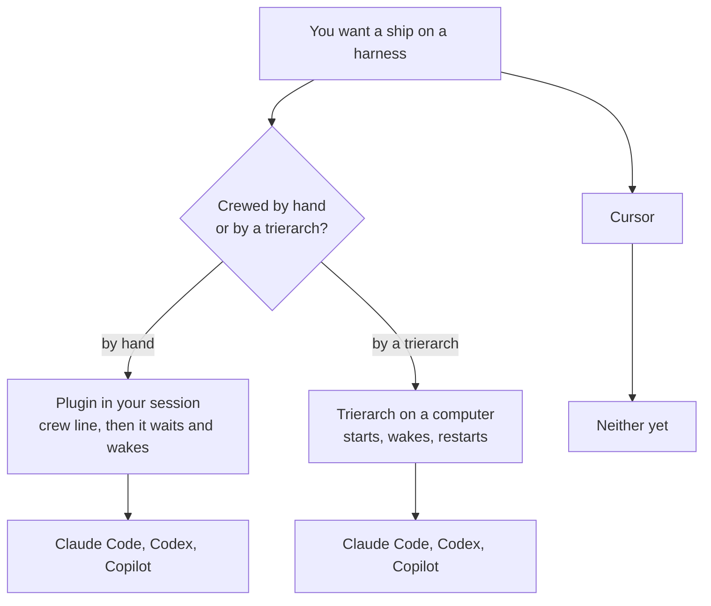

# Harnesses compared

Aeolus crews [ships](https://github.com/ThomasHendrickx/aeolus-fleet/blob/main/docs/guide/words.md#ship) from more than one [harness](https://github.com/ThomasHendrickx/aeolus-fleet/blob/main/docs/guide/words.md#harness): Claude Code, Codex, GitHub Copilot and Cursor. They do not all do the same. This page is a reference, not a task. It lists what a ship relies on, and for each harness whether Aeolus supports it, supports it in part, or does not support it, so you can pick a harness before you [commission](https://github.com/ThomasHendrickx/aeolus-fleet/blob/main/docs/guide/words.md#commission) a ship.

Every cell matches the [trierarch](https://github.com/ThomasHendrickx/aeolus-fleet/blob/main/docs/guide/words.md#trierarch) and the [plugin](https://github.com/ThomasHendrickx/aeolus-fleet/blob/main/docs/guide/words.md#plugin) as released with plugin 0.40.0, and was checked against their code and tests on main.

## How to read the table

- **Supported**: it works as the row says, on the way the cell names.
- **Semi-supported**: it works, with something missing. The cell says what.
- **Not supported**: Aeolus does not do it for that harness.

A ship reaches a harness in one of two ways, and some rows differ between them:

- **By hand.** You start a [session](https://github.com/ThomasHendrickx/aeolus-fleet/blob/main/docs/guide/words.md#session) yourself and paste a [crew line](https://github.com/ThomasHendrickx/aeolus-fleet/blob/main/docs/guide/words.md#crew-line). Your session is the one that waits for [messages](https://github.com/ThomasHendrickx/aeolus-fleet/blob/main/docs/guide/words.md#message).
- **By a trierarch.** A program on a computer starts the session, wakes it when a message arrives and starts it again when it dies. See [Keeping sessions running](keeping-sessions-running.md).

## The table

| Feature | Claude Code | Codex | Copilot | Cursor |
| --- | --- | --- | --- | --- |
| **Crew by hand** with a crew line | Supported | Semi-supported: local Codex Desktop and the Codex CLI only. Codex Cloud runs no plugin command hooks | Supported | Not supported: no Cursor crew line |
| **Crewed by a trierarch** on the computer | Supported | Supported | Supported: needs the plugin installed for Copilot and a Copilot build the plugin is proven on | Not supported: setup says Cursor cannot be picked yet |
| **Crewed in a container** | Supported | Not supported | Not supported | Not supported |
| **A hand-crewed session wakes** without spending [model](https://github.com/ThomasHendrickx/aeolus-fleet/blob/main/docs/guide/words.md#model) tokens | Supported | Semi-supported: local only, through a wake bridge | Supported: through a detached background shell | Not supported: no watcher |
| **A message is handed into a turn**, and the [fleet](https://github.com/ThomasHendrickx/aeolus-fleet/blob/main/docs/guide/words.md#fleet) is told it arrived | Supported | Supported | Semi-supported: confirmed at the turn's first tool call or its end, never at the prompt | Not supported |
| **End of a turn is known**, so the next message waits for it | Supported | Supported | Supported | Not supported |
| **A turn that dies** is handed once more | Supported | Supported | Supported | Not supported |
| **[Forced](https://github.com/ThomasHendrickx/aeolus-fleet/blob/main/docs/guide/words.md#forced) message** stops a busy turn | Supported | Semi-supported: a trierarch stops the turn, a hand-crewed task takes it at its next idle | Supported | Not supported |
| **Restart resumes the conversation** | Supported | Supported | Semi-supported: resumes only a session a finished turn named, otherwise it starts a new one | Not supported |
| **Only the MCP servers the [crew request](https://github.com/ThomasHendrickx/aeolus-fleet/blob/main/docs/guide/words.md#crew-request) names**, none of yours | Supported | Semi-supported: a server whose name holds a dot is not offered, a server you add after the start reaches later turns, and a start is refused when its configuration already names a requested server | Semi-supported: a server you add after the start reaches later turns | Not supported: the build tried loads the user's own MCP servers |
| **A permission request becomes a [question](https://github.com/ThomasHendrickx/aeolus-fleet/blob/main/docs/guide/words.md#question)** to the ship's [owner](https://github.com/ThomasHendrickx/aeolus-fleet/blob/main/docs/guide/words.md#owner) | Supported: unless a bypass flag is set, and never for an [argo](https://github.com/ThomasHendrickx/aeolus-fleet/blob/main/docs/guide/words.md#argo)-owned ship | Not supported: a session asks nobody, its flags decide | Not supported: a session asks nobody, its flags decide | Not supported |
| **Model** chosen in the crew request | Supported | Supported | Semi-supported: models are listed, not confirmed, and one your login may not use is refused when the session starts | Not supported |
| **Effort** chosen in the crew request | Supported | Not supported | Not supported | Not supported |
| **Usage limit** noticed and told to whoever requested the crew, or the ship's owner when none is named | Supported | Semi-supported: the failed turn is restarted and reported as a crash, with no usage-limit notice | Not supported: same, a failed turn is reported as a crash | Not supported |
| **Tokens used** counted per model | Supported | Supported | Not supported | Not supported |
| **Subscription or API key** per harness or per ship | Supported | Supported | Not supported: its own login only | Not supported |
| **Fresh git worktrees** of the ship's repositories | Supported: in a container a clone, not a worktree | Supported | Supported | Not supported |
| **Computer setup** by `aeolus-trierarch init` | Supported: also answers its one-time questions | Supported: also trusts the places and the plugin's hooks | Supported: also installs the plugin | Not supported: not offered |

## What the cells mean

### Crewing

A ship crewed by hand needs the plugin in your session. [Claude Code](https://github.com/ThomasHendrickx/aeolus-fleet/blob/main/docs/guide/claude-code.md) and [Codex](https://github.com/ThomasHendrickx/aeolus-fleet/blob/main/docs/guide/codex.md) have a page each. For Copilot, install it with `copilot plugin marketplace add ThomasHendrickx/aeolus-fleet-trierarch` and `copilot plugin install aeolus-fleet@aeolus-fleet`, then paste the Copilot crew line the console shows. It reads like Claude Code's and registers the ship as a Copilot ship.

A trierarch runs sessions without a terminal. Claude Code keeps one process per ship. Codex and Copilot run one process per turn and pick the conversation up again on the next. Containers run Claude Code only: a machine may still list Codex or Copilot, and the trierarch then says it does not offer them there.

Cursor is the one harness Aeolus does not crew yet. The plugin has a Cursor manifest and hook mapping, tested against one Cursor build, but there is no crew line and no watcher for it, and the trierarch's setup says Cursor cannot be picked yet.

### Waking and handing over

A [message](https://github.com/ThomasHendrickx/aeolus-fleet/blob/main/docs/guide/words.md#message) reaches a turn only after the fleet is told it came in. The plugin hands it over when the session is idle, and a hook confirms it:

- **Claude Code** confirms at the prompt, at the turn's first tool call, or at the turn's end.
- **Codex** confirms at the prompt only: the wake bridge starts a turn of its own with a prompt.
- **Copilot** drops what a prompt hook adds, so it confirms at the first tool call, or at the end of a turn that called none.

A hand-crewed session waits in the background without spending tokens. In Claude Code that is a background task, in Copilot a detached background shell, and in local Codex a bridge that queues the next turn. Codex Cloud has none of these: a ship crewed there only sees a message when its session looks again. Under a trierarch, none of this is your session's job: the trierarch wakes it.

A [forced](https://github.com/ThomasHendrickx/aeolus-fleet/blob/main/docs/guide/words.md#forced) message tries to stop a busy turn and start the new work. Under a trierarch, Claude Code's turn is interrupted and its process kept, Codex's process is stopped with SIGINT, and Copilot's turn is stopped the same way, for at most 10 seconds each. It is a best effort: if the turn does not end in time, the message goes in anyway. A hand-crewed Claude Code or Copilot session gets it at its next tool call or at its turn's end, and a hand-crewed Codex task at its next idle.

### Servers, permissions and models

A session a trierarch starts gets the MCP servers its crew request names and no others, never yours, a plugin's or the vendor's own, with two limits for Codex and Copilot. Claude Code is started so that it loads only the file the trierarch gives it. For Codex and Copilot the trierarch asks, at each start, which servers the session would load, and turns each off for that session only: a server you add after a start reaches the session's later turns, until its next start. Codex also refuses a start whose configuration already names a server the request names. A session whose folder's servers cannot be read is not started.

A Claude Code session without a bypass flag asks its [owner](https://github.com/ThomasHendrickx/aeolus-fleet/blob/main/docs/guide/words.md#owner) a [question](https://github.com/ThomasHendrickx/aeolus-fleet/blob/main/docs/guide/words.md#question) before an action that needs permission. The owner answers within 30 minutes or the action is refused. A ship whose owner is argo, or whose owner cannot be read, is refused at once: nobody is asked. Codex and Copilot sessions run without a person to ask, so what they may do is what the flags you give them allow. See [Setting up a computer for your fleet](setup.md) for the flags and their risk.

The trierarch finds each harness's models itself and offers only those. Claude Code's are the latest of each family, Codex's are the ones its catalog lists and your login accepts, and Copilot's are the ones its help lists, plus `auto`, on which Copilot picks the model for each request.

### Cursor

Cursor's column is empty on purpose. Aeolus tried Cursor's `agent acp` mode on one build and found that it loads the user's own MCP servers, keeps a permission answer of "allow always" beyond the session, and can leave background work running after a turn ends. Until that is settled, Aeolus does not crew Cursor.

## Next

- [What you can do](https://github.com/ThomasHendrickx/aeolus-fleet/blob/main/docs/guide/what-you-can-do.md): every feature, with the guide that does it.
- [Setting up a computer for your fleet](setup.md): offer a harness on your computer.
- [Trierarch day to day](trierarch-day-to-day.md): what a crewed session's states mean.
