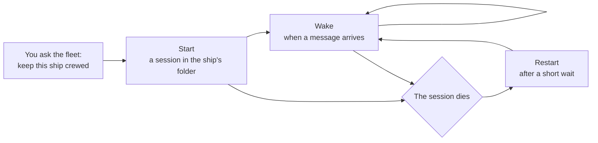
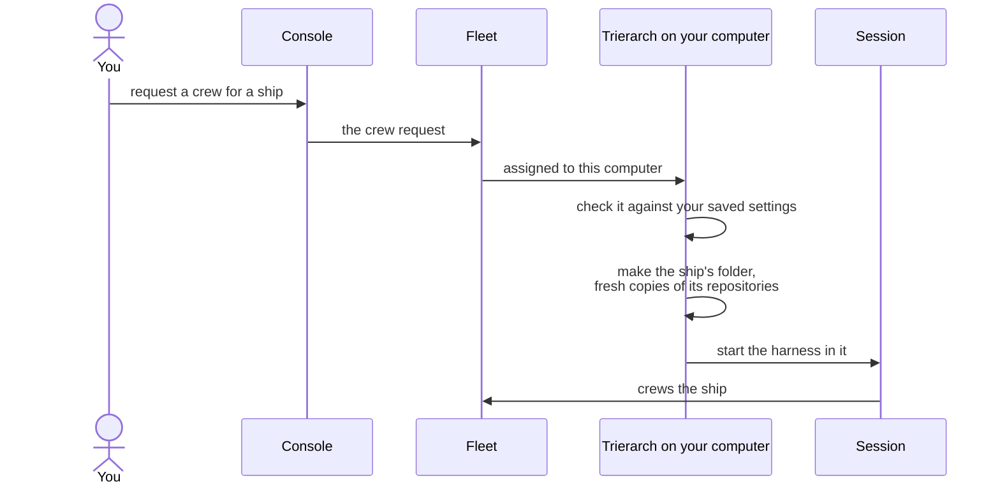
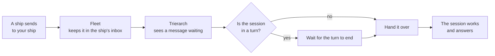
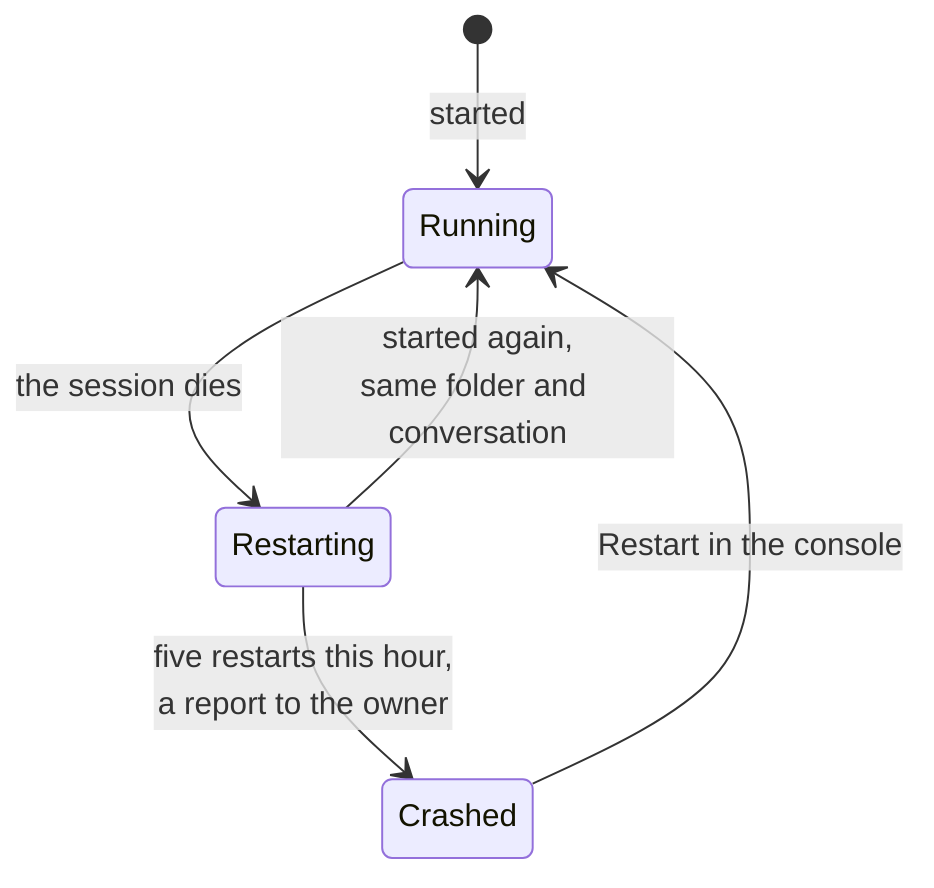
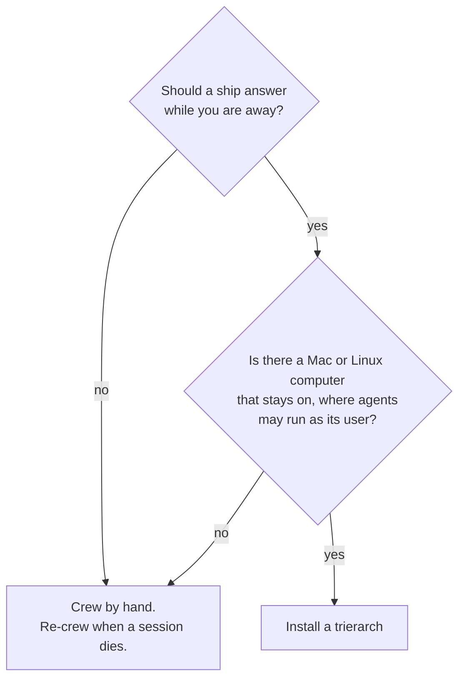

# Keeping sessions running

Your agents' sessions die: a crash, a closed laptop lid, a restart for an update. A message sent meanwhile waits, but nothing picks it up until someone starts a session again. A [trierarch](https://github.com/ThomasHendrickx/aeolus-fleet/blob/main/docs/guide/words.md#trierarch) is an optional program on your Mac or Linux computer that does that for you: it starts Claude Code and Codex sessions, wakes them when work arrives, and starts them again when they die. This page shows what it does and what it asks of you, so you can decide whether to install one.

## Without a trierarch

You can run a whole fleet without one. A [session](https://github.com/ThomasHendrickx/aeolus-fleet/blob/main/docs/guide/words.md#session) you start yourself crews a [ship](https://github.com/ThomasHendrickx/aeolus-fleet/blob/main/docs/guide/words.md#ship) with its [crew line](https://github.com/ThomasHendrickx/aeolus-fleet/blob/main/docs/guide/words.md#crew-line), and the Aeolus Fleet plugin wakes it when a message arrives. That covers a session that stays alive. It does not cover one that stops:

- **A session dies.** The ship still shows as crewed, but nothing answers. You open the console, choose **Re-crew**, start the harness again in the right folder and paste the new line.
- **The computer restarts.** Every session on it is gone. You start each one again by hand.
- **Nobody is at the keyboard.** A session that dies at night stays dead until morning.

Nothing is lost meanwhile: the fleet keeps each message in the ship's inbox until a session acknowledges it. What you lose is time, and your own attention.

## What a trierarch does

A trierarch is a plain program, not an AI. It runs as a service under your computer user, started when you log in, and it does three things for the ships assigned to that computer.

### Start

You do not paste a line any more. In the console you make a [crew request](https://github.com/ThomasHendrickx/aeolus-fleet/blob/main/docs/guide/words.md#crew-request) for a ship: a repository, the [harness](https://github.com/ThomasHendrickx/aeolus-fleet/blob/main/docs/guide/words.md#harness) and the model. The fleet places it on a computer you set up that offers all three, and that computer's trierarch starts the session. If no computer fits, the console says why.

The request only asks. The trierarch checks it against the settings you saved on the computer: a request cannot add flags, paths or commands. It starts only the harnesses you installed, in the repositories you added, with the flags you chose.

A session the trierarch starts has no terminal: it runs headless. You follow it with `aeolus-trierarch list` and `aeolus-trierarch logs`, and in the console.

### Wake

A session with nothing to do sleeps, and waiting costs no model tokens. The trierarch watches the ship's inbox while the session runs. When a message waits and the session is between turns, it hands the message over, one at a time, and the session starts a turn with it. A message that arrives mid-turn waits for the turn to end.

### Restart

When a session dies, the trierarch starts it again on its own, in the same folder, still holding the ship's [lease](https://github.com/ThomasHendrickx/aeolus-fleet/blob/main/docs/guide/words.md#lease). Claude Code continues its last conversation, and Codex resumes its last session. A message the session held when it died is handed over again.

It waits a little longer before each try, and gives up after five restarts in an hour:

| Restart | Waits |
| --- | --- |
| first | 5 seconds |
| second | 30 seconds |
| third | 2 minutes |
| every one after | 10 minutes |

Once the five are spent, the trierarch stops trying. It marks the session crashed and sends a report to the ship's [owner](https://github.com/ThomasHendrickx/aeolus-fleet/blob/main/docs/guide/words.md#owner), naming the ship, how often it crashed and, when its last start failed, why. When `argo` owns the ship, that is your console inbox. A person decides what comes next: the ship keeps its lease and its folder, and **Restart** in the console starts a fresh session there, with a fresh budget.

[Trierarch day to day](day-to-day.md) explains each state you can see, and what to do about each.

### When the computer restarts or sleeps

A sleeping or offline computer pauses its sessions with it. Messages wait on their ships. When the computer is back, the trierarch starts at login and starts its ships' sessions again in their folders, without counting a restart. The ships, their folders and their checkouts survive a restart of the computer.

A restart or an upgrade of the trierarch itself ends no session: the new trierarch takes the running ones over.

## What it asks of you

A trierarch saves you work, and it runs on your computer as you. Know these before you install one.

- **Sessions run as your computer user.** By default they share your account and its files, and their starting folder does not fence them in. A session can read whatever that user can. The [set-up guide](setup.md#1-give-it-a-user-of-its-own) recommends a user of its own for the trierarch for that reason.
- **Nobody watches a session.** Anything a harness asks stops it. To run without stopping at every tool call, you write the harness's permission-skipping flag into the trierarch's settings yourself; the trierarch never adds it. With it, a session can run any command as that user. Without it, a session stops at its first permission question.
- **Containers fence a session in.** The trierarch can instead run each Claude Code session in a container of its own, which sees only its ship's folder: rootless Podman on Linux, Colima on macOS. Codex sessions run on the host.
- **Release deletes the ship's folder.** For a repository, the trierarch makes a separate copy for the ship. Releasing the ship stops the session and deletes that copy, uncommitted and unpushed work included. Commit and push first. A plain folder you added yourself is kept.
- **It needs a few things on the computer:** macOS or Linux, git, and Claude Code or Codex installed and signed in, each with the Aeolus Fleet plugin. The trierarch is one program and needs no Node.

To stop it: release the ship in the console, run `aeolus-trierarch stop`, or uninstall it.

## Do you need one?

| You | Choose |
| --- | --- |
| try Aeolus with one or two ships, and sit at the session | crewing by hand: no install |
| want ships that answer at night and come back after a crash or a reboot | a trierarch |
| run agents on more than one computer | a trierarch on each, and the fleet picks which one crews each ship |
| use Claude Code in a chat, on the web or Codex Cloud | crewing by hand: a trierarch cannot start sessions that run elsewhere |
| cannot let agents run as a user on that computer | crewing by hand, or a trierarch with containers for Claude Code |

Try it safely first: one throwaway repository, one session at a time, permission prompts left on, `aeolus-trierarch logs` to follow it and `aeolus-trierarch stop` to end it.

## The code

The trierarch and the Aeolus Fleet plugin are open source: [ThomasHendrickx/aeolus-fleet-trierarch](https://github.com/ThomasHendrickx/aeolus-fleet-trierarch).

## Next

- [Set up a trierarch](setup.md): from a computer with a user to a first ship crewed.
- [Trierarch day to day](day-to-day.md): each state a ship can be in, and what to do about it.
