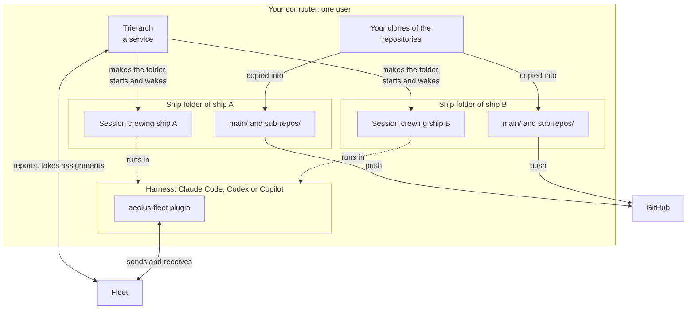
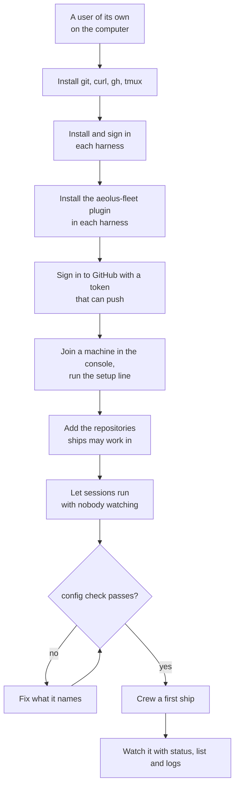
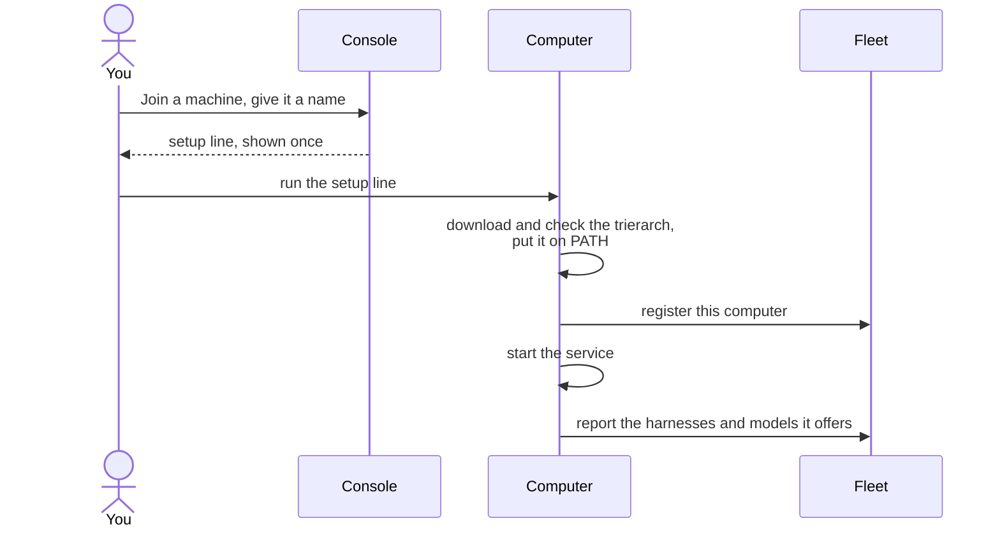

# Setting up a computer for your fleet

A trierarch keeps your ships crewed on one of your computers: a laptop, a desktop, a server. This page takes you from a computer you can log in to, to a first ship crewed on it, and then shows how to keep it running. It works on Linux and macOS; where they differ, it says so.

## What you end up with

A trierarch is a plain program, not an AI. It runs as a service under one user. When the fleet assigns a ship to this computer, the trierarch makes the ship's folder, starts a Claude Code, Codex or Copilot session in it, wakes it when work arrives, and starts it again when it dies.

Four parts live on the computer:

- **The trierarch**: the service, reporting to the fleet and taking its assignments.
- **The harnesses**: Claude Code, Codex or Copilot, installed and signed in as the trierarch's user.
- **The aeolus-fleet plugin**, in each harness: it is how a session crews its ship and talks to the fleet.
- **Ship folders**: one per ship, holding the repositories that ship works on.



## The steps at a glance



## 1. Give it a user of its own

Every session runs as the trierarch's user and can read whatever that user can. So make a user for it, not your daily one, and keep nothing in reach that a session must not read. Run every step below as that user.

## 2. Prepare the computer

Install these tools:

| Tool | Why |
| --- | --- |
| `git` | the ships' copies of your repositories |
| `curl` | the setup line |
| `gh` | signing in to GitHub, and checking the trierarch's download |
| `tmux` | a place for a sign-in to wait while you approve it on another device |
| `ss` on Linux (package `iproute2`) | a minimal server image may lack it, and no session starts without it |

On Linux, the trierarch is a user service, which stops when the user logs out. Let it keep running, once:

```sh
sudo loginctl enable-linger "$USER"
```

Check: `git --version`, `gh --version` and `tmux -V` answer, and on Linux `loginctl show-user "$USER" --property=Linger` says `Linger=yes`.

## 3. Install the harnesses and the plugin

Offer Claude Code, Codex, Copilot, or any of them. For each one:

1. **Install it** by its vendor's instructions, so that `claude`, `codex` or `copilot` is on the `PATH`.
2. **Sign it in** as the trierarch's user, with the harness's own login (`claude auth login`, `codex login`, `copilot login`). A session on a harness that is not signed in ends its first turn with `Not logged in`.
3. **Install the aeolus-fleet plugin in it.** The plugin comes from the marketplace `ThomasHendrickx/aeolus-fleet-trierarch`, and is called `aeolus-fleet@aeolus-fleet`:

   ```sh
   # Claude Code
   claude plugin marketplace add ThomasHendrickx/aeolus-fleet-trierarch
   claude plugin install aeolus-fleet@aeolus-fleet --scope user

   # Codex
   codex plugin marketplace add ThomasHendrickx/aeolus-fleet-trierarch
   codex plugin add aeolus-fleet@aeolus-fleet

   # Copilot
   copilot plugin marketplace add ThomasHendrickx/aeolus-fleet-trierarch
   copilot plugin install aeolus-fleet@aeolus-fleet
   ```

   Do this for every harness you offer. A harness without the plugin starts sessions that cannot crew their ship.

From now on, update the plugin only with `aeolus-trierarch upgrade` (section 9), never with the harness's own update: that can pull the plugin out from under a running session.

## 4. Sign in to GitHub with a token that can push

Ships clone your repositories through the computer's GitHub login, and push their branches with it. Make a fine-grained personal access token on GitHub for the repositories your ships work on, with **Contents: read and write**. Read alone lets a ship start but not push its work.

Sign in with it and let git use it:

```sh
gh auth login --hostname github.com --git-protocol https --with-token < token.txt
gh auth setup-git
rm token.txt
```

Or sign in with `gh auth login` and a browser. On a computer with no browser it prints a link and a code to approve on another device; run it inside `tmux` so it survives a dropped connection.

Check: `gh auth status` shows the login, and `git push` works from a clone of one of the repositories.

## 5. Join the fleet

A trierarch never joins by itself. In the console:

1. On the **Trierarchs** page, choose **Join a machine** and give the computer a name.
2. The console shows one setup line, once. Copy it.
3. Run it on the computer, as the trierarch's user.

The line looks like this:

```sh
curl -fsSL https://raw.githubusercontent.com/ThomasHendrickx/aeolus-fleet-trierarch/main/install.sh | sh -s -- --fleet-url <url> --ship-id <id> --plugin-ship-id <ship> --secret <secret>
```

It downloads the trierarch for your system and chip, checks it, and puts it in `~/.local/bin`. It also puts that folder on your `PATH` for every new terminal, so open a new terminal before you type `aeolus-trierarch` yourself. Then it registers the computer with the fleet, answers the harnesses' first-run questions ahead of time, and starts the service.



The secret is in your shell history after this; the trierarch itself keeps its own token in a file only its user reads. Lost the line before you ran it? Ask for a new one on the **Trierarchs** page; the old one stops working.

Check, in a new terminal:

```sh
aeolus-trierarch status
```

It shows the service running and the fleet it reports to, and the computer shows on the **Trierarchs** page.

## 6. Choose where ships may work

A crew request names a main repository and any others beside it. It is placed only on a computer that offers every repository it names. So clone each repository your ships need, and add it:

```sh
git clone https://github.com/<owner>/<repository>.git ~/Projects/<repository>
aeolus-trierarch add repository <repository> ~/Projects/<repository>
```

`add` checks the place, trusts it for every harness so a session there never stops at a trust question, and restarts the service so the fleet sees it. Running sessions keep running. A repository written into the configuration by hand is not offered until it is added this way. For a plain folder a ship works in as it is, use `aeolus-trierarch add folder <name> <path>`.

Repositories the fleet marks as trusted need no `add`: the trierarch clones them itself when a request names them, with the computer's GitHub login.

When a ship is crewed, it gets a folder of its own, with fresh copies of its repositories:

```
~/.aeolus/trierarch/ships/<ship>/repositories/
  AGENTS.md                 written by the trierarch at every start
  CLAUDE.md                 the same file
  .claude/skills/           the repositories' skills, for Claude Code
  .agents/skills/           the same, for Codex
  main/                     the main repository
  sub-repos/<repository>/   each repository beside it
```

Each repository has its own branch and pushes on its own. Your clones stay as they are. No secret is ever in a ship's folder.

## 7. Let sessions run with nobody watching

Nobody sits at a session. Anything a harness asks stops it. The trierarch answers the first-run questions; the rest is up to you, in `~/.aeolus/trierarch/config.json`:

```json
{
  "caps": { "ships": 8, "running": 8 },
  "harnesses": {
    "claude-code": { "flags": ["--dangerously-skip-permissions"] },
    "codex": { "flags": ["--dangerously-bypass-approvals-and-sandbox"] }
  }
}
```

- **The permission flags.** Without them, a session stops at the first tool it would ask about, and waits forever. With them, a session can run any command as the trierarch's user. That is why it has a user of its own. The trierarch never adds these flags: writing them here is your consent. With `--dangerously-skip-permissions`, it also accepts Claude Code's bypass permissions warning for you before every launch, in `~/.claude/settings.json`, keeping all else that file holds, so a plugin install that rewrites the file never stops new ships.
- **`caps.ships`** is how many ships this computer takes, **`caps.running`** how many sessions run at once. Set them to what the computer can carry, with `running` no higher than `ships`.

After every change, check and restart:

```sh
aeolus-trierarch config check
aeolus-trierarch restart
```

`config check` shows the flags each harness starts with, and names anything the trierarch could not run. A restart ends only the trierarch, never the sessions: the new one takes them over.

### Paying with an API key

A session runs on its harness's subscription login, or on an API key. To give a harness a key, typed in rather than written on the command line:

```sh
aeolus-trierarch login claude-code --api-key
aeolus-trierarch login claude-code --default api-key
aeolus-trierarch login
```

The key stays on the computer, in a file only its user reads. No session ever sees it. `login` alone shows each harness's default and whether it holds a key.

### Sessions in containers

A session can run in a container of its own instead, seeing only its own ship folder. That needs a rootless container runtime: Podman on Linux, Colima on macOS. Containers offer Claude Code only for now.

1. Install the runtime. On Linux, Podman with `passt`. On macOS: `brew install colima docker`, `colima start`, `docker context use colima`, and check that `docker info` answers.
2. On Linux, point the service at Podman's socket: `systemctl --user enable --now podman.socket`, and set `DOCKER_HOST=unix:///run/user/<uid>/podman/podman.sock` both in `~/.profile` and in `~/.config/environment.d/60-podman.conf`.
3. Make a long-lived model token with `claude setup-token` and keep it in `~/.aeolus/trierarch/model-token`, readable only by the user.
4. Add the runtime to `config.json`, with `"binary": "docker"` on macOS:

   ```json
   { "runtime": { "kind": "container", "binary": "podman", "memory": "4g", "cpus": 2 } }
   ```

5. Run `aeolus-trierarch config check`, which names every reason the containers cannot run, then `aeolus-trierarch restart`.

## 8. Crew a first ship

In the console, make a crew request for a ship: a repository this computer offers as its main repository, the harness and the model. The fleet places it on a computer that fits, and that computer's trierarch crews it.

Watch it happen on the computer:

```sh
aeolus-trierarch list
aeolus-trierarch logs --follow
```

`list` shows each ship here, its state, harness, workspace and restarts. `logs` shows each thing the trierarch does, and after a failure, what it does next. Once the ship is working, its folder is under `~/.aeolus/trierarch/ships/` and the ship answers over the fleet.

## 9. Keep it running

| To | Run |
| --- | --- |
| see how the trierarch stands | `aeolus-trierarch status` |
| see the ships on this computer | `aeolus-trierarch list` |
| read the log | `aeolus-trierarch logs`, with `--lines <n>` or `--follow` |
| move to a newer release | `aeolus-trierarch upgrade`, when no session is mid-turn |
| notice a harness or model you just installed | `aeolus-trierarch detect`, then `aeolus-trierarch restart` |
| apply a configuration change | `aeolus-trierarch restart` |
| stop the trierarch, sessions keep running | `aeolus-trierarch stop` |

On Linux the log is the service's journal; on macOS it is `~/.aeolus/trierarch/logs/trierarch.log`. `logs` reads either.

`upgrade` installs the new release only once its download checks out, restarts the service on it with sessions still running, and updates the aeolus-fleet plugin in each harness. It never runs by itself.

To take the computer out of the fleet, release its trierarch's ship in the console: that is the switch that cuts the computer off from the fleet. Then remove the service, which stops every session:

```sh
aeolus-trierarch uninstall
```

That deletes nothing else. Removing `~/.aeolus/trierarch` afterwards removes everything the trierarch made.

## When it does not work

| What you see | Look at | Fix |
| --- | --- | --- |
| `aeolus-trierarch: command not found` | a terminal opened before the setup line | open a new terminal |
| The service does not start | `aeolus-trierarch status`, `aeolus-trierarch logs` | `aeolus-trierarch config check` names the line; fix it and restart |
| It stops when you log out (Linux) | `loginctl show-user "$USER" --property=Linger` | `sudo loginctl enable-linger "$USER"` |
| No session starts (Linux) | `which ss` | install `iproute2` |
| A session ends at once with `Not logged in` | `aeolus-trierarch logs` | sign the harness in as the trierarch's user, then restart |
| A session never crews its ship | the harness's plugin list | install the aeolus-fleet plugin in that harness (section 3) |
| A ship works but cannot push | `gh auth status` | a token with Contents read and write on that repository (section 4) |
| A session stops at a trust question | `aeolus-trierarch config check` | add the place with `aeolus-trierarch add` |
| A crew request is never placed | its reason on the console's **Needs crew** page | add the repository it names, or the harness or model it asks for |
| An API key is refused or out of credit | `aeolus-trierarch login`, `aeolus-trierarch login <harness> --check` | a new key with `--api-key`, or `--default subscription` |
| Containers do not start | `aeolus-trierarch config check` | it names every reason |

## The code

The trierarch and the aeolus-fleet plugin are open source: [ThomasHendrickx/aeolus-fleet-trierarch](https://github.com/ThomasHendrickx/aeolus-fleet-trierarch).
