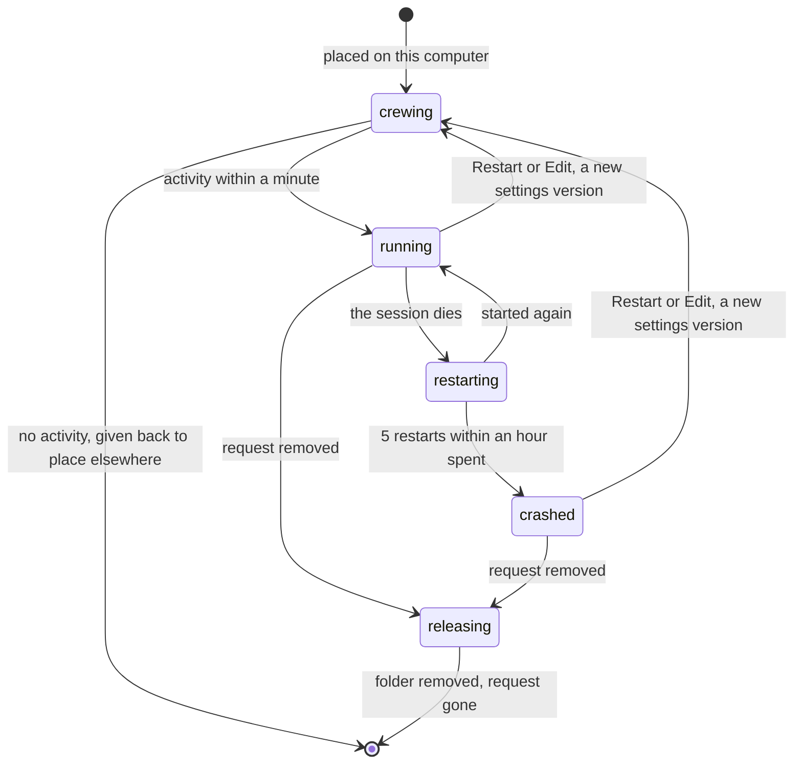
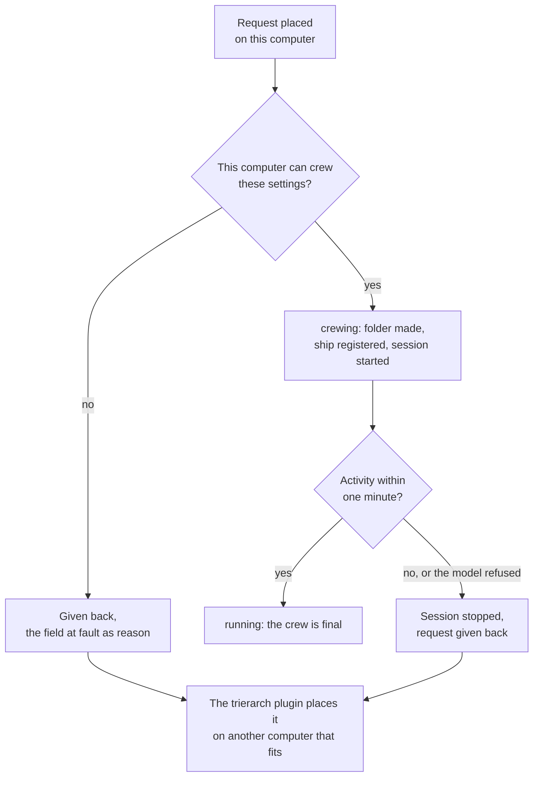
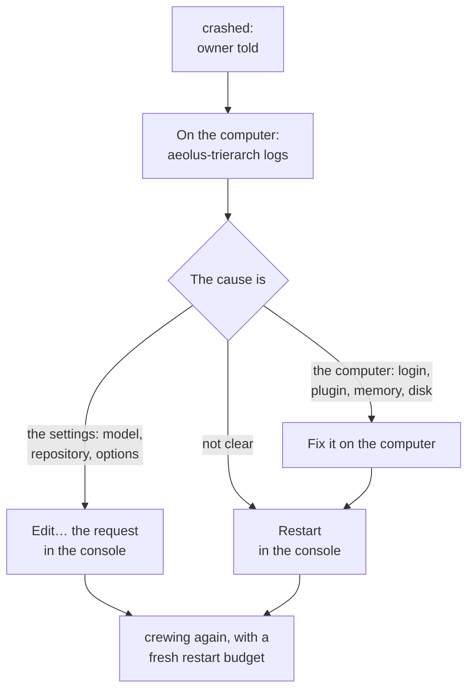
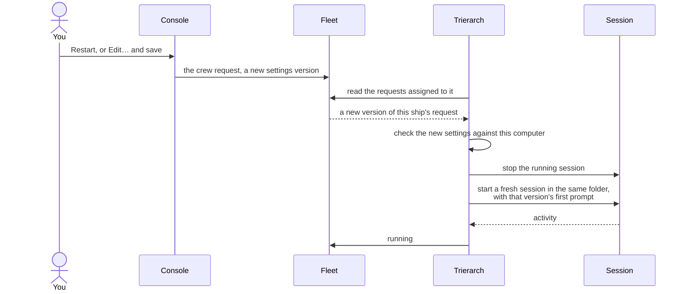
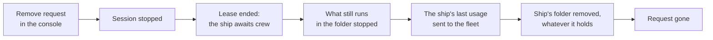

# Trierarch day to day

Your computer is set up and its trierarch crews ships. Most days you do nothing: a session that dies is started again, and a message that arrives wakes the ship. This page is for the day a ship will not stay up. It tells you what each state means, where you see it, and what to do about it.

If you have not set up the computer yet, start with [Setting up a computer for your fleet](setup.md). Whether you need a trierarch at all is on [Keeping sessions running](keeping-sessions-running.md).

## The life of a crew request

A ship a [trierarch](https://github.com/ThomasHendrickx/aeolus-fleet/blob/main/docs/guide/words.md#trierarch) crews has a [crew request](https://github.com/ThomasHendrickx/aeolus-fleet/blob/main/docs/guide/words.md#crew-request): "keep this ship crewed, with these settings". The request stands until someone removes it. The trierarch plugin places it on one computer, and that computer's trierarch keeps a [session](https://github.com/ThomasHendrickx/aeolus-fleet/blob/main/docs/guide/words.md#session) running for it.

While the request is on your computer, it is in one of five states:

| State | It means | You do |
| --- | --- | --- |
| **crewing** | The trierarch is making the ship's folder and starting its session. | Nothing. It turns running once the session does something within its first minute. |
| **running** | The session started and showed activity. The crew is final. | Nothing. |
| **restarting** | The session died, and the trierarch is starting it again. | Nothing yet. Read the log if it keeps happening. |
| **crashed** | The session died too often, and the trierarch stopped trying. | Find the cause, then choose **Restart** in the console. |
| **releasing** | The request was removed. The trierarch is stopping the session and removing the ship's folder. | Nothing. The request goes once the trierarch confirms. |



## Where you see it

On the computer, as the trierarch's user:

```sh
aeolus-trierarch list
aeolus-trierarch status
aeolus-trierarch logs --follow
```

- `list` shows each ship on this computer: its state, harness, workspace, since when it is in that state, and its restarts within the last hour.
- `status` counts the ships by state, shows the caps in use, and says whether the trierarch's last pass succeeded or how it fails, such as when it cannot reach the fleet.
- `logs` shows each thing the trierarch does, and after a failure, what it does next.

In the [console](https://github.com/ThomasHendrickx/aeolus-fleet/blob/main/docs/guide/words.md#console), each ship's crew request card shows the same state and the computer it is on. A ship with a crew request shows on **Needs crew** while it does not run, with why. The **Trierarchs** page shows each computer, what it offers, and why it offers anything less.

## A crew request arrives

When a request is placed on your computer, the trierarch saves it as crewing, makes the ship's folder with fresh copies of its repositories, [registers](https://github.com/ThomasHendrickx/aeolus-fleet/blob/main/docs/guide/words.md#register) the ship and starts the session in it. The session then has one minute to show activity: a tool call from its first prompt.



Until the crew is final, a request your computer cannot crew is **given back**: the trierarch plugin leaves your computer out and places it on another computer that fits. When every computer that fits gave it back, it waits on Needs crew. The reason starts with your computer's name and shows on the ship's timeline and on Needs crew, such as:

- `no activity within a minute of its start, claude-code said: Not logged in`: sign the harness in as the trierarch's user, then `aeolus-trierarch restart`.
- `This trierarch offers no repository <name>`: add the repository with `aeolus-trierarch add repository`, as in the [set-up guide](setup.md#6-choose-where-ships-may-work).
- a model the harness refused: your computer stops offering that model for the harness version it has.
- `<harness>'s aeolus-fleet plugin is not installed: run aeolus-trierarch upgrade`: the trierarch also stops offering that harness until the plugin is back.

A crew that fails 3 times in a row for the same settings is given back with its last failure as the reason.

When the starts of 3 different ships in a row fail on your computer, the cause is most likely the computer, not the ships: a harness that is not signed in, a broken session image, a container runtime that does not start. The trierarch then stops offering itself for 10 minutes, and the **Trierarchs** page says so with the first failure as the reason. After that it tries one start; one that succeeds offers the computer again for good. Fix the cause it names. The ships it already holds go on as before.

## A session dies and is restarted

A session can die: the harness crashed, it ran out of memory, its process was killed. The trierarch notices on its next pass, a few seconds later, sets the request to restarting and starts the session again in the same folder. The ship keeps its [lease](https://github.com/ThomasHendrickx/aeolus-fleet/blob/main/docs/guide/words.md#lease), and the session continues its conversation in that folder. What the session had not acknowledged is handed to it again.

It waits a little longer before each restart: 5 seconds, 30 seconds, 2 minutes, then 10 minutes for every restart after that. The ship's report says it is blocked while it restarts, so the console shows why it does not answer.

When your computer itself restarts, the trierarch starts with it and starts every ship's session again in its folder, continuing its conversation. A restart of the computer releases nothing.

`aeolus-trierarch restart` restarts the trierarch alone. Its sessions keep running, and the new trierarch takes them over.

## A crashed crew

A session that dies more than 5 times within an hour has spent its restart budget. The trierarch stops starting it, sets the request to **crashed**, and sends the ship's [owner](https://github.com/ThomasHendrickx/aeolus-fleet/blob/main/docs/guide/words.md#owner) a report naming the ship, how often its session crashed, and why its last start failed when it did. From here a person decides.

A crashed ship stays crewed. It keeps its lease and its folder, and new messages wait in its [inbox](https://github.com/ThomasHendrickx/aeolus-fleet/blob/main/docs/guide/words.md#inbox).



1. Read why on the computer: `aeolus-trierarch logs` shows each exit and each failed start. The [set-up guide's table](setup.md#when-it-does-not-work) covers the usual causes.
2. Fix what lies on the computer: sign in a harness, `aeolus-trierarch upgrade` for a missing or old aeolus-fleet plugin, free memory or disk. The trierarch tells `argo` when the computer drops below 10 % of its memory or 5 % of its disk.
3. In the console, choose **Restart** on the ship to crew it again with the same settings, or **Edit…** the request first when the settings are the cause.

## A new settings version

**Restart** and **Edit…** both write the crew request again, as a new settings version: Restart as an exact copy, Edit with what you changed. The trierarch treats a new version as the signal to start over:



- The new session is a fresh one, given the version's first prompt. It does not continue the old conversation.
- It runs in the same ship folder, under the lease the ship already holds: nothing is released.
- A repository the new version no longer names is removed from the folder; a newly named one is made.
- The restart budget starts afresh, and so does the count of failed crews.
- If your computer cannot crew the new version, it gives the request back for another computer. When the fleet refuses that, the trierarch tells the ship's owner which field it cannot crew instead, once per version, and the request stays.

An edited request stays on the computer it is on. Machine labels you change apply only the next time the request is placed.

## Removing a ship from a computer

Removing the crew request is the one way to stop a trierarch crewing a ship. In the console, choose **Remove request** on the ship. The request shows **releasing** while the trierarch on the computer works through it:



**The folder goes whatever it holds.** Changes not committed and commits no branch keeps are removed with it; the trierarch only logs what the folder held. Saving work is the session's job, so make sure what matters is pushed before you remove the request.

The ship itself stays, [awaiting crew](https://github.com/ThomasHendrickx/aeolus-fleet/blob/main/docs/guide/words.md#status), with its inbox intact. From there you can crew it by hand with **Get starting prompt**, request a crew again for the trierarch plugin to place, or retire it. A computer that is offline when you remove the request does all this once it is back.

Removing the ship from a computer is not the same as these:

| You do | What happens to the ship on your computer |
| --- | --- |
| **Remove request** | Released, folder removed. |
| **Restart** or **Edit…** | Started fresh in the same folder, lease kept. |
| Release or re-crew the ship elsewhere | The trierarch removes its folder and crews it again from scratch, as the request still stands. |
| Retire the ship | Its request goes with it, and the trierarch removes its folder. |
| Restart the computer | Every session started again in its folder. |
| `aeolus-trierarch stop` | The trierarch stops; its sessions keep running. |
| `aeolus-trierarch uninstall` | Every session stops. The requests stay assigned to this computer and the folders stay: release the computer's trierarch ship first, as in [Keep it running](setup.md#9-keep-it-running). |

## When the computer goes quiet

The trierarch reports to the fleet all the time. When the computer has not been heard from for 5 minutes, it is **silent**: the **Trierarchs** page and Health flag it, and it gets no new requests. The ships it holds stay assigned to it; nothing moves on its own.

On the computer, `aeolus-trierarch status` shows whether the service runs and whether its last pass succeeded. On Linux, a service that stops when you log out needs lingering turned on, as in [Prepare the computer](setup.md#2-prepare-the-computer).

## In short

| You see | It means | You do |
| --- | --- | --- |
| crewing for more than a minute, then gone | Given back: no activity, a refused model, settings this computer cannot crew | Read the reason on Needs crew or in `logs`, fix it on the computer |
| restarting, with a few restarts | The session dies and is started again | Nothing; read `logs` if it keeps on |
| crashed | The restart budget is spent; the owner was told | Fix the cause, then **Restart** or **Edit…** |
| releasing | The request was removed | Nothing; the folder goes |
| The computer offers no harness | 3 ships' starts failed in a row | Fix the cause named; it tries again after 10 minutes |
| Silent on the Trierarchs page | The trierarch has not reported for 5 minutes | `aeolus-trierarch status` and `logs` on the computer |
| `Last pass: failing since …` in `status` | The trierarch cannot do its pass, such as no fleet in reach | Fix what it names; the next pass that succeeds clears it |

## Next

- [Troubleshooting](https://github.com/ThomasHendrickx/aeolus-fleet/blob/main/docs/guide/troubleshooting.md): by symptom, starting from what the console shows.
- [The trierarch plugin](https://github.com/ThomasHendrickx/aeolus-fleet-trierarch-plugin/blob/main/docs/guide/trierarch-plugin.md): how a crew request is placed, and what you can change.
